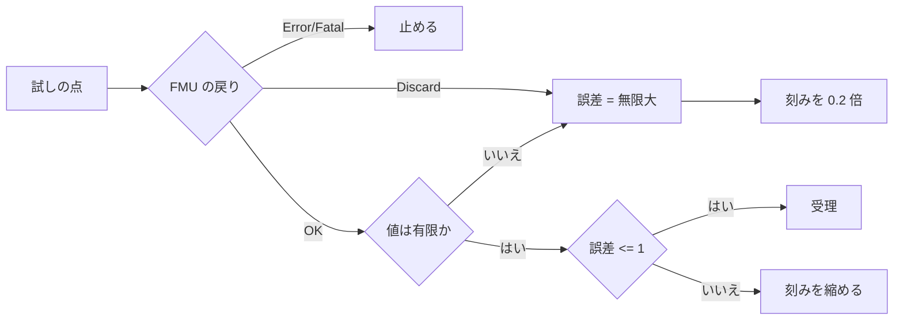

# S206 FMI Import のレビューの指摘

| | |
| --- | --- |
| セッション | S206 |
| 日付 | 2026-11-07 |
| ブランチ | `feature/s206-fmi-import-review-fixes` |
| Phase | P5 |
| スライド | [slides.html](slides.html) |
| 作業記録 | `log/work/2026-11-07-s206-fmi-import-review-fixes.md` |
| レビュー | `log/review/2026-11-07-s206-fmi-import-review-fixes-fable.md` |

## 1. 目的

S205（FMI Import の Model Exchange）への ponytail-review の指摘 4 件を、1 件ずつ失敗する試験で再現してから直す。あわせて、ユーザーが 2026-11-07 に決めた「FMI Import の案 B: 自前で作成」を [ADR-0026 の (m)](../../adr/0026-fmi-import-placement.md) に書く。

## 2. 決定と理由

| # | 指摘 | 結果 | 理由 |
| --- | --- | --- | --- |
| 1 | 誤差が有限でないときに刻みを縮めない | 直した。再現した（指摘より悪かった） | `fold(0.0, f64::max)` は NaN を捨てるので、NaN の試しの点が**受理**されていた。x' = −√x、x(0) = 0.01、t_end = 0.15 で、直す前は `Ok` で NaN を返した（解析解 0.000625） |
| 2 | 格子点の数の上限 | 直した | ME も CS も無制限だった。上限は **1000 万点**。実行の前（FMU を読み込む前）に「出力の刻みが細かすぎる。`--step` を大きくする」と断る |
| 3 | `stepSize` の文字列走査 | 直した | `globe-mode-fmi` の `DefaultExperiment.step_size` が 2.0・3.0 で読み書きする。走査の関数と `Fmu.default_step_size` を消した |
| 4 | 3.0 の真偽の出力が Rust の `bool` | 直した。試験では再現できない | 0/1 以外を書く FMU がないと UB は出ない。出力を `u8` で受けて `!= 0` |

### `Discard` の扱い（指摘 1 の延長）

- 出典: FMI 2.0.5 §2.1.3「For "model exchange": It is recommended to perform a smaller step size and evaluate the model equations again」（`fmi2GetDerivatives`・`fmi2SetContinuousStates`・`fmi2GetEventIndicators` など ME の関数は `Discard` を返しうる）<https://github.com/modelica/fmi-standard/blob/v2.0.5/docs/2_1_common_api.adoc>。FMI 3.0 §2.2.4「Advanced importers may try alternative approaches to continue the simulation」「Otherwise the simulation algorithm must treat this return code like fmi3Error」<https://fmi-standard.org/docs/main/>。確認日 2026-11-07。
- 実装: `Error::Discard` を足し、`check` が status 2 で返す。Dormand–Prince（`dopri5_accepted`）は `Discard` と有限でない値を同じに却下し、刻みを 0.2 倍にして再試行する。`Error`・`Fatal` はそのまま止める。
- 縮めないところ: 固定刻みの RK4（刻みが出力の刻みに結ばれている）と、state event の二分法の中の試しの点。どちらも `Error::Discard` のまま止まる（ADR (l) の限界として残る）。

### 格子点の上限の根拠

1 行は `(f64, Vec<f64>)`: タプル 32 B、配列の本体 8 B × 出力の数、確保の管理 16 B 前後。出力 1 個で 1000 万点が約 0.6 GB、10 個で約 1.3 GB。開発の環境（WSL、RAM 3 GB）でも収まる。刻みを細かくしたい人は `--step` を大きくするか、区間を分ける。

### 案 B

[ADR-0026 の (m)](../../adr/0026-fmi-import-placement.md)。`fmi` crate は入れず、FMI Import は全部、自前の `globe-mode-fmi-import` で進める。「自前に無いもの」の表（出典は docs.rs と jondo2010/rust-fmi v0.8.0、確認日 2026-11-07）から、(k) に入っていなかった項目を 6 番として足した。

## 3. 図



## 4. 再現手順

```bash
cargo xtask fetch-reference-fmus
cargo test -p globe-mode-fmi -p globe-mode-fmi-import -p globe-mode-fmu -p globe-mode-cli
mise run check
mise run wasm:node
gh workflow run fmu-import.yml --ref feature/s206-fmi-import-review-fixes
```

結果の数字は作業記録 `log/work/2026-11-07-s206-fmi-import-review-fixes.md`。

## 5. 次回

- ワーカーのプロセスの中で読み込む、facade・UI・Python・C ABI、マスター、SE、Integer 以下の型（ADR (k) の 2〜4）。
- 陰的な積分（硬い系。方向微分が要る）、連続時間の入力、`HybridSystem` へのアダプタ。
- 未確認: 跳ねた後に指標が 0 以下のまま残る FMU では、上がるときにも state event が数えられるはず（結果は変わらず、事象の数の表示だけ）。
