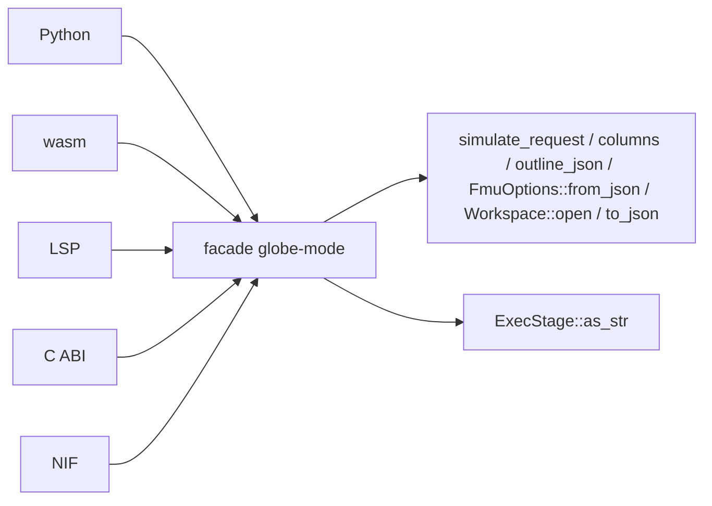

# S208 言語の面の重複を facade に寄せた

| | |
| --- | --- |
| セッション | S208 |
| 日付 | 2026-11-07 |
| ブランチ | `feature/s208-facade-dedup` |
| Phase | P7 |
| スライド | [slides.html](slides.html) |
| 作業記録 | `log/work/2026-11-07-s208-facade-dedup.md` |

## 1. 目的

振る舞いを 1 つも変えずに、言語の面（Python `globe-mode-py`、wasm `globe-mode-wasm`、LSP `globe-mode-lsp`、C `globe-mode-c`、NIF `globe-mode-nif`）に散らばった同じ処理を、facade `globe-mode` の関数に寄せる。面を 1 つ足す、応答に鍵を 1 つ足すたびに 4〜5 か所を同じに直す状態を無くす。[S202](../S202-c-nif-review-fixes/解説書.md) が C と NIF の 4 か所を寄せ、Python・wasm・LSP を持ち越していた（[対応表](../../research/lang-api-matrix-2026-11-03.md) の 4 章）。あわせて issue #16 の S203 の残り 2 つを見直す。

## 2. 決定と理由

洗い出しの表。「3 つ以上の面で同じもの」だけを寄せ、2 つだけ・形が違うものは残した。

| 処理 | 面 | 判断 | 理由・置き換え先 |
| --- | --- | --- | --- |
| 設定の JSON から要求 | C・NIF・Python | 寄せた（Python が残っていた） | `simulate_request`。wasm は `Request` を JSON で受けるので元から不要。LSP は params の `request` を直接読む |
| 進捗の段の名前 | C・NIF・Python・wasm・LSP | 寄せた | `ExecStage::as_str`。`format!("{:?}").to_lowercase()` は Python・wasm・LSP に残っていた |
| outline の誤りの文面 | C・NIF・Python・wasm | 寄せた | `Workspace::outline_json`。Python は文面を `outline_json` から取り、`.diagnostics` だけ `outline()` から足す |
| 列の道の layout（名前・点数・defaults） | C・NIF・Python・wasm・LSP | LSP を寄せた | `Simulated::columns`。LSP だけが `run` の軌跡から手で組み立てていた |
| FMU の書き出しの options の JSON | C・NIF・Python | 寄せた | `FmuOptions::from_json(Option<&str>)`。文面 `options が読めない: …` は同じ |
| ライブラリの有無で `new` / `with_libraries` | C・NIF・Python | 寄せた | `Workspace::open(&[PathBuf])`。「空ならライブラリ無し」の規則を 1 か所に |
| 値を JSON にする（`JSON: …`） | C・NIF・Python・wasm | 寄せた | `to_json`。3 つの同じ私的な関数を消し、wasm は `JsValue` に包むだけ |
| `Simulated::layout_json` | C・NIF | 残した（2 面） | Python は `response` に `defaults` を足した形、wasm は `ColumnsLayout` だけ、LSP は `{response, layout, columns}`。面ごとに形が違い、寄せると引数だらけになる |
| 進捗を面の形に写す | 5 面 | 残した | dict、`call4`、`NifMap`、C の構造体、LSP の `$/progress` と形が全部違う。共通なのは段の名前だけで、それは `as_str` に寄せた |
| 診断の最初の error を文面に | C・NIF・Python・wasm（outline） | outline で寄せた | `tunable_parameters` の「全部を `; ` でつなぐ」は wasm と LSP の 2 面で別の規則なので残した |
| `check`・`deps`・`flat`・`solvers` の JSON | 全面 | 残した | すでに 1 行の呼び出しで、重複する規則が無い |
| `load_dir` の誤りの文面 | Python・NIF | 残した | 2 面だけ。C は -1 を返す |
| 設定から要求（CLI） | CLI | 対象外 | clap の引数から組み立てる別の形 |

### issue #16 の残り

| 箇所 | 判断 |
| --- | --- |
| `node/memory.mjs` の `readMo` と `pkg` の道のりの写し | `common.mjs` の `readMo`・`defaultPkg`・`repo` を使うようにした（S201 が入ったので）。`readMo(mslDir, mslDir)` で、キーは同じ（`mslDir` からの相対） |
| xtask の `solver`・`known_deviations` の `None` の分岐 | **直した**。S203 は `sim.rs` の広い範囲に及ぶと見て残したが、数えると 10 か所ほどだった。`msl-sim` の `Options` の `solver` を `&str`、`known_deviations` を `&Path` にし、CLI の `solver` を `String` にした（既定は `auto` のまま）。ワーカー側の `Option<String>` は手で呼ぶ人のために残す。報告の文面と JSON は CLI からの呼び出しでは変わらない |

### 挙動が変わる点

なし。応答の JSON、例外の型と文面、終了コード、進捗の形は同じで、試験の期待値を変えた所は 0 件。次の 2 点は到達できない経路の違いで、記録のために書く。

- Python の `outline` は、`Outline` の JSON 化が失敗する場合（到達しない）に、`RuntimeError` でなく `SourceError` になる。
- xtask の `Options` を直接使う試験が `known_deviations: None` で一覧なしを表していたが、いまは実在する一覧のパスを渡す（試験の中身は `retries()` だけで、一覧を読まない）。

## 3. 図



## 4. 再現手順

```bash
export CARGO_TARGET_DIR=<main>/.git-worktree/target-shared CARGO_BUILD_JOBS=2
mise run check
mise run wasm:node && mise run wasm:compare   # 387/400・既知の差 13・不一致 0
mise run c:zig && mise run c:julia && mise run elixir:test && mise run gleam:test
.venv/bin/python -m pytest src/Python/tests && .venv/bin/mypy
```

検証の数字は作業記録（`log/work/2026-11-07-s208-facade-dedup.md`）に書く。

## 5. 次回

- 面を足すときは、この表の関数を呼ぶだけでよい。`Simulated::layout_json` を使う面が 3 つになったら、Python の `defaults` の足し方も寄せる。
- Astro の fmt の CI は S203 から変わらず未着手（ワークフローの変更が要る）。
