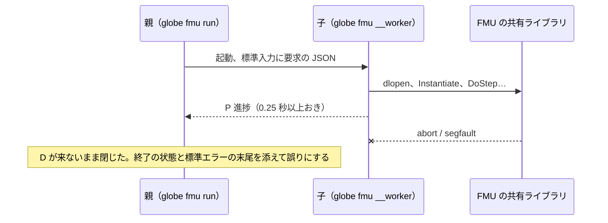

# S210 FMI Import のワーカー

| | |
| --- | --- |
| セッション | S210 |
| 日付 | 2026-11-07 |
| ブランチ | `feature/s210-fmi-import-worker` |
| Phase | P5 |
| スライド | [slides.html](slides.html) |
| 作業記録 | `log/work/2026-11-07-s210-fmi-import-worker.md` |

## 1. 目的

FMU は任意のネイティブコードを実行する。これまでの `globe fmu run` は自分のプロセスの中で読み込んだので、FMU が落ちる（segfault・abort）、止まらない、メモリを食いつぶすと、呼び出した側ごと落ちた。FMU の読み込みと実行を別のプロセス（ワーカー）に隔離し、落ちても誤りとして受け取れるようにする（[ADR-0026 の (k) 2 と (n)](../../adr/0026-fmi-import-placement.md)）。

## 2. 決定と理由

- **自分自身をワーカーにする**: `globe fmu run` は `current_exe()` を隠しの副命令 `fmu __worker` で起動する。Desktop の sidecar が同じ `globe` を `lsp` の副命令で持つ設計（[ADR-0023](../../adr/0023-desktop-and-web-process-layout.md)）と、`msl:sim` のワーカー（[ADR-0013](../../adr/0013-exec-backend.md)）と同じ流儀。
- **API は crate の中**: `run_in_worker` / `worker_main` / `run_in_process`（`globe-mode-fmi-import`）。実行ファイルは呼び出し側が渡す（`WorkerSpec`）ので、将来の facade・UI・Python が同じ形を使える。今回は口を足していない。
- **要求と結果の形**: 要求は 1 行の JSON。結果は行ごとのメッセージ（印 `\u{1}GW ` の行だけ）で、値の行は f64 を `{:?}` で書く（serde_json は NaN を `null` にするため、JSON にしない）。FMU の `printf` は印が無いので結果に混ざらず、落ちたときの文面に添える。
- **上限**: 時間は kill（`--timeout`）。メモリは Linux だけ `sh -c 'ulimit -v …; exec …'`（`unsafe` も `libc` も足さない）。親が消えたら子は標準入力の EOF で終わる。
- **隔離しないもの**: ディスク、ネットワーク、環境変数。「信頼できない FMU を安全に開ける」ではなく「FMU のバグで呼び出し側が落ちない」まで。実行前の警告をそう書き換えた。
- **依存**: `serde`・`serde_json` を fmi-import に足した（どちらも workspace に既にあり、Cargo.lock は変わらない）。

## 3. 図



## 4. 再現手順

```bash
cargo xtask fetch-reference-fmus
cargo test -p globe-mode-cli --test fmu_worker -- --nocapture
globe fmu run Dahlquist.fmu --timeout 60 --progress
```

試験の結果（Linux x86_64。親の誤りの文面）:

| FMU | 親の誤り |
| --- | --- |
| Instantiate で `abort()` | FMU のワーカー（別プロセス）: 結果を返す前に終わった（signal: 6 (SIGABRT)）。FMU が落ちたとみられる |
| DoStep で segfault | 同（signal: 11 (SIGSEGV)） |
| DoStep が戻らない（`--timeout`） | FMU のワーカー（別プロセス）: 1.500 s で終わらないので止めた |
| GetReal が 1 MiB の malloc を繰り返す（1 GiB の上限） | 同（signal: 6 (SIGABRT)。malloc が失敗して abort） |

どれも親は落ちず、`/proc/self/task/*/children` に子が残らない（zombie も孤児も無い）。親が消えたときに子が終わることは、標準入力を閉じて終了コード 3 で終わるのを手で確かめた。3 OS の結果は作業記録。

## 5. 次回

- sandbox（seccomp・Landlock・ファイルシステムとネットワークの名前空間、Windows の AppContainer）。
- macOS・Windows のメモリの上限（Job Object）、FMU が作る孫プロセスの掃除（プロセスグループ）。
- facade の `import_fmu` と UI の「FMU を開く」（確認つき）、Python・C ABI（ADR (k) 3）。
