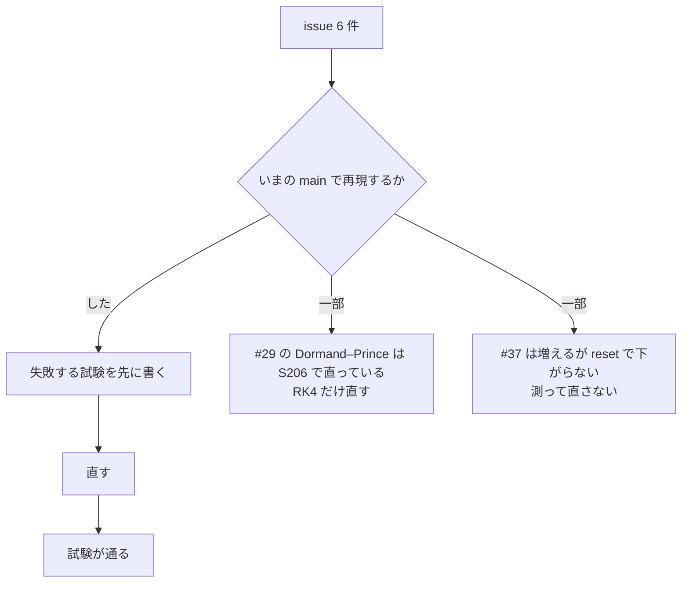

# S212 核の issue 6 件（実行系・設定・facade・frontend・FMU の書き出し）

| | |
| --- | --- |
| セッション | S212 |
| 日付 | 2026-11-07 |
| ブランチ | `feature/s212-core-issues-2` |
| Phase | P3・P4・P5・P7（実行系の設定、facade、frontend、FMU の書き出し、FMI Import） |
| スライド | [slides.html](slides.html) |
| 作業記録 | `log/work/2026-11-07-s212-core-issues-2.md` |
| レビュー | `log/review/2026-11-07-s212-core-issues-2-ponytail-audit.md` |

## 1. 目的

ユーザーが 2026-11-07 に `/ponytail-audit` で立てた issue のうち、実行系の設定・facade・frontend・FMU の書き出しに関わる 6 件（#23・#29・#31・#34・#37・#38）を、いまの main で 1 件ずつ再現してから直す。指摘は「コードを読んだだけで、実行していない」ものなので、失敗する試験を先に書き、直す前の失敗と直した後の成功を確かめた。前例は [S193](../S193-exec-issues-triage/解説書.md)。

## 2. 決定と理由

| issue | 再現 | 直し | 足した試験 |
| --- | --- | --- | --- |
| #23 FMU の Export が既存のフォルダを確認なしに消す | した。`<out>/Test/` に `mine.mo` を置いて `write_fmu` を呼ぶと、フォルダごと消えて `Ok` | `write_fmu` の中の 1 つの守り `check_out_root`（`<out>/<名前>/` があって `modelDescription.xml` が無ければ断る）。CLI の事前検査（計算の前に断る `prepare_out_dir`）は `.mo` を探す自前の走査をやめ、同じ関数を呼ぶ | `write_fmu_refuses_to_remove_a_folder_that_is_not_an_fmu`（`globe-mode-fmi`）。CLI の既存の `fmu_export_does_not_remove_a_source_folder` も通る |
| #34 出力の点数に上限が無い | した。`--stop-time 1000 --interval 1e-9`、rk4 の `--step 1e-15` が設定の決定を通った | `settings::resolve` で `区間 / Interval`（固定刻みでは `区間 / 刻み幅`）が 1e7 を超えたら `GM-E10004`。UI の実行の設定・Python・CLI・C・NIF・wasm のどれも `resolve` を通るので、全部に効く | `too_many_output_points_are_refused`（`globe-mode-sim`、上限ちょうどは通る） |
| #38 Integer・Boolean の上書きが丸められる | した。`n = 2.5` と `on = 0.3` の `compile_retaining_with_overrides` が `Ok`（3 と true で組み込まれる） | 小数部のある Integer と 0 / 1 でない Boolean は `GM-E10006`。丸めた値を埋め込んで、実行時の `param_overrides` には素の 2.5 が渡る食い違いが無くなる | `globe-mode-exec` の `structural_overrides_reach_bindings_inlined_by_same_name_modifications` に 2 件 |
| #37 長く生きる Workspace が `Checker::reset` を呼ばない | 増えることは再現した。だが `reset` を呼んでも RSS は下がらない（下の節） | **直さない**。facade の `Workspace` に reset を足すと、全部読む道で RSS の最大が 1955 から 2150 MiB に増え、分割の道では変わらない | `checks_are_the_same_before_and_after_a_reset`（reset の前後で `check` の JSON が一致。将来 reset を足すときの歯止め）、`#[ignore]` の RSS の測定 2 本 |
| #31 既定のライブラリ読み込みに S068 の規則が無い | した。AixLib の `RadiatorType` が `GM-E1001`（二重定義）。小さい構造でも再現 | frontend の `collect_mo_files` を公開し、facade と `globe-mode-db` の写しを消した | `sibling_file_wins_in_the_directory_split`（`globe-mode`） |
| #29 FMU の NaN が検査をすり抜ける | Dormand–Prince は再現しない（S206 で直っている）。RK4 は再現した（`Ok` で `[NaN]` の行が 2 つ） | `me.rs` の `drive` で、1 歩ごとに状態が有限でなければ `Error::Fmu` | `nan_derivatives_are_an_error_for_both_integrators`（両方の積分器。Dormand–Prince は直す前から通る） |

### #23: 守りを 1 つにした

守りは `globe-mode-fmi::export::check_out_root` の 1 か所。`write_fmu` が呼ぶので、Desktop（`globe-mode-lsp` の `exportFmu`）・Python の `export_fmu`・C の `gm_export_fmu`・NIF のどれも、`modelDescription.xml` の無いフォルダを消せない。CLI は計算の前に断りたいので同じ関数を事前に呼び、残る CLI 独自の検査は「入力・ライブラリのファイルがその下にある」ことだけ（`modelDescription.xml` があるフォルダに入力が入っていても止める）。挙動の変更: 空のフォルダも断る（`modelDescription.xml` が無いため）。利用者が前の Export を手で消せば通る。

### #34: 上限の根拠

1e7 は S206 が FMI Import（`globe-mode-fmi-import` の `MAX_GRID_POINTS`）に入れた値と同じで、根拠も同じ（1 点 8 バイト × 変数の数で、変数が 10 個で約 0.8 GB）。`globe-mode-sim` は FMI Import に依存しないので、定数を 2 か所に置き、`globe-mode-sim` 側のコメントで相手を指した（`globe-mode-fmi-import` は S210 が触っているので書き換えない）。`GM-E10004` は「設定が妥当でない」の既存のコードで、`interval`・`step` の誤りを今も同じ形で報告している。experiment annotation の `Interval` から来た値も同じ検査を通る。

### #38: 実行時の上書きとの食い違い

構造的な上書き（Integer は `Int`、Boolean は `Bool` で埋め込む）と、実行時の `param_overrides`（素の `f64`）は、これまで小数部のある値で食い違った。断ることで、両方が同じ値になる。Real に整数を渡す場合や、Integer に `3.0` を渡す場合は今までどおり通る。

### #37: RSS の前後（直さなかった理由）

測定は `tests/session_reset.rs` の `rss_stays_flat_with_resets` と `rss_with_edits`（どちらも `#[ignore]`、`data/msl` が要る）。1 つの `Workspace` で MSL の例題を続けて `check` し、`/proc/self/status` の `VmRSS` を読む。reset は `ws.db().checker().reset()` を `GM_RESET_EVERY` 本ごとに呼ぶ（issue の規則、xtask の既定と同じ 50）。

**分割読み込み（LSP・Python・C・NIF の道）、release、異なるモデル 100 本**（軽い 7 つのパッケージ 70 本 + Fluid の例題 13 本 + MultiBody の Elementary 17 本。`GM_N=200`）:

| 検査した本数 | 5 | 20 | 40 | 50 | 60 | 70 | 75（Fluid に入る） | 80 | 90 | 100 |
| --- | --- | --- | --- | --- | --- | --- | --- | --- | --- | --- |
| reset しない（前）RSS MiB | 217 | 240 | 259 | 272 | 286 | 297 | 690 | 730 | 756 | 808 |
| 50 本ごとに reset（後）RSS MiB | 217 | 241 | 259 | 273 | 285 | 296 | 690 | 729 | 759 | 812 |

**全部を読む道（`with_libraries_full`。wasm などが通る）、debug、重い 20 本**（Fluid 13 + MultiBody 7）:

| 検査した本数 | 5 | 10 | 15 | 20 | 最大 |
| --- | --- | --- | --- | --- | --- |
| reset しない（前）RSS MiB | 1709 | 1906 | 1916 | 1955 | 1955 |
| 5 本ごとに reset（後）RSS MiB | 1719 | 2000 | 2149 | 2003 | 2150 |

**打鍵に近い使い方**（1 つのモデルの本文を 300 回変えて `check`。分割、debug）: reset しないで 139（50 回）→ 127 MiB（300 回）。増えない。50 回ごとに reset しても 156 MiB 前後（50 回）。

読み取り:

- 異なるモデルの数に比例して増える（軽い例題で 1 本あたり約 0.8 MiB、最初の Fluid の例題が入ると約 400 MiB の段差）。ここまでは issue の言うとおり。
- ところが reset を 50 本ごとに呼んでも、50 本目の前後（272 → 273 MiB）でも、その後の 100 本（808 → 812 MiB）でも、RSS は変わらない。頭打ちにならない。全部を読む道では reset のあとに Rumoca がライブラリの解決をやり直す（Session のクローンに解決済みの木が無い）ので、最大 RSS はむしろ約 10% 増える（1955 → 2150 MiB）。
- 増えているのは reset が戻す Session の文書とキャッシュではなく、読んだライブラリのファイルの集合（`pristine` と分割読み込みの `loaded` に残る）か facade の DB のモデルごとの結果らしい【未確認。どれが増えているかは測っていない】。
- 打鍵では増えない。issue が挙げた「打鍵の途中のクラス名のメモ」は、300 回で 12 MiB 減っている。
- issue が引いた「MSL 566 本で 7.8 GB」は、S005 の作業記録では「大部分は 1 本の大きなモデルが単独で使う 6.3 GiB」で、累積ではない。

つまり、reset を facade に足しても RSS が下がるという測定が無く、全部を読む道では悪化するので、足さなかった（足せば LSP の打鍵のたびの検査が reset の直後だけ再解決で遅くなる）。issue の「1 日開いたエディタがスワップする」は、この測定の範囲（100 本、打鍵 300 回）では再現しない。`checks_are_the_same_before_and_after_a_reset` は、reset の前後で `check` の JSON が一致すること（全 5 回、利用者のファイルを足したあとも）を確かめるので、将来足す場合の歯止めになる。

LSP は独自の `Checker` を持たず、`Workspace::check` を通る（`globe-mode-lsp/src/lib.rs` に `Checker` は出てこない）。

### #31: 消した写しと残した写し

| 場所 | 扱い |
| --- | --- |
| `globe-mode/src/lib.rs` の `collect_mo` | 消して `globe_mode_frontend::collect_mo_files` に |
| `globe-mode-db/src/lib.rs` の `collect_mo`（`load_dir`） | 消して同じ関数に |
| `globe-mode-lsp/src/lib.rs:875` の `collect_mo`（ライブラリの木 `tree()`〈lint 用〉とワークスペースの根の走査。ドットのフォルダも `X.mo` と `X/` の二重も区別しない） | **触らない**（別のセッション S213 の範囲）。同じ規則に揃えるなら `globe_mode_frontend::collect_mo_files` を呼ぶ |
| `globe-mode-cli/src/main.rs:794` の `collect_mo` | **別物**。`fmt` / `lint` の対象を `ignore` crate（`.gitignore`・隠しディレクトリ）で集める関数で、ライブラリの読み込みではない。S208・S211 の範囲でもあり触らない |

挙動の変更: facade の `Workspace::with_libraries`（LSP・CLI・Python・C）と `GlobeDb::load_dir` が、`.` で始まるフォルダ（`.git` など）を読まなくなり、`package.mo` の無い `X/` の隣に `X.mo` があれば `X.mo` だけを読む。AixLib の `RadiatorTypes` の二重定義が無くなる。再現した実例（AixLib、`data/libs/AixLib` を `with_libraries` で読み、`Radiators.Radiator` を検査）は `GM-E1001: Duplicate class '…RadiatorTypes.RadiatorType' found … with non-identical definition (EM001)`。toy の構造では、定義が同一だと Rumoca は二重を許すので、型の定義を違えた（`Real` と `Integer`）。

### #29

`ode.rs` の `dopri5_accepted` は S206 で、`x5` と誤差の両方が有限でなければ誤差を無限大として却下する。模擬 FMU で t > 0.4 に NaN の微分を返させると、Dormand–Prince は刻みを縮め続けて `Error` で止まる（直す前から）。RK4 の道には検査が無く、`Ok` で `(0.6, [NaN])`・`(0.9, [NaN])` の行を持って終わった。`drive` に、1 歩ごとに状態が有限かどうかを見る 1 か所を足した。

## 3. 図



## 4. 再現手順

```bash
export CARGO_TARGET_DIR=…/.git-worktree/target-shared CARGO_BUILD_JOBS=2
cargo test -p globe-mode-fmi --features export --lib write_fmu              # #23
cargo test -p globe-mode-sim --lib too_many                                 # #34
cargo test -p globe-mode-exec --test simulate structural_overrides_reach    # #38
cargo test -p globe-mode --test library_closure sibling                     # #31
cargo test -p globe-mode --test session_reset                               # #37（reset の前後で同じ）
GM_RESET_EVERY=0 GM_N=200 GM_DIRS=Electrical/Analog/Examples,Fluid/Examples,Mechanics/MultiBody/Examples/Elementary \
  cargo test --release -p globe-mode --test session_reset -- --ignored --nocapture rss_stays   # #37（RSS。50 で比べる）
cargo test -p globe-mode-fmi-import --lib nan                               # #29
```

検証の結果は作業記録にある（`mise run check`、`msl:compare`、`wasm:node`、`wasm:compare`、workflow の run）。

## 5. 次回

- #34: `globe-mode-fmi-import` の `run_cs` は S206 で済んでいる。CSV 全体を 1 つの `String` にする facade の出力（`no_csv` でないとき）は、上限が 1e7 点 × 変数の数のままなので、変数が多いモデルでは数 GB になりうる。点数×変数の数で断るかは別に決める。
- #37: 何が増えているか（`loaded` と `pristine`、DB のモデルごとの結果、Rumoca のグローバルなキャッシュ）を測ってから、減らす場所を決める。reset は効かない。
- #31: `globe-mode-lsp` と `globe-mode-cli` の `collect_mo` の写し（S208・S213）。
