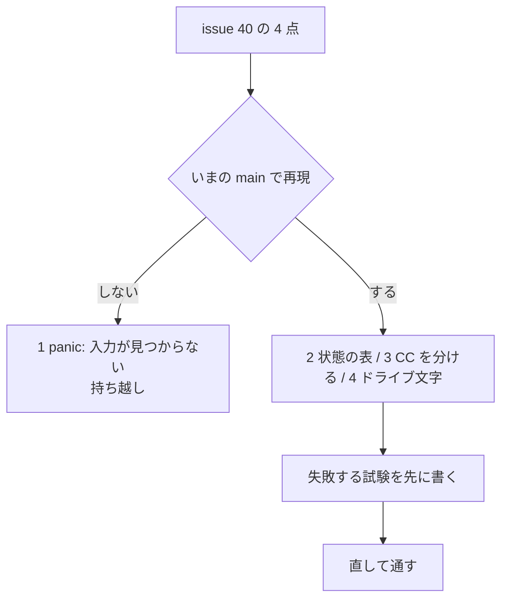

# S213 Export した FMU のランタイムの issue #40

| | |
| --- | --- |
| セッション | S213 |
| 日付 | 2026-11-07 |
| ブランチ | `feature/s213-fmu-runtime-issues` |
| Phase | P5 |
| スライド | [slides.html](slides.html) |
| 作業記録 | `log/work/2026-11-07-s213-fmu-runtime-issues.md` |
| レビュー | `log/review/2026-11-07-s213-fmu-runtime-issues-ponytail.md` |

## 1. 目的

ユーザーが 2026-11-07 に `/ponytail-audit` で立てた issue #40（自前のランタイム `globe-mode-fmu` と、FMU のビルドの 4 点）を、いまの main で 1 点ずつ再現してから直す。ponytail の指摘は読んだだけでビルドも実行もしていないので、再現しなければ理由を書いて直さない（[S193](../S193-exec-issues-triage/解説書.md) と同じ流儀）。設計は [ADR-0031](../../adr/0031-fmi-export-p5a-first.md)・[ADR-0032](../../adr/0032-p5b-own-runtime.md)。

## 2. 決定と理由

| # | 指摘 | 再現 | 直したか | 足した試験 |
| --- | --- | --- | --- | --- |
| 1 | `extern "C"` の入口の panic が境界を越える | しない | 直さない（持ち越し） | 無し |
| 2 | 状態の start 値が作り直しで消える | する（`[1.0, 2.0]` ≠ `[5.0, 2.0]`） | 直した | `state_start_values_survive_a_rebuild`（`tests/fmpy.rs`） |
| 3 | `CC="ccache cc"` を 1 つのプログラム名と見る | する | 直した | `cc_with_arguments_is_split_on_whitespace`（`export.rs`） |
| 4 | Windows の `file:///C:/x` が `/C:/x` になる | する（関数の単体） | 直した | `resource_path_from_uri`（`lib.rs`） |

### 1 を直さなかった理由

- Rust 2024 では `extern "C"` を越える unwind は未定義動作でなく abort になる（モジュールの冒頭に書いてある）。落ちるのは本当だが、落ちる入力が見つからなかった。
- 探した入力: 範囲外の valueReference、初期化の前の事象の関数、NaN の時刻・状態、状態 0 個、空のモデル、`1/0` の微分、NaN の start、代数ループ、`when`。どれも `fmi2Error` か NULL で返り、診断は標準エラーに出る。MSL の全例題で panic は 0 本（[msl-funnel.md](../../msl-funnel.md)）。
- 入口を包むなら `each`・`states`・`instantiate`・`rebuild` の 4 か所（約 15 行）で足りる。panic する入力が見つかったら足す。

### 2 の原因

`fmi2SetReal` は状態を `ModelInstance` に直接書くが、パラメータ（または開始時刻）が変わると `fmi2ExitInitializationMode` の `rebuild` が lowering からインスタンスを作り直し、状態は既定の start に戻る。FMPy の `start_values={'x': 5, 'k': 2}` は x と k を続けて書くので x が消える。`inputs` と同じ表 `states`（添字 → 値）を持ち、作り直した後に置き直す。`fmi2Reset` は規格で「作り直したのと同じ」なので既定に戻るのが正しく、そこは変えていない。

### 3・4

- 3: `globe-mode-fmi/src/export.rs` の `build`（`write_fmu` ではない）の `CC` を `split_whitespace` で分け、最初を実行ファイル、残りを引数にした（`cc` crate は入っていない）。空なら `cc`。
- 4: `read_resource` の URI → パスを `resource_path` に切り出し、`/C:/…` のドライブ文字の前の `/` を落とした。Windows 形の入力は文字列で試す（Linux の `Path` は `\` を区切りと見ないため）。実機の確認は CI の Windows ランナー。

## 3. 図



## 4. 再現手順

```bash
export CARGO_TARGET_DIR=…/.git-worktree/target-shared CARGO_BUILD_JOBS=2
cargo test -p globe-mode-fmu --lib                         # 4
cargo test -p globe-mode-fmu --test fmpy state_start       # 2
cargo test -p globe-mode-fmi --features export --lib cc_   # 3
```

FMPy・fmusim は `gh workflow run fmu-export.yml --ref feature/s213-fmu-runtime-issues`、Windows は `gh workflow run ci.yml --ref … -f full=true`。

## 5. 次回

- 1: panic する入力（Rumoca の panic など）が見つかったら入口を包む。
- 付記の GUID（P5a の `globe-mode-frontend/src/fmi_export.rs` はモデル名だけの `DefaultHasher`）は数えていない。
