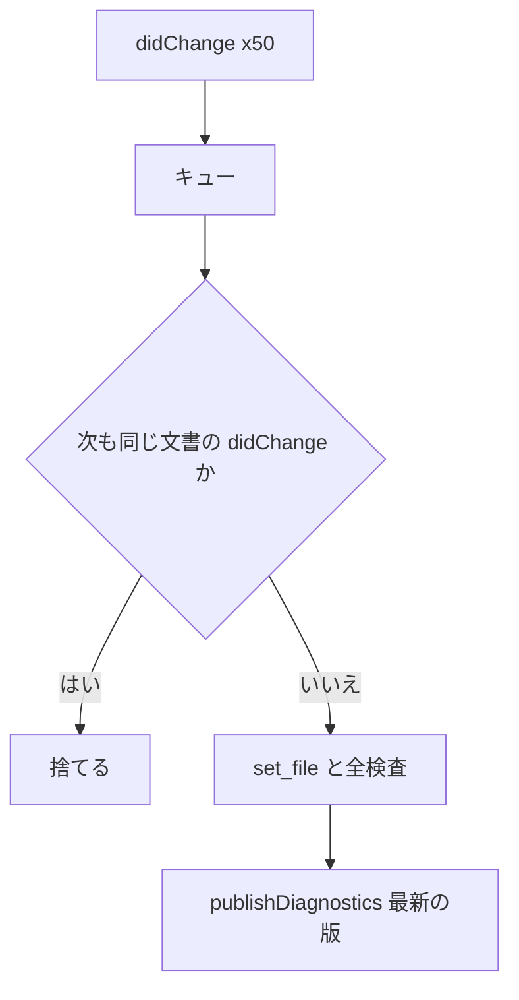

# S214 LSP と言語バインディングの issue の点検

| | |
| --- | --- |
| セッション | S214 |
| 日付 | 2026-11-07 |
| ブランチ | `feature/s214-lsp-bindings-issues` |
| Phase | P7（言語の束ね）、LSP |
| スライド | [slides.html](slides.html) |
| 作業記録 | `log/work/2026-11-07-s214-lsp-bindings-issues.md` |
| レビュー | `log/review/2026-11-07-s214-lsp-bindings-issues-ponytail.md` |

## 1. 目的

ユーザーが 2026-11-07 に `/ponytail-audit` で立てた issue のうち、LSP（`globe-mode-lsp`）と言語バインディング（Elixir の NIF、Julia）の 6 件（#25・#30・#33・#35・#37 の LSP 側・#39）を、いまの main（S208 まで）で 1 件ずつ再現してから直す。issue は「読んだだけで実行していない」ので、再現しなければ理由を書いて直さない。

## 2. 決定と理由

| issue | 再現したか | 直した所 | 足した試験 |
| --- | --- | --- | --- |
| #33 打鍵ごとに全検査が積まれる | した。1 文字ずつ 50 回の `didChange` を送ると、**検査（`publishDiagnostics`）が 51 回**（`didOpen` の 1 回と 50 回） | `serve` が積まれたメッセージを読み切り、次も同じ文書の `didChange` なら今のは検査せずに捨てる（全文の同期なので次の版が本文のすべて）。検査は **2 回**（`didOpen` と最後の版）で、最後の診断は最新の版の行。`globe/simulate`・`globe/simulateColumns` は要求に `max_wall_seconds` が無ければ 180 s の予算を置く | `queued_did_changes_are_coalesced`、`simulate_gets_a_default_wall_budget` |
| #25 検査の panic のあと本文が古い | **panic を起こす入力が無く、再現できない**（`compile_model_strict` が panic する Rumoca への入力は、いまの main では見つからない）。順序は読んで確かめた | `update` で `texts.insert` を `diagnostics` の前に動かした（1 行）。`catch_unwind` はリクエスト単位（S198）が通知の道にも効いている（`serve` が `handle_with` 全体を包む）。`compile_model_strict` の周りの `catch_unwind` は `globe-mode-frontend` の変更になるので持ち越し | 無し（panic の入力が無い） |
| #37 LSP 側の `Checker::reset` | LSP は facade の `Workspace` の上に乗っている（`Server.ws: Workspace`、`scratch: Workspace`）。`Checker` を直接持たない | 何もしない。S212 が facade の `Workspace` に入れる規則（検査した異なるモデルの数が閾値を超えたら reset）が、そのまま LSP にも効く。S212 が main に来ていなければ、規則は main に来た時点で効く | 無し |
| #39 `globe/format` が設定の indent を無視する | した。issue の文面は逆で、`globe-mode.toml` の `indent = 4` があっても、VS Code が常に送る `indent: tabSize`（2）が勝って 2 空白で整形された（`textDocument/formatting` は設定が勝つ） | `Server::indent` を 1 つ足し、`textDocument/formatting` と `globe/format` の両方が使う。設定ファイルがあればその値、無いときだけ要求の値（ブラウザ版の UI）。**挙動が変わる** | `config_file_at_the_root_drives_lint_and_formatting` の期待を 4 に直し、設定ファイルの無いときは要求の indent を採ることも確かめる |
| #35 NIF の poison と dirty CPU | した。Mutex を持ったまま panic した後の `set_file` が `{:error, "ワークスペースが panic で壊れた"}`。dirty CPU を 1 本に絞ると、実行が Mutex を持つ間 `check` が待ち、無関係の `format` も通らない | `with` が `PoisonError::into_inner` で続ける（C ABI と同じ）。Mutex を取る NIF（`check`・`graph`・`outline`・`deps`・`flat`・`simulate`・`simulate_observed`・`simulate_columns`）を DirtyIo に | Elixir の `panic の後も同じ workspace が使える`（試験用の NIF `panic_for_test`）、`実行が Mutex を持つ間、check の待ちが dirty CPU を塞がない` |
| #30 Julia のコールバックの例外 | した。コールバックが `error("boom")` を投げると、その後の `check` が「ワークスペースは使用中」のまま固まる | `Observer` に例外を退避し、トランポリンは `true`（中断）を返し、`ccall` が返ってから投げ直す。`GC.@preserve ws o` を付けた | `test.jl` に例外を投げるコールバック 1 本（`@test_throws` のあと `check` が通る） |

### 2.1 #33 のまとめ方

- 「今の `didChange`」の直後のキューの先頭が、同じ URI の `didChange` なら捨てる。間に別のメッセージ（hover など）があるときは捨てない（その要求は途中の版を見るべきなので）。
- 別の文書の変更が間に挟まる場合も捨てない（隣り合っているときだけ）。1 人の開発者が 1 つの文書を打つ負荷を想定した割り切り。
- `didOpen` は捨てない。
- 時間の予算は 180 s（`msl-sim` と同じ）。要求の `max_wall_seconds` が優先する。ネイティブの積分が段の間でしか中断を見ない件そのもの（`$/cancelRequest` が積分中に効かない）は、実行系の変更になるので触らない。

### 2.2 #39 の文面の食い違い

依頼の文面は「設定の indent を無視する（固定 2）」だったが、issue の本文は「要求が設定に勝つ」という別の症状だった。issue の本文に従った（実際の症状もそちら）。

## 3. 図



## 4. 再現手順

```bash
export CARGO_TARGET_DIR=…/.git-worktree/target-shared CARGO_BUILD_JOBS=2
cargo test -p globe-mode-lsp --lib -- queued_did_changes config_file_at_the_root   # #33 #39
mise run elixir:test                                                              # #35
mise run c:julia                                                                  # #30
```

直す前の結果は作業記録にある。

## 5. 次回

- #25: `compile_model_strict` の周りの `catch_unwind`（`globe-mode-frontend`）。panic する入力が見つかったときに。
- #33: ネイティブの積分が中断を段の間でしか見ない件（実行系）。
