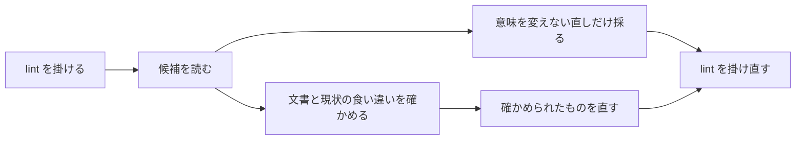

# S217 doc-yomiyasu

| | |
| --- | --- |
| セッション | S217 |
| 日付 | 2026-11-08 |
| ブランチ | `feature/s217-doc-yomiyasu` |
| Phase | 文書 |
| スライド | [slides.html](slides.html) |
| 作業記録 | `log/work/2026-11-08-s217-doc-yomiyasu.md` |

## 1. 目的

ユーザーの指示（2026-11-08）は、doc と日本語の内容監査を yomiyasu でリファクタリングすること。正典と準正典の日本語の文書を yomiyasu の規則で推敲し、あわせて文書どうし、文書とコードの食い違いを見つけて直した。

対象は [README.md](../../../README.md)、[CLAUDE.md](../../../CLAUDE.md)、[architecture.md](../../architecture.md)、[roadmap.md](../../roadmap.md)、[features.md](../../features.md)、[licenses.md](../../licenses.md)、[upstream.md](../../upstream.md)、[format-style.md](../../format-style.md)、[web-apps.md](../../web-apps.md)、[release.md](../../release.md)、`doc/mise-setup.html`、[doc/adr/](../../adr/README.md)、`src/*/README.md`。

## 2. 決定と理由

| 項目 | 決定 | 理由 |
| --- | --- | --- |
| 推敲の範囲 | 文末のコロン、比喩の「黙って」、太字の表示、補助動詞の表記など、意味を変えない直しだけ | 計画の中身と ADR の決定の文言は変えない約束のため |
| 残した指摘 | 「版」（version）の直訳語、技術用語の「閉包」、箇条書きの多さ | この文書群の語として定着しており、置き換えると意味の幅が変わる |
| 食い違い | コードや他の文書で確かめられたものだけ直す | 推測を事実のように書かない（[CLAUDE.md](../../../CLAUDE.md) の 4 章） |
| 英語の要約 | 触らない | 指示のとおり。食い違いは報告に回す |

## 3. 図



## 4. 再現手順

```bash
python3 .agents/skills/yomiyasu/scripts/yomiyasu_lint.py doc/architecture.md
python3 -I .claude/skills/session-docs/check_docs.py
```

検証の結果（数字）:

- lint の指摘の合計は 348 件から 274 件（対象 63 本）。
- 直した食い違いは 11 件（README 2、CLAUDE.md 1、architecture.md 3、roadmap.md 2、format-style.md 2、web-apps.md 1、Svelte と Rust の README 各 1 など）。

## 5. 次回

- `doc/mise-setup.html` の「完成例」と「タスク定義の例」は S001 の時点のまま。冒頭に注記を足しただけで、書き直してはいない。
- README の英語の要約に「Not done: FMI import」が残る。日本語の側は CLI だけが済んでいる状態に直した。
