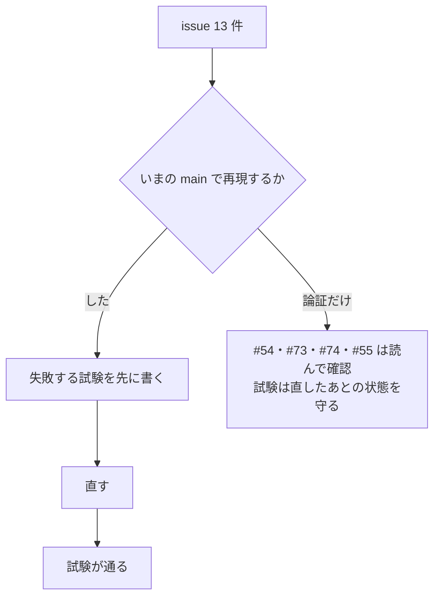

# S218 監査の「必ず直す」13 件（CI・秘密・データ損失・機能）

| | |
| --- | --- |
| セッション | S218 |
| 日付 | 2026-11-08 |
| ブランチ | `feature/s218-audit-fixes-1` |
| Phase | P3〜P7（CI、実行系、FMU、LSP、整形、ウェブアプリ、UI） |
| スライド | [slides.html](slides.html) |
| 作業記録 | `log/work/2026-11-08-s218-audit-fixes-1.md` |
| 親 issue | #42（2026-11-08 の ponytail 全体監査） |

## 1. 目的

2026-11-08 の全体監査の区分「必ず直す」13 件（#72・#74・#75・#55・#43・#48・#64・#54・#73・#49・#67・#68・#83）を、1 件ずつ、いまの main で再現してから最小の直しと「壊れたら落ちる試験」で直した。1 件 1 コミットで、本文に `Fixes #n` と原則を書いた。前例は [S212](../S212-core-issues-2/解説書.md)。閉じるのはユーザー。

## 2. 決定と理由

| issue | 再現 | 直し | 足した試験・確かめ |
| --- | --- | --- | --- |
| #72 push の run が止められ、差分が検査されない | 実例（止められた run が 23 本）。issue の記述どおり | `cancel-in-progress: ${{ github.event_name != 'push' }}` | `ci.yml` を全体検査で回した |
| #74 Android の署名鍵がジョブの全 step に見える | workflow を読んで確認 | 4 つの secret を `keystore.properties` を書く step の `env` に移し、空なら中で `exit 0`。tauri-cli を 2.12.4 に固定 | `android.yml` を鍵なしで回し、exit 0 の道を確かめた |
| #75 `gho_` が伏せ字にならない | した。`redact` が `gho_…` を残し、`--check` も通った | 規則を `\bgh[pousr]_[A-Za-z0-9]{36,}` に | `.claude/hooks/test_save_session_log.py`（5 種類。`mise run check` に入れた）。`log/sessions` の 14 件は 0 件のまま |
| #55 `globe fmu run --out victim.mo` が .mo を CSV で上書き | 読んで確認（`simulate` が持つ `check_writable_file` が無い） | `run_in_worker` の前に `check_writable_file`、失敗は exit 2 | `run_refuses_an_unwritable_or_source_out_before_running` |
| #43 既定のソルバで `CancelToken` が効かない | した。調和振動子で bdf は 0.3 s に立てても止まらず 129 s かかって試験が落ちた | トークンがあるとき、型付きの道を別のスレッドで回して即返す（下の節） | `cancel_from_another_thread_stops_the_default_solvers`（bdf・auto・dopri45） |
| #48 P5a の FMU から experiment が消える | した。`<DefaultExperiment>` が XML に出ない | `export_me_sources` が `startTime`・`stopTime`・`tolerance` を `<ModelVariables` の前に 1 回挿す | `tests/fmu_export.rs`（FMI 2.0・3.0 とも Decay の StopTime=1、Tolerance=1e-8） |
| #64 別の文書を直しても診断が古い | した。P の `R` を `Q` に変えても T への publish が 0 件 | `republish_others`。編集・閉じ・開きのあと、ほかの開いている文書を検査し直し、前に出したものと違うものだけ publish | `editing_or_closing_a_document_republishes_the_ones_that_depend_on_it` |
| #54 深い HTML で整形がスタックを溢れさせる | 論証（`block`・`flat`・drop が再帰） | 深さ 256 の上限、超えたら整えない | 1 MiB のスレッドで 10,000 段（上限なしだと abort する大きさ） |
| #73 CLI 経由の 6 アプリで 1 MiB の lint が 11.8 s・2.6 GB | issue の実測を採用 | 6 アプリに `--disable connect-type-mismatch` を常に付けた | FastAPI の pytest（偽の `globe` で引数を確かめる）。CI の python ジョブで `fastapi_fmt` の pytest も回す |
| #49 ワーカーが kill・クラッシュで終わると FMU が /tmp に残る | した（abort・segfault・kill の 3 通りで展開先が残った） | 親が一時ディレクトリを作り `WorkerRequest.work_dir` で子に渡す（`Fmu::open_in`） | `fmu_worker.rs` の落ちる FMU の試験に、guid で探した残りが 0 件の確認 |
| #67 最近使ったファイルのタブが Ctrl+S で保存できない | `FAKE_TAURI` を本物と同じに厳しくして再現（許可を消すと forbidden path） | Rust の `write_recent{path,text}`（.mo、親のフォルダがある、ディレクトリでない）。`saveFile` は path があるときそれを呼ぶ | `test_ui.py`、`test_tauri.mjs`、`write_mo` の単体試験。desktop crate は手元で組めない |
| #68 Android でプロットの CSV/PNG が TypeError | Android の UA と dialog / fs の無い `__TAURI__` で再現 | `inDesktop()` を `tauri-backend.ts` に 1 つ置き、`App.svelte` と `Plot.svelte` で使う | `test_ui.py` の Android の節 |
| #83 `SimSettings` が綴りの誤りを黙って捨てる | 論証と protocol の試験で確認 | `#[serde(deny_unknown_fields)]` | `simulate_request_rejects_unknown_fields` に入れ子 2 件と正しい綴り 1 件 |

### #43: 型付きの道を別のスレッドで回して即返す

ネイティブの型付きの道（bdf・auto・dopri45）は Rumoca の積分が 1 歩ごとにトークンを見ないので、止められなかった。Rumoca は改変しない。

**第 1 案（コミット済み、のちに取り消した）**: トークンがあるときは `Route::Session`（自前の 1 歩ごとにトークンを見る道）で回す。結果は型付きの道とビット単位で同じ（[ADR-0014](../../adr/0014-session-route-wasm.md)）が、Cranelift の JIT が無い。release で測ると（同じ `Workspace`、2 回目以降）、

| モデル（ソルバ） | 型付き（トークン無し） | session（トークン有り） |
| --- | --- | --- |
| ChuaCircuit（bdf） | 0.20〜0.23 s | 0.25〜0.26 s |
| ChuaCircuit（dopri45） | 0.12〜0.14 s | 0.17〜0.18 s |
| DoublePendulum（bdf・dopri45） | 1.6〜2.1 s | 1.1〜2.0 s（差なし） |
| CauerLowPassSC（bdf） | 18.8・19.1 s | 22.1・27.8 s |
| CauerLowPassSC（auto） | 21.5・22.7 s | 25.1・38.7 s |
| EngineV6（bdf、予算 170 s） | 202 s で完走 | 予算で `GM-E11005`（273 s） |

小さなモデルは良いが、重いモデルで 1.2〜1.7 倍遅く、EngineV6 は完走から時間切れに変わった。Python・C・NIF・LSP・wasm は常にトークンを渡すので、既定の道が失敗に変わる。そこで第 2 案に替えた（HeatingSystem は測る前に替えたので未測定）。

**第 2 案（採用）**: トークンがあるとき、`checked_simulate` は型付きの道を別のスレッド（スタック 256 MiB）で回す。呼び手のスレッドは 20 ms ごとにトークンを見ながら、スレッドが送る進捗（段の知らせ）を `on_progress` に渡し、トークンが立ったら**すぐ `GM-I11004` で返す**。回しているスレッドは止められないので放置する。終わるか `max_wall_seconds` が来るまで CPU とメモリを使い、結果は捨てる。ADR-0013 に付記した。

**挙動が変わる点**:

- Python・C・NIF・LSP の `bdf`・`auto`・`dopri45` は、止めるとすぐ返る（以前は最後まで走った）。止めた時刻までの途中経過（`Termination::Cancelled`）は返らず、`ok: false` と `GM-I11004` だけ。session の道の自前の積分器は今までどおり途中経過を返す。
- 止めたあとも、その計算が裏で走り続ける。LSP は既定の予算 180 s で終わる。予算の無い呼び出しは、モデルによっては長く走り続ける。
- 速さは変わらない（スレッドを 1 本足すだけ。モデルの複製は `Arc` の参照）。トークンの無い CLI・xtask と wasm は変わらない。

### #73: 6 アプリで型検査を止める理由

CLI の `lint` は既定で connect の型検査（Workspace の構文解析）も回す。`a+a+…` 52 万項（1 MiB）で 11.8 s・RSS 2.6 GB、止めると 0.6 s・229 MB。S215 の本文 1 MiB・時間切れ 10 s の守りでは抑えられない。Rust の 4 アプリは `fmt::lint` だけを呼ぶので、もともと型検査を出さない。**挙動が変わる点**: 6 アプリで `connect-type-mismatch` の指摘が出なくなる（もともと標準入力 1 本では、別ファイルの型は解決できず、判定されないことが多い）。

### #72: 残る穴

`cancel-in-progress` を push で切っても、GitHub は待ち行列で並んだ古い待ちを捨てる。続けて push するときは `ci.yml -f full=true` で回す、とコメントに書いた。

### #49: 親が死んだとき

親が SIGKILL で落ちたときは、子が標準入力の閉鎖で終わるが、親の一時ディレクトリは残る。これは直していない（`/tmp` の掃除に任せる）。

## 3. 図



## 4. 再現手順

```bash
export CARGO_TARGET_DIR=…/.git-worktree/target-shared CARGO_BUILD_JOBS=2
python3 .claude/hooks/test_save_session_log.py                                   # #75
cargo test -p globe-mode-cli --test fmu_import run_refuses                       # #55
cargo test -p globe-mode --features fmu --test observed                          # #43
cargo test -p globe-mode-cli --test fmu_export                                   # #48
cargo test -p globe-mode-lsp --lib editing_or_closing                            # #64
cargo test -p globe-mode-fmt --lib very_deep                                     # #54
cargo test -p globe-mode-cli --test fmu_worker                                   # #49
cargo test -p globe-mode-protocol simulate_request_rejects                       # #83
(cd src/Python/fastapi_fmt && GLOBE_BIN=…/globe uv run --locked pytest -q)       # #73
mise run ui:check                                                                # #67・#68
```

CI の run は作業記録にある。

## 5. 次回

- #72: 待ち行列で捨てられる古い待ちを拾うには、差分の base を `github.event.before` でなく「最後に成功した run の SHA」にする必要がある。
- #49: 親が落ちたときの一時ディレクトリ。
- facade の `globe-mode` 単体のビルド（#89）。
