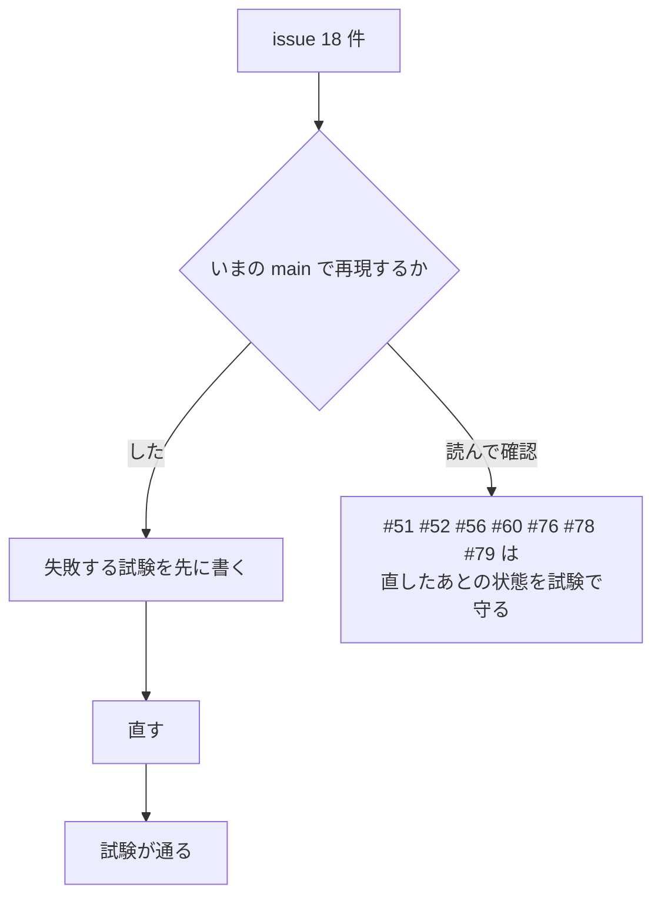

# S223 監査の「直した方がよい」18 件

| | |
| --- | --- |
| セッション | S223 |
| 日付 | 2026-11-08 |
| ブランチ | `feature/s223-audit-fixes-2` |
| Phase | P3〜P7（実行系、ライブラリ、FMU、lint、CLI、UI、CI） |
| スライド | [slides.html](slides.html) |
| 作業記録 | `log/work/2026-11-08-s223-audit-fixes-2.md` |
| 親 issue | #42（2026-11-08 の ponytail 全体監査） |

## 1. 目的

全体監査の区分「直した方がよい」18 件（#44・#50・#51・#52・#56・#57・#58・#59・#60・#69・#70・#76・#77・#78・#79・#84・#85・#86）を、1 件ずつ、いまの main で再現してから最小の直しと「壊れたら落ちる試験」で直した。1 件 1 コミットで、本文に `Fixes #n` と原則を書いた（ファイルが重なる #84・#85、#57・#58、#56・#60 は 2 件ずつ 1 コミット）。閉じるのはユーザー。前例は [S218](../S218-audit-fixes-1/解説書.md)。

## 2. 決定と理由

| issue | 再現 | 直し | 足した試験・確かめ |
| --- | --- | --- | --- |
| #44 出力点数の上限が Rumoca とずれる | した。`resolve` が issue の 3 例（0〜1 を 1e-7、0〜1e7 を 1、1e9〜+0.05 を 1e-8）を通す。旧い試験「ちょうど 1e7 は通る」は誤った側を固定していた | `grid_problem`: `floor(区間/刻み)+1 >= 1e7`、または刻みが時刻の ulp より細かい設定を `GM-E10004`。Rumoca の `Options` エラーも `GM-U0005` でなく `GM-E10004`（S10） | `too_many_output_points_are_refused`（3 例を断り、1 点少なければ通る） |
| #59 木の BOM と panic | した。BOM で `within` を落とし（`P.M` が `M`）、`\` と多バイト文字で終わる文字列で `tree.rs:184` の panic | `new` で BOM を落とす。字句の切り出しは `s.get`、記号は文字の長さだけ進める | `a_bom_and_a_broken_string_do_not_break_the_tree` |
| #84 ライブラリの BOM | した。`-L` のライブラリは `GM-W1001` で読み飛ばされ、使う側が `GM-E1001`（分割・in-memory とも） | frontend の `blank_bom` を `set_file`・`SplitLibrary::new`・`parse_sources_lenient` が共有 | `library_closure.rs` の 2 本 |
| #85 UTF-8 でないファイル | した。Latin-1 の `B.mo` 1 つで無関係な `P.A` を使うモデルも `GM-E1003` | `with_libraries` は悪いバイトだけ U+FFFD にして読む。`load_dir` は誤りにパスを付け、全部読めてから足す | `library_closure.rs`、`load_dir_names_the_unreadable_file_and_adds_nothing` |
| #86 グラフが指数的に膨らむ | issue の実測（16 で 3.1 s・560 MB）。いまは `--depth 30` でも 0.01 s・39 MB | `walk` に開いている途中のクラスを渡し、既にある型は部品のノードにする | `a_model_containing_itself_is_not_expanded_again`（深さ 40） |
| #50 FMI 3.0 の配列変数 | した。StateSpace.fmu の `fmu run` が `fmi3GetFloat64 が Error` | `ScalarVariable::dimensions`。`output_names` で外し、`find_float` で「配列は未対応」と断る。既定の出力は time だけの CSV になる | `array_variables_are_refused_not_read_as_scalars`（実 FMU） |
| #51 Integer・Boolean の start | コードで確認（f64 の `{:?}`） | `Int32` は整数、`Boolean` は `true`/`false` | `integer_and_boolean_inputs_start_in_their_own_types`（2.0・3.0） |
| #52 fmu run の見出し | 読んで確認（`join(",")`。実 FMU は未確認） | `,` `"` を含む名前だけ `push_quoted`（`pub` にして再利用）。ほかは引用しない | `csv_header_quotes_names_with_commas` |
| #56 `lint --disable` | 読んで確認（コードと打ち間違いを黙って無視） | `globe_mode_fmt::rule_name` を設定ファイルと CLI が共有。知らない規則は 2 | `lint_disable_takes_codes_and_rejects_unknown_rules` |
| #57 extends の説明の偽陽性 | した。`model extends Base(p(a = 1)) "説明"` で出る | 名前の次が `(` なら `skip_group` で飛ばす | `missing_description_skips_the_modification_of_extends` |
| #58 line-too-long が 1 行目 | した。MSL の Electrical で 6330 件中 4784 件が 1 行目（試験でも 1） | 整形で書き換わった行は、最長の語を本文から探す。Electrical で 884 件に減った | `line_too_long_points_at_the_source_line_even_when_the_format_changes_it` |
| #60 fmt 標準入力の終了コード | 読んで確認（S211 の試験が 1 を固定） | 標準入力の構文の誤りを 2 に。`--json` は 1 のまま | `fmt_syntax_error_exits_2_on_stdin_like_a_file`、`fmt_dirs.rs` を 2 に |
| #69 wasm の 2 GiB | した。旧 `client.js` で試験 7 が落ちる | `worker.js` が応答に `mem`、`client.js` の `#call` が上限（2 GiB）と比べて `#die` で作り直す。再生のあとは数え直す | `worker-node.mjs` の 7。`wasm:node`・`wasm:web` ok |
| #70 Desktop の保存 | した。旧 `App.svelte` で `test_ui.py` が落ちる（確認が出ない） | 書く前に `openPath` で読み、`clean` と違えば `confirm` | `test_ui.py`（取り消しなら書かない、承知なら書く、自分で書いたあとは確かめない） |
| #78 Astro の `spawnSync` | 読んで確認 | `spawn` の Promise。時間切れは SIGKILL | 待つ間のイベントループの試験（`spawnSync` では 0 回） |
| #79 使われない依存 | 消して c・nif・py が全 target で通る | 4 行 | `cargo check --all-targets` |
| #76 action の SHA | 読んで確認 | release.yml・android.yml の 4 つを SHA で固定（`gh api …/commits/<tag>`） | release.yml の dry run、android.yml |
| #77 試験が CI に無い | 手元で 5 アプリが通る | `ci_plan.py` に `astro`、`python`・`lang` も CLI の影響で。python が marimo・Streamlit、lang が Phoenix・Wisp、新しい `astro` | `test_ci_plan.py`、`ci.yml -f full=true` |

### #60: JSON は 1 のまま

issue は「stdin の `Err` の 2 腕を 2 に」としている。しかし `--json` の腕は、Astro・FastAPI・Phoenix・Wisp が 0 と 1 を結果として読み、`ok: false` の JSON を返す契約になっている。2 にすると 6 アプリが異常終了と取る。そこで JSON でない腕だけを 2 にした。**挙動が変わる点**: `fmt -`（`--check` の有無にかかわらず、`--json` でない）の構文の誤りが 1 から 2。S211（#26）の試験は壊れた入力の 1 を固定していたので、2 に直した。

### #85: 警告は出さない

issue は「読めないファイルを読み飛ばしの列へ回す」としている。分割読み込みは読み飛ばしを検査の結果にだけ出す作りで、読めないファイルの理由を運ぶ口が無い。読み飛ばすと、そのファイルを使うモデルが無関係に見える `GM-E1001` で止まる（#84 と同じ症状）。悪いバイトだけ U+FFFD に置き換えて読むほうが、`°` のような字がコメントや文字列にあるだけのライブラリを動かせる。**挙動が変わる点**: UTF-8 でないファイルのコメント・文字列の悪いバイトが `U+FFFD` になる。警告は出ない（次回）。

### #56: 知らない規則名

6 つのウェブアプリは、利用者が送った `disable` の規則名をそのまま CLI に渡す。知らない規則名は以前は黙って無視され、いまは終了コード 2 で、アプリによっては異常終了の応答になる。

### #77: 試験を入れたら潜んでいた欠陥が出た

Phoenix の「時間切れで kill される」試験が CI で落ちた。kill のあと port が自分で閉じ、閉じ済みの `Port.close` が `ArgumentError` になる競合で、手元では 5 回とも通る。rescue で受けた。

## 3. 図



## 4. 再現手順

```bash
export CARGO_TARGET_DIR=…/.git-worktree/target-shared CARGO_BUILD_JOBS=2
cargo test -p globe-mode-sim settings                                   # #44
cargo test -p globe-mode-fmt                                            # #56 #57 #58 #59
cargo test -p globe-mode-graph                                          # #86
cargo test -p globe-mode-fmi-import --test reference                    # #50
cargo test -p globe-mode-fmu --lib                                      # #51
cargo test -p globe-mode-cli --test review_fixes --test fmt_dirs        # #56 #60
cargo test -p globe-mode --features fmu --test library_closure          # #84 #85
cargo test -p globe-mode-db --test checks load_dir                      # #85
mise run wasm:node && node src/Rust/mod/globe-mode-wasm/web/worker-node.mjs   # #69
mise run ui:check                                                       # #70
(cd src/Astro/fmt && GLOBE_BIN=…/globe node --test test/api.test.mjs)   # #78
python3 .github/scripts/test_ci_plan.py                                 # #77
```

CI の run は作業記録にある。`facade` の `globe-mode` 単体のビルドは #89 のとおり `--features fmu` が要る。

## 5. 次回

- #85: UTF-8 でないファイルの警告（分割読み込みが読み飛ばしの理由を運ぶ口を持つとき）。
- #58: 1 行目に残る長い行の位置（Electrical で 884 件）。整形後の行と元の行の対応を、整形器から取る。
- #56: 知らない規則名を送られたウェブアプリが、異常終了でなく 400 を返す。
