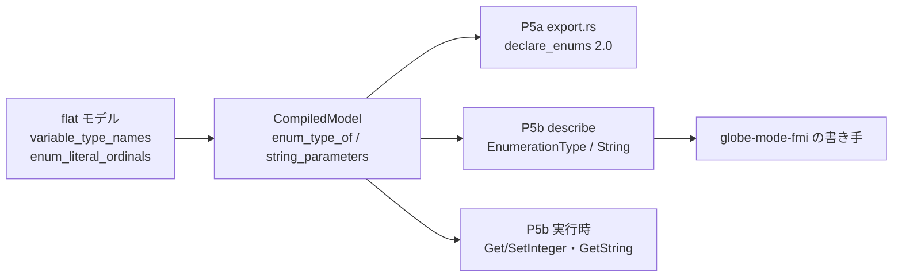

# S224 FMU の Export の型（Enumeration・String・`dependencies`）

| | |
| --- | --- |
| セッション | S224 |
| 日付 | 2026-11-08 |
| ブランチ | `feature/s224-fmu-export-types` |
| Phase | P5 |
| スライド | [slides.html](slides.html) |
| 作業記録 | `log/work/2026-11-08-s224-fmu-export-types.md` |

## 1. 目的

[roadmap](../../roadmap.md) の表「FMU の Export の残り」のうち、Enumeration・String・`dependencies` を片付ける。対象は P5a（Rumoca のテンプレート、`globe-mode-fmi/src/export.rs`）と P5b（自前のランタイム、`globe-mode-fmu`）の両方の `modelDescription.xml` と、P5b の実行時。設計は [ADR-0031](../../adr/0031-fmi-export-p5a-first.md)。Integer・Boolean の start の型（#51）と `ScalarVariable` の配列（#50）は S223 が直すので触らない。

## 2. 決定と理由

| 項目 | 決定 | 理由 |
| --- | --- | --- |
| Enumeration の型の名前とリテラル | `globe-mode-frontend` が flat モデルから取る（`CompiledModel::enum_type_of`、型 `EnumType`） | DAE は Enumeration を「ordinal の整数」としか持たず、型の名前もリテラルの名前も無い。flat の `variable_type_names` と `enum_literal_ordinals` にある。`compile_strict` の中で 1 回だけ集める |
| String のパラメータ | `CompiledModel::string_parameters`（DAE の start か束縛が文字列リテラルのスカラー） | Rumoca の `text_start` は非公開。式のもの（`label + "!"`）は含めない |
| P5a（2.0） | テンプレートの出力の `<Integer>` を `<Enumeration declaredType="…">` に書き換え、`<TypeDefinitions>`（`SimpleType`）を `<LogCategories>` の前に足す | テンプレートは改変しない（ADR-0031）。#48 の `<DefaultExperiment>` と同じ後処理。Enumeration の変数が無いモデルの XML は 1 バイトも変えない |
| P5a（3.0） | **Enumeration は Rumoca のまま（Int32）**。String は Rumoca が既に `<Start value>` で出す | 3.0 の Enumeration の getter・setter は Int64。Rumoca の fmi3 の C は `UNSUPPORTED_GET_SET(fmi3Int64, Int64)` なので、`<Enumeration>` と書くと FMPy が読めない。壊れた FMU を出すより Int32 の方がよい。C は書き換えない |
| P5b の XML | `globe-mode-fmi` の読み手と書き手に `EnumerationType`・`declared_type`・`VarType::String`/`Enumeration` を足す | 2.0 は `SimpleType`/`Enumeration`、3.0 は `EnumerationType`。3.0 の String の start は子の `<Start value>`。読み→書き→読みで同じ表になる |
| P5b の値参照 | String のパラメータも Enumeration も、既存のパラメータの枠・変数の枠に載せる（新しい値参照を作らない） | Rumoca の枠には String も 1 つ入っていた（Real の 0.0）。型と値だけ直す |
| P5b の実行時 | Enumeration は `fmi2Get/SetInteger`（3.0 は `fmi3GetInt32/SetInt32/GetInt64/SetInt64`）。範囲（1 以上リテラルの数以下）の外は Error。String は `fmi2GetString`/`fmi3GetString`。`SetString` は Error とログ | tunable な Enumeration のパラメータは `overrides` に入れて、`ExitInitializationMode` で作り直す（Real と同じ）。String は `variability="fixed"` で、.mo から決まる |
| `dependencies` | **持ち越し（書かない）** | 下の「`dependencies` を調べた結果」 |

### `dependencies` を調べた結果

出力と微分が「どの状態・入力に依存するか」を書くには、代数変数を経由した推移閉包が要る。`globe-mode-analysis` と frontend にあるのは方程式と未知数の incidence（S005 のマッチング、Dulmage–Mendelsohn 分解、代数ループ）だけで、出力ごとの依存を返す道は無い。閉包を新しく書くのは「新しい依存解析は書かない」に反するので、この項は持ち越した。`dependencies` を省くと FMI は「すべてに依存する」と読むので、書かないことは正しいが粗い（FMPy・fmusim の validate は通る）。書くときの足がかり: 方程式の出現から未知数の依存の辺を張り、マッチングで各方程式の左辺を決め、出力・微分から状態・入力・time へ辿る。

### 試して分かったこと

- Rumoca の P5a は Enumeration を `<Integer start="2">` で描く。start の値は ordinal（1 始まり）で、FMI の `Item` の `value` と同じ。
- P5b の出力 `output Speed level = speed` は、Rumoca の役割では Discrete（離散）になり、`causality` は `local`、値は事象の後まで開始値（1）のまま。初期化の事象を回さない P5b の既存の限界で、Integer・Boolean の離散の変数と同じ道。試験は読めることだけを見る。
- 型の名前は flat の短い名前（`Speed`）。同じ短い名前の型が別のパッケージにあると、リテラルの引き当てが先勝ちになる（shortcut。`export.rs` の注と `enum_types` の注）。

## 3. 図



## 4. 再現手順

```bash
export CARGO_TARGET_DIR=<main>/.git-worktree/target-shared CARGO_BUILD_JOBS=2
cargo test -p globe-mode-frontend --test enum_types
cargo test -p globe-mode-fmi
cargo test -p globe-mode-cli --test fmu_export exports_enumeration_and_string_types
cargo test -p globe-mode-fmu --test fmpy enumeration_and_string   # FMPy は uv 経由
globe fmu export src/Modelica/GlobeModeValidation -m GlobeModeValidation.Simulation.EnumString --out build
gh workflow run fmu-export.yml --ref feature/s224-fmu-export-types
```

XML の形（P5a、FMI 2.0）:

```xml
<TypeDefinitions>
  <SimpleType name="Speed">
    <Enumeration>
      <Item name="slow" value="1"/>
      <Item name="fast" value="2"/>
    </Enumeration>
  </SimpleType>
</TypeDefinitions>
…
<ScalarVariable name="speed" … causality="parameter">
  <Enumeration declaredType="Speed" start="2"/>
</ScalarVariable>
<ScalarVariable name="label" … causality="parameter">
  <String start="decay"/>
</ScalarVariable>
```

P5b の FMI 3.0:

```xml
<TypeDefinitions>
  <EnumerationType name="Speed">
    <Item name="slow" value="1"/>
    <Item name="fast" value="2"/>
  </EnumerationType>
</TypeDefinitions>
…
<Enumeration name="speed" valueReference="2" causality="parameter" variability="fixed" initial="exact" declaredType="Speed" start="2"/>
<String name="label" valueReference="3" causality="parameter" variability="fixed" initial="exact">
  <Start value="decay"/>
</String>
```

検証の結果: 作業記録の「検証」を見る。手元で、Rumoca の C を `--build` した FMI 2.0・3.0 の FMU は、FMPy の validate が問題なし、ME・CS の x(1) = 0.1353353（e⁻² との差 9e-9）。

## 5. 次回

- `dependencies`: 出力・微分ごとの依存の閉包（足がかりは 2 章）。
- P5a の FMI 3.0 の Enumeration: Rumoca の fmi3 が Int64 を実装したら `declare_enums` を 3.0 にも使う（上流に伝える種）。
- P5b の離散の出力（Discrete の役割）を `causality="output"` にし、初期化の事象を回す。
- Enumeration の `Item` の description（リテラルのコメント）、配列の Enumeration（2.0 は要素ごとの名前）、`min`・`max`。
