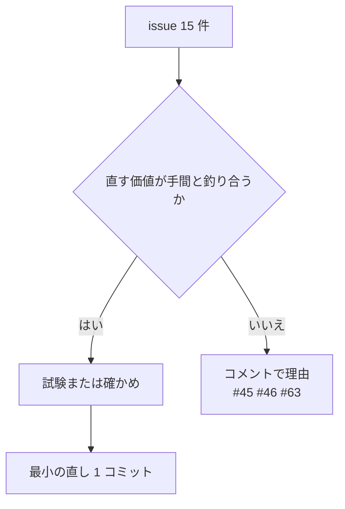

# S226 監査の「あれば良い」15 件

| | |
| --- | --- |
| セッション | S226 |
| 日付 | 2026-11-08 |
| ブランチ | `feature/s226-audit-fixes-3` |
| Phase | P3〜P7（FMU、fmt・lint、Julia・Zig、xtask、Python、CI） |
| スライド | [slides.html](slides.html) |
| 作業記録 | `log/work/2026-11-08-s226-audit-fixes-3.md` |
| 親 issue | #42（2026-11-08 の ponytail 全体監査） |

## 1. 目的

全体監査の最後の区分「あれば良い」15 件（#45・#46・#47・#53・#61・#62・#63・#65・#66・#71・#80・#81・#82・#87・#88）を、1 件ずつ「直す価値が手間と釣り合うか」で判断した。直すものは最小の直しと試験で 1 件 1 コミット（本文に `Fixes #n` と原則）、直さないものは issue にコメントで理由を書く（親が貼る）。閉じるのはユーザー。前例は [S218](../S218-audit-fixes-1/解説書.md)・[S223](../S223-audit-fixes-2/解説書.md)。

## 2. 決定と理由

| issue | 判断 | 確かめ方 | 直し | 試験 |
| --- | --- | --- | --- | --- |
| #47 イベントの 2 行の文書 | 直す | exec の `simulate.rs:245` が「数 ulp ずらして書く」と言っている | `store.rs`・`mat.rs` の文書 2 か所 | 文書だけ |
| #53 初期化の前の `Terminate` | 直す | 読んで確認。落ちる FMU は【未確認】のまま | `Common::initialized`（`ExitInitializationMode` の成功後だけ真）。drop は真のときだけ `Terminate`、`FreeInstance` は常に | `abi3::tests::terminate_only_after_initialization`（偽の関数表で呼び出し数を数える） |
| #61 `split` の死んだ分岐 | 直す | 分岐を `unreachable!` にして fmt の試験 33 本と MSL 4.1.0・`src/Modelica` の `fmt --check` を回し、0 回しか通らない | 分岐と `Element::first` を消す（-13 行） | 既存の fmt の試験（挙動が変わらない） |
| #62 function の PascalCase | 直す | した。`function f` が出る | `t.text != "function"` を足す（`pure`・`operator function` も） | `lowercase_function_names_are_not_flagged` |
| #65 Julia の ws の GC | 直す | 【未確認】のまま（タイミング依存で再現できない） | `Base.cconvert` で ws を返し、`unsafe_convert` でポインタにする。ccall は `ws` を渡す | `mise run c:julia` が通る |
| #66 Zig のパスの JSON | 直す | `\` を含むディレクトリ名で回して通る | `std.json.fmt` で埋める | `mise run c:zig`、`\` を含むパスの実行 |
| #71 `LONG` の競合 | 直す | タイミングの競合で再現できない | `LONG` を `StopTime = 1e6` にし、3 か所を揃える | `test_ui.py`（CI の full で回す） |
| #81 `fetch_zip` の古いファイル | 直す | 試験で再現 | 目印がある展開先は消してから展開（`fetch_library` と同じ） | `fetch_zip_removes_files_of_the_previous_version`（`file://` の zip を 2 版続けて取る） |
| #82 FastAPI の応答 | 直す | した。503 の本文に `GLOBE_BIN`、500 の本文に stderr | 本文は固定の短い文、詳細は `uvicorn.error` のログ | `test_missing_binary_is_503` に追記、`test_unreadable_output_is_500_without_stderr` |
| #87 クエリの実行の記録 | 直す | `take_executed` を呼ぶのは db の試験だけ（grep） | `record_executed()` で旗を立てたときだけ積む。試験の構築 9 か所で呼ぶ | `executed_queries_are_recorded_only_after_record_executed` |
| #88 段階の式が 3 つ | 直す | simulate は `response.diagnostics` が空から足すので `checked.failed_stage()` と同じ | `check` は `report.passed()`・`failed_stage()`、`checked_failed_stage` を消す | 既存の facade の試験 |
| #80 意味的な衝突 | 直す（手順の 1 項目と ci.yml の 1 行） | 読んで確認 | `finish-session` に項目を足し、`workflow_dispatch` の `full=false` の比較元を `origin/main` に（main 自身は `HEAD~1`） | `ci.yml` の手動実行（full=false と full=true） |
| #45 BDF の初期化 3 回 | 直さない | 読んで確認 | なし | なし |
| #46 lowering 2 回 | 直さない | 読んで確認（測っていない） | なし | なし |
| #63 annotation の行コメント | 直さない | した。出力は崩れるが 2 回目の整形で同じ | なし | なし |

### 直さない理由

- **#45**: 3 回目は `run_bdf` の `check_prepared_initialization`。これを外すと、初期化の失敗を「初期化」の段の診断（コードと段）として返せず、積分の失敗に混ざる。上流の `run_prepared_simulation` が初期化済みの状態を受け取る口を持つまで、こちらでは省けない。上流の候補として貯める（実測の数字も無い）。
- **#46**: issue の直し方（session の道で dopri45 を 1 回にする）は、#43（S218、[ADR-0013](../../adr/0013-exec-backend.md)）で測って取り消した案で、重いモデルが遅くなる（EngineV6 の bdf が時間切れ）。いまの 2 回は、dopri45 が `preflight_alone` と `rk45::simulate` で lowering を 1 回ずつ、auto の回し直しが段ごとに 1 回で、プリフライトと初期化の解き直し（GM-W10004）の設計から来ている。1 回にするには `rk45::simulate` が lowering 済みを受け取る上流の口が要る。この区分では測らず、手を付けない。
- **#63**: 試験の入力（`Icon(…), // a` の後に `Documentation(…)`）で、並べ替えた後ろの行コメントが次の引数の前の行に出て、字下げが崩れる。意味は変わらず、2 回目の整形で同じになる（べき等）。直し方が報告に無く、コメントを引数にぶら下げる作りの変更になるので、見た目だけのために入れない。

### #80: 構造的な防ぎは入れない

マージキューやマージ前の自動再検査は入れず、手順で足りる範囲にした。`finish-session` に「feature に最新の main を取り込み、`ci_plan.py --base <CI が通った最後の main の sha>` の `rust_packages` に自分が触っていない crate が出たら、その crate を手元か feature の CI で検査する」を足した。`ci.yml` の手動実行（`full=false`）は、`HEAD~1` でなく `origin/main` との差を見る（`ci_plan.py` は `base...head` の merge-base 比較）。main 自身の手動実行は直前のコミットのまま。

## 3. 図



## 4. 再現手順

```bash
export CARGO_TARGET_DIR=…/.git-worktree/target-shared CARGO_BUILD_JOBS=2
cargo test -p globe-mode-fmi-import --lib      # #53
cargo test -p globe-mode-fmt                   # #61 #62
cargo test -p globe-mode-db                    # #87
cargo test -p globe-mode --features fmu        # #88
cargo test -p xtask                            # #81
mise run c:julia                               # #65
mise run c:zig                                 # #66
(cd src/Python/fastapi_fmt && GLOBE_BIN=…/globe uv run pytest)   # #82
python3 .github/scripts/ci_plan.py --base origin/main --head HEAD   # #80
```

#71 は `test_ui.py`（`mise run ui:check`）で、手元では回していない。CI の run は作業記録にある。

## 5. 次回

- #45 と #46: 上流（Rumoca）に、初期化済みの状態を受け取る口と lowering 済みを受け取る口を頼む候補。まとめて測ってから。
- #63: 行コメントを引数にぶら下げる整形の作り直し（見た目だけなので優先は低い）。
- #53 の【未確認】（状態の守りが弱い FMU で実際に落ちるか）と #65 の GC の競合。
