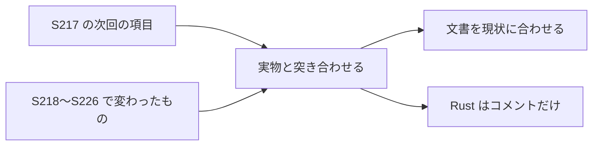

# S227 doc-stale-notes

| | |
| --- | --- |
| セッション | S227 |
| 日付 | 2026-11-08 |
| ブランチ | `feature/s227-doc-stale-notes` |
| Phase | 文書 |
| スライド | [slides.html](slides.html) |
| 作業記録 | `log/work/2026-11-08-s227-doc-stale-notes.md` |

## 1. 目的

[S217](../S217-doc-yomiyasu/解説書.md) が直せなかった食い違いと、その後の WP（S218〜S226）で古くなった記述を、内容として現状に合わせる。推敲ではないので、文は最小限だけ変える。計画の中身は変えない。

## 2. 決定と理由

| 項目 | 直したもの（前 → 後） | 理由 |
| --- | --- | --- |
| README の英語の要約 | 「Not done: FMI import」 → 「FMI import in the UI and the language APIs (CLI only for now)」。ほかに、編集の行へ plot の機能・実行の設定・FMU の書き出し、ソルバの一覧へ [msl-solvers.md](../../msl-solvers.md)、既知の限界へ [libraries.md](../../libraries.md) を足した | `globe fmu run` は CS・ME を別プロセスで回す。日本語の側（S217 で直した表）と 1 行ずつ突き合わせた |
| [ADR-0026](../../adr/0026-fmi-import-placement.md) | 「ME は設計だけ」（S204 の時点）は本文のまま、(o) を足した: S205 で ME、S210 でワーカー、S218 で展開先を親が作る（#49） | ADR は追記で扱う |
| [ADR-0023](../../adr/0023-desktop-and-web-process-layout.md) | 「`rpc` は 18 個」の下に付記: いまは 20 個（`globe/*` が 19、`textDocument/foldingRange` が 1）。(c) の 2 GiB の作り直しは S223（#69）の実装の付記がすでにあった | 数は `shell.rs` の `RPC_METHODS` を数えて正とした |
| `globe-mode-lsp` の先頭のコメント | 「`globe/format`・`globe/lint` は wasm と同じく params だけで決める」 → 設定ファイルを土台にし、indent は設定が勝つ（S143・S214） | 同じファイルの実装と食い違っていた。コメントだけ |
| [mise-setup.html](../../mise-setup.html) | 完成例を `mise.toml` の `[settings]`・`[tools]` に、タスクの例を `check`・`ci:plan`・`docs:check` に差し替えた。uv の 0.12 の記述、`uv run 20261018-globemode`、`src/main.rs` も直した | S001 のまま（uv 0.12 など）だった |
| [architecture.md](../../architecture.md) の 2.5 章 | `ci.yml` の行へ `pull_request`（使わない決め）と `full` の既定、`python` ジョブの FastAPI の試験（S218）を足した | `ci.yml` の実物と突き合わせた。`astro` ジョブは載っていた |
| [CLAUDE.md](../../../CLAUDE.md) の workflow の一覧 | 直しなし | 12 本すべてが載っている |
| [roadmap.md](../../roadmap.md) の末尾の表 | Astro の CI の行に打ち消し線と「（S223 で済）」 | MAT v4（S219）、結果を開く（S222）、折りたたみ（S220・S225）、Enumeration・String（S224）は、すでに打ち消してあった |

## 3. 図



## 4. 再現手順

```bash
export CARGO_TARGET_DIR=<main>/.git-worktree/target-shared CARGO_BUILD_JOBS=2
cargo fmt --check -p globe-mode-lsp
python3 -I .claude/skills/session-docs/check_docs.py
uv run python .claude/skills/session-docs/render_slides.py
grep -c '^    "' src/Rust/apps/desktop/src/shell.rs   # RPC_METHODS の数は shell.rs の配列を見る
```

## 5. 次回

- [mise-setup.html](../../mise-setup.html) の S001 の手順（3 章ほか）は、実行して確かめていないまま。
- README の英語の要約には、日本語の側にあるキーボードの補足（スキップリンク、未保存の印、初回の案内）を足していない。
