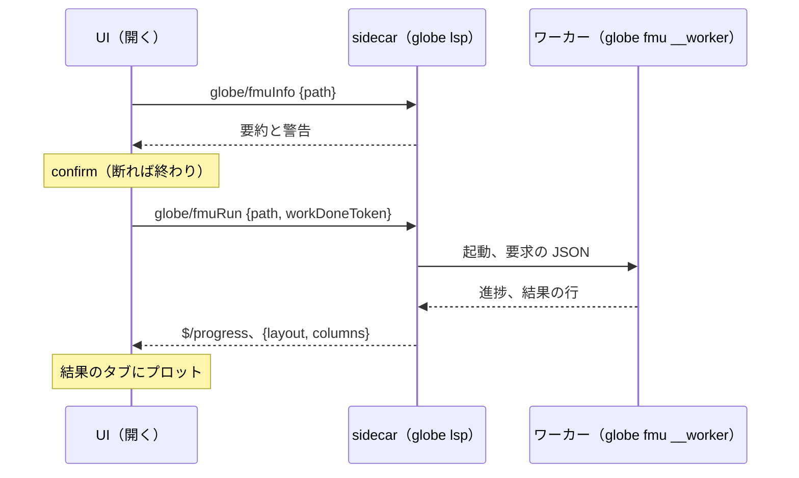

# S229 FMI Import を facade・Python・Desktop の UI へ

| | |
| --- | --- |
| セッション | S229 |
| 日付 | 2026-11-08 |
| ブランチ | `feature/s229-fmu-import-facade` |
| Phase | P5 |
| スライド | [slides.html](slides.html) |
| 作業記録 | `log/work/2026-11-08-s229-fmu-import-facade.md` |

## 1. 目的

[ADR-0026 の (k)](../../adr/0026-fmi-import-placement.md) の 3 番目。S210 までは FMI Import が CLI（`globe fmu info` / `run`）だけだった。これを Rust の facade、Python、Desktop の UI から使えるようにする。ブラウザ・Android はネイティブコードを動かせないので対象外で、UI は「Desktop だけ」と案内する。

## 2. 決定と理由

- **ワーカーの実行ファイルは呼び手が渡す**（S210 の `WorkerSpec`）。CLI と Desktop の sidecar は自分自身（`current_exe()`）、Python は `GLOBE_BIN` か PATH の `globe`（wheel に実行ファイルは入らない。見つからなければ `FmuError` が置き方を言う）。
- **facade の口は 2 つ**: `import_fmu_info` と `run_fmu`。feature `fmu-import` にした（共有ライブラリを読むので、wasm が引く `globe-mode-lsp` では既定で切る。CLI と Python が付ける）。結果の列は S222 の `OpenedResults` を使い回した。CLI の `fmu` も facade を呼ぶ形に寄せ、写しは作っていない。
- **中断**: `run_in_worker` に旗（`WorkerSpec::cancel`）を足し、親が 50 ms おきに見て kill する。進捗が出ない FMU も止まる。`worker.rs` を触ったのはこの旗と、`Kind` の JSON を `"cs"` / `"me"` にした 1 行だけ。
- **LSP**: `globe/fmuInfo`（実行前の警告を添える）と `globe/fmuRun`（`$/progress`・`$/cancelRequest`）。Desktop に新しい実行ファイルは要らない（ワーカーは sidecar と同じ `globe`）。
- **UI の確認**: 警告と要約を `confirm` に出し、承知したときだけ回す。結果は S222 の結果のタブ。ME の積分器や実験設定の入力欄は出していない。

詳しくは [ADR-0026 の (p)](../../adr/0026-fmi-import-placement.md)。

## 3. 図



## 4. 再現手順

```bash
cargo xtask fetch-reference-fmus
cargo test -p globe-mode-cli --test fmu_worker --test lsp
GLOBE_BIN=$PWD/target/debug/globe uv run pytest src/Python/tests/test_fmu.py
```

```python
from globe_mode import fmu_info, run_fmu, table

print(fmu_info("Dahlquist.fmu")["model_name"])
print(table(run_fmu("Dahlquist.fmu", stop_time=1, outputs=["x"])))
```

## 5. 次回

- C ABI・NIF からの呼び出し（(k) 3 の残り）、マスター、SE、sandbox。
- UI の実験設定の入力欄と ME の積分器の選択。
