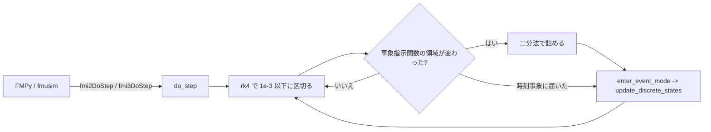

# S231 P5b の Co-Simulation（`fmi2DoStep`・`fmi3DoStep`）

| | |
| --- | --- |
| セッション | S231 |
| 日付 | 2026-11-08 |
| ブランチ | `feature/s231-fmu-export-p5b-cs` |
| Phase | P5 |
| スライド | [slides.html](slides.html) |
| 作業記録 | `log/work/2026-11-08-s231-fmu-export-p5b-cs.md` |

## 1. 目的

[roadmap](../../roadmap.md) の表「FMU の Export の残り」にある「P5b の CS」。P5b（自前のランタイム `globe-mode-fmu`）はこれまで Model Exchange だけだった。設計は [ADR-0031](../../adr/0031-fmi-export-p5a-first.md)・[ADR-0032](../../adr/0032-p5b-own-runtime.md)。同じセッションで issue #89（facade `globe-mode` が単体でビルドできない）も直した。

## 2. 決定と理由

| 項目 | 決定 | 理由 |
| --- | --- | --- |
| 積分器 | `globe-mode-fmi-import` の `ode.rs` は**再利用しない**。crate の中に古典 RK4 を 20 行ほど置く | `ode.rs` は `pub(crate)` で `Error` が Import の型。Import の crate は `libloading`・zip・tempfile を引くので、FMU の cdylib が依存すると Export のランタイムが Import の読み込みを背負う。`globe-mode-exec` に `ModelInstance` を 1 歩ずつ進める道は無い |
| 刻み | 内部の刻みは 1e-3 以下に区切る（固定）。誤差の制御なし | shortcut。Decay は 4e-15 で足りた。硬い系・速い系は上限を下げるか陰的な積分に |
| 事象 | ME と同じ。刻みごとに事象指示関数の領域を比べ、変わったら二分法で詰めて `enter_event_mode` → `update_discrete_states`。時刻事象（`sample`）は刻みを区切る | `globe-mode-fmi-import` の `me.rs` と同じ規則。`reinit` で状態が変わったら取り直す |
| `modelDescription.xml` | `model_description_kind(model, source, v3, Kind::{Me, Cs, Both})` | CS を要求されたときだけ書く。既存の `model_description`・`model_description_3` は `Me` で、出力は変わらない |
| CLI の `--kind` | **足さない** | `globe fmu export` は P5a（Rumoca のテンプレート）で、P5b を作る道が CLI に無い。P5a は ME と CS を 1 つの FMU に元から書くので、旗は何も変えない。P5b の FMU は cdylib と `examples/md.rs` で組む。Python・UI の選択肢も足していない |
| `terminate()` | 3.0 は `terminateSimulation` を真に。2.0 は伝える道（`fmi2Discard` と `fmi2GetBooleanStatus`）を実装しないので `fmi2Error` | `GetStatus` の `Discard` は未対応のまま |

### CS の入口の表

| 関数 | 対応 |
| --- | --- |
| `fmi2Instantiate(CoSimulation)`、`fmi3InstantiateCoSimulation` | ○（`eventModeUsed`・`earlyReturnAllowed` は使わない） |
| `fmi2DoStep`、`fmi3DoStep` | ○。`currentCommunicationPoint` が今の時刻と違う（巻き戻し）は `Error` |
| `fmi3EnterStepMode` | ○（何もしない。初期化の直後から Step Mode） |
| 3.0 の出力（`eventHandlingNeeded`・`earlyReturn`・`terminateSimulation`・`lastSuccessfulTime`） | 偽・偽・`terminate()` のとき真・到達した時刻 |
| `fmi2SetRealInputDerivatives`、`fmi2GetRealOutputDerivatives`、`fmi3GetOutputDerivatives` | `Error`（入力は刻みの間 0 次ホールド） |
| `fmi2CancelStep`、`fmi2GetStatus`・`GetRealStatus`・`GetIntegerStatus`・`GetBooleanStatus`・`GetStringStatus` | `Error`（`Discard` を返さないので問い合わせが要らない） |

### #89

`src/Rust/mod/globe-mode/Cargo.toml` の `serde` が optional なのに、`to_json` と options の derive が無条件で使っていた。`cargo check -p globe-mode --tests` が `E0433` で落ちるのを再現してから、`serde` を optional でなくし、`fmu` feature の `dep:serde` を外した（使う側を feature で囲むより差分が小さい）。別のコミット（`Fixes #89`）。

## 3. 図



## 4. 再現手順

```bash
export CARGO_TARGET_DIR=<main>/.git-worktree/target-shared CARGO_BUILD_JOBS=2
cargo test -p globe-mode-fmu --test fmpy -- --nocapture --test-threads=1 co_simulation model_description_kind   # FMPy は uv 経由
cargo test -p globe-mode            # #89。feature 無しで通る
cargo run -p globe-mode-fmu --example md -- src/Modelica/GlobeModeValidation/Simulation/Decay.mo GlobeModeValidation.Simulation.Decay 2 both > modelDescription.xml
gh workflow run fmu-export.yml --ref feature/s231-fmu-export-p5b-cs
```

結果（FMPy 0.3.32 の CS、debug）:

| モデル | 値 | 比べた相手 |
| --- | --- | --- |
| Decay（2.0・3.0） | x(1) = 0.3678794411714462 | e⁻¹ = 0.36787944117144233。差 4e-15 |
| BouncingBall（2.0・3.0） | h = 0.26074173、v = -0.16586914、n = 3 | exec: h = 0.26074169、v = -0.16586948、n = 3 |
| InputDecay（2.0・3.0） | x = 1.1548181217、y = 2.3096362435 | 解析解 |

## 5. 次回

- 誤差の制御（Dormand–Prince）と陰的な積分。`ode.rs` を低い crate に移して共有する案は Import の内部の変更になるので別のセッションで。
- `fmi2CancelStep`・`GetStatus`・入力の微分、`terminate()` の 2.0 での伝え方。
- P5b を作る CLI（今は cdylib と `examples/md.rs` で組む）、Python・UI の選択肢。
- FMI 3.0 の SE、Windows・macOS 向けの P5b、fmuCheck。
