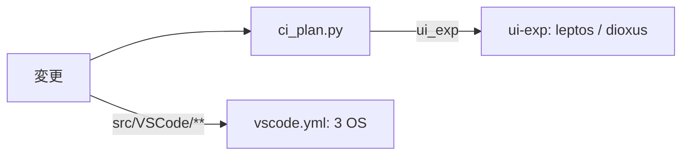

# S233 CI の穴 2 つ: VS Code の 3 OS と試験版 UI

| | |
| --- | --- |
| セッション | S233 |
| 日付 | 2026-11-08 |
| ブランチ | `feature/s233-ci-vscode-matrix-ui-exp` |
| Phase | P4・P7 |
| スライド | [slides.html](slides.html) |
| 作業記録 | `log/work/2026-11-08-s233-ci-vscode-matrix-ui-exp.md` |

## 1. 目的

[roadmap](../../roadmap.md) 末尾の表にある CI の穴を 2 つ塞ぐ。VS Code の拡張が Linux でしか試験されていないこと（P4）と、Leptos・Dioxus の試験版 UI を push の CI が見ていないこと（P7）。

## 2. 決定と理由

| 項目 | 決定 | 理由 |
| --- | --- | --- |
| `vscode.yml` | `matrix: [ubuntu, windows, macos]`、`fail-fast: false`。steps の shell は bash | Windows でも `export` や `if [ ]` を同じ書き方にするため |
| rust | 全 OS で rustup を直接使う。mise は node・pnpm だけ | Windows では mise の shim 経由の cargo が失敗した（[ADR-0006](../../adr/0006-incremental-ci.md) 周辺、ci.yml の rust-windows と同じ理由） |
| PATH | `$GITHUB_PATH` に追記 | Windows の bash に `\` の入るパスを `export` しない |
| `xvfb-run` と apt | Linux だけ | macOS・Windows にはディスプレイがある |
| e2e の user-data-dir | `mkdtemp` した短い一時フォルダ（`e2e/run.mjs`） | 試験の書き方の問題。macOS は IPC のソケットが 103 文字まで。既定の `.vscode-test/user-data` はチェックアウトの下で超えた |
| `ui_exp` | `src/Rust/apps/experimental/*` か、facade `globe-mode`（とその依存）の影響か、full | web と同じ考え方。別の workspace はルートの cargo が見ない |
| ジョブ `ui-exp` | matrix leptos・dioxus。`cargo build --locked --target wasm32-unknown-unknown` と `cargo test --locked` | trunk・dx・wasm-bindgen は回さない（表示の確認は手元の `leptos:check`・`dioxus:check`） |
| 2 つの Cargo.lock | `cargo update -w` で現状に合わせた | 新しいジョブの `--locked` が初回で見つけた。`globe-mode` に `serde` が増え、frontend に `globe-mode-fmt` が増えたのに、試験版の lock が古かった |

## 3. 図



## 4. 再現手順

```bash
python3 .github/scripts/test_ci_plan.py   # 29 件
mise run ci:plan                          # 出力に ui_exp
gh workflow run vscode.yml --ref feature/s233-ci-vscode-matrix-ui-exp
gh workflow run ci.yml --ref feature/s233-ci-vscode-matrix-ui-exp -f full=true
```

結果（拡張の実装の問題は 0 件。試験の書き方の問題が 1 件）:

| OS | 1 回目（run 42461195163） | 直し | 2 回目（run 42462400728） |
| --- | --- | --- | --- |
| ubuntu | 成功 | なし | 成功 |
| windows | 成功（e2e 5 本とも ok） | なし | 成功 |
| macos | 失敗（`listen EINVAL … 1.14-main.sock`） | `e2e/run.mjs` に短い `--user-data-dir` | 成功 |

ci.yml の full（run 42461749541）は全ジョブ成功。`ui-exp (leptos)`・`ui-exp (dioxus)` も成功。最初の run（42461197860）では `--locked` が古い Cargo.lock で落ち、上の 2 つの lock を直した。

## 5. 次回

- `ui-exp` の `cargo test` は試験版にホストの Rust の試験が無いので、ビルドの確認にとどまる。
- Windows・macOS の fmusim（FMU の Export）など、roadmap の別の CI の穴。
