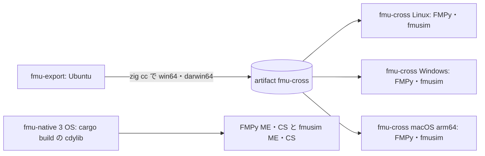

# S234 Windows・macOS 向けの FMU と fmusim

| | |
| --- | --- |
| セッション | S234 |
| 日付 | 2026-11-08 |
| ブランチ | `feature/s234-fmu-export-cross-os` |
| Phase | P5 |
| スライド | [slides.html](slides.html) |
| 作業記録 | `log/work/2026-11-08-s234-fmu-export-cross-os.md` |

## 1. 目的

[roadmap](../../roadmap.md) の表「FMU の Export の残り」にある「Windows・macOS 向けの FMU」と「Windows・macOS の fmusim」。設計は [ADR-0031](../../adr/0031-fmi-export-p5a-first.md)（P5a）と [ADR-0032](../../adr/0032-p5b-own-runtime.md)（P5b）。

## 2. 決定と理由

### 現状（着手前）と今回の差

| | 着手前 | 今回 |
| --- | --- | --- |
| P5a の作り方 | `--build --target <triple>` が `zig cc` で Linux・Windows・macOS（aarch64）の置き場を作る（S105）。`x86_64-macos` も `platform()` は通るが、確かめていない | `x86_64-macos` の Mach-O を試験で確かめる。macOS を 2 つ付けて FMI 2.0 の `darwin64` が重なるのを断る |
| P5a の実行（FMPy） | `fmu-cross` が 3 OS で ME・CS（FMI 2.0・3.0） | 同じ |
| P5a の実行（fmusim） | Linux のランナーだけ（`fmu-export` のジョブの中） | `fmu-cross` で 3 OS とも、その OS の fmusim で validate と ME・CS（macOS の 2.0 の simulate だけ飛ばす） |
| P5b の作り方 | Linux の `.so` だけ | Windows の `.dll`・macOS の `.dylib` をランナーでネイティブに（`fmu-native`）。cross はしない |
| P5b の実行（FMPy） | Linux だけ（`tests/fmpy.rs` は `cfg(linux, x86_64)`）。CS は fmusim も | `tests/fmpy.rs` の cfg を外し、OS ごとの置き場と拡張子を試験の側で決める。3 OS で ME・CS |
| P5b の実行（fmusim） | Linux の CS だけ | 3 OS で ME・CS |
| `resource_path` の Windows | S213 で `file:///C:/…` に対応済み | 変更なし（試験は S213 のまま） |

### 前後の表（OS × 道 × 種類 × 実行器）

| OS | 道 | 前 | 後 |
| --- | --- | --- | --- |
| Linux x86_64 | P5a（host の `cc`）ME・CS | FMPy・fmusim | 同じ |
| Linux x86_64 | P5b ME | FMPy | FMPy（`fmu-native` でも CI に入った） |
| Linux x86_64 | P5b CS | FMPy・fmusim | FMPy・fmusim（ME の fmusim も足した） |
| Windows x64 | P5a（zig cross）ME・CS | FMPy | FMPy・fmusim |
| Windows x64 | P5b ME・CS | 無し | FMPy・fmusim（ネイティブ） |
| macOS arm64 | P5a（zig cross）ME・CS | FMPy | FMPy（FMI 2.0・3.0）・fmusim（3.0 だけ。2.0 は fmusim 側の問題で飛ばす） |
| macOS arm64 | P5b ME・CS | 無し | FMPy（ME・CS）・fmusim（3.0 の ME・CS。2.0 は飛ばす） |
| macOS x86_64 | P5a（zig cross） | 未確認 | Mach-O の magic を試験で確かめるだけ（実行はしない） |
| macOS x86_64 | P5b | 無し | 無し |

### 結果（`fmu-export.yml`、run 42472525126、全ジョブ success）

x(1) − e⁻¹（Decay、`stop-time 1`）。FMPy の ME は −2.608e-08、CS は 3.331e-16（P5a）・3.886e-15（P5b、RK4）。fmusim の ME は −2.282e-08、CS は P5a が 3.331e-16・P5b が 3.886e-15。3 OS・FMI 2.0・3.0 とも同じ桁。`tests/fmpy.rs` は Ubuntu・Windows・macOS で 16 件通った。

### 落ちた原因と直し

| 落ちたもの | 原因 | 直し |
| --- | --- | --- |
| mise-action、fmusim の取得（run 42465688885〜42471079551） | github.com の release の直リンク（`packslip.sigstore.json`、mise 本体、fmusim）が 504 を返し続けた。API 経由の `gh release download` は通った | `fmu-cross`・`fmu-native` は mise をやめてランナーの rustup と `pipx install uv`。fmusim は `gh release download`。`fmu-export`（zig に mise が要る）は再実行で通った。ci.yml・他の workflow は触っていない |
| macOS の fmusim simulate（FMI 2.0） | fmusim 0.15.0 の arm64 版が 2.0 の FMU でも `binaries/aarch64-darwin/` を探して `dlopen failed`（P5a・P5b とも）。Linux・Windows は 2.0 の名前で見つける | FMU は規格の `darwin64` のまま。その 1 組（macOS・2.0）だけ fmusim の simulate を飛ばす（validate は通る）。fmusim 側の問題として持ち越し |

macOS x86_64 を実行しない理由は、`macos-latest` が arm64 で、fmusim の release に x86_64-darwin が無いため（GitHub の release の資産は aarch64-darwin・aarch64-linux・x86_64-linux・x86_64-windows。確認 2026-11-08）。

### 変更の中身

| 項目 | 決定 | 理由 |
| --- | --- | --- |
| `--target` の重なり | `write_fmu` が `platform()` の名前の重なりを先に断る | FMI 2.0 の `darwin64` は arch を区別しない。以前は `x86_64-macos` と `aarch64-macos` を両方付けると後のものが前を黙って上書きした（**挙動が変わる**）。3.0 は `x86_64-darwin`・`aarch64-darwin` で分かれる |
| P5b を zig で cross しない | ランナーの OS でビルド | cdylib は Rumoca と exec を静的に含み、zig の C コンパイラでは組めない。Rust の target を足して cross する道もあるが、リンカと実行器が要るので、各 OS のランナーで組むのが最小 |
| `tests/fmpy.rs` | `cfg(linux, x86_64)` を外し、cdylib の名前（`.so`・`.dll`・`.dylib`）を OS で決め、JSON の `\\` を戻す。`--release` の試験なら cdylib も release | FMPy か `uv` が無い環境は従来どおり skip する。Windows の `ci.yml`（`cargo test --workspace`）は `uv` を入れていないので skip のはず【ランナーの image は未確認】 |
| `fmpy_run.py` | 置き場（`linux64`・`win64`・`darwin64`、3.0 は `<arch>-<os>`）と拡張子を実行中の OS で決める | 同じ FMU を 3 OS で組むため |
| fmusim の取得 | OS ごとの release、sha256 は GitHub の digest | Linux は S094 で確かめた値。Windows・macOS は release の API の digest（2026-11-08） |
| 許容 | fmusim は 1e-3、FMPy は 1e-6 | fmusim の ME と CS は既定の刻みで、P5b の CS は RK4。値は run の summary に残る |

### 1 つの FMU に複数 OS（対象外）

1 つの FMU に P5b の複数 OS の置き場を同梱する道は今回は対象外。各 OS のランナーで組んだ cdylib を 1 つの zip に集める手順が要る。P5a の同梱は S105 から（`--target` を複数）。

## 3. 図



## 4. 再現手順

```bash
export CARGO_TARGET_DIR=<main>/.git-worktree/target-shared CARGO_BUILD_JOBS=2
cargo test -p globe-mode-fmi --all-features --lib export            # 重なりと platform の名前
cargo test -p globe-mode-cli --test fmu_export zig_cross -- --nocapture   # zig が要る。PE と Mach-O の先頭
cargo test -p globe-mode-fmu --test fmpy                             # FMPy（uv 経由）
gh workflow run fmu-export.yml --ref feature/s234-fmu-export-cross-os
```

## 5. 次回

- 1 つの FMU に P5b の複数 OS の置き場を同梱する手順。
- x86_64 の macOS の実行（Intel のランナー、または fmusim が配るようになったら）。
- FMI 3.0 の SE、MSL を使うモデルの Export、fmuCheck。
