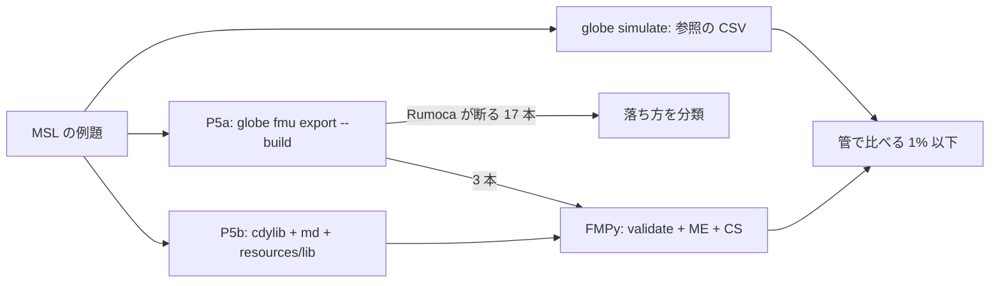

# S237 MSL を使うモデルを FMU に（P5a と P5b の測定と P5b の直し）

| | |
| --- | --- |
| セッション | S237 |
| 日付 | 2026-11-08 |
| ブランチ | `feature/s237-fmu-export-msl-models` |
| Phase | P5 |
| スライド | [slides.html](slides.html) |
| 作業記録 | `log/work/2026-11-08-s237-fmu-export-msl-models.md` |

## 1. 目的

[roadmap](../../roadmap.md) の表「FMU の Export の残り」にある「MSL を使うモデル」。Export の試験は `GlobeModeValidation`（MSL を使わない）だけだったが、利用者のモデルはほぼ MSL を使う。設計は [ADR-0031](../../adr/0031-fmi-export-p5a-first.md)（P5a は Rumoca のテンプレート）と [ADR-0032](../../adr/0032-p5b-own-runtime.md)（P5b は自前のランタイム）。

1. 現状を測る: MSL の例題 20 本を P5a と P5b で FMU にして FMPy で回し、`globe simulate` の結果と比べる。
2. 落ち方の上位のうち、GlobeMode の側で直せるものを直す。Rumoca の側の限界は上流の下書きに貯める（提出しない）。
3. 通った例題 3 本を `fmu-export.yml` に足し、試験を足す。

## 2. 決定と理由

### 測り方

| 項目 | 決めたこと | 理由 |
| --- | --- | --- |
| 20 本の選び方 | `doc/msl-sim.md` の元の JSON（実行できて参照結果の管に収まった例題）から compile の短い順。Clocked は除き、パッケージごとに 2 本まで。依頼にあった PID_Controller・ChuaCircuit・Rotational.First・TwoMasses を先頭に | Clocked の例題が上位を埋めるため。「小さい」の物差しは compile 秒数（状態の数や式の数ではない） |
| 比べ方 | `.github/scripts/fmu_msl_check.py`。`globe simulate` の CSV と FMPy の CSV の両方にある変数すべてを、`compare.rs` と同じ幅（時間・値とも 0.002）の矩形の管で比べる | 管の幅は `globe-mode-sim` に合わせた。Rust の `compare.rs` を直接呼ぶ道は CLI に無いので、同じ式を Python で書いた（簡略版: 折れ線の窓の最小・最大。イベントの行の正規化はしない） |
| 合格 | 比べた信号すべてで、管の外の点が 1% 以下。ME と CS の両方 | FMPy の ME は CVode で、exec（Rumoca の BDF）と事象の時刻が数 ms ずれる。段差の 1〜2 点が管の外に出る（PID_Controller の `PI.I.u`）。割合は JSON に残る |
| FMI の版 | 20 本は 2.0。3.0 は P5a の通った 3 本と、CI の 3 本 | 落ちる理由は版によらない（Rumoca の `fmi2`・`fmi3` が同じ検査） |

### 結果（FMI 2.0、FMPy 0.3.32、release の `globe`）

| 例題（`Modelica.` を略） | P5a（Rumoca のテンプレート） | P5b（自前のランタイム） |
| --- | --- | --- |
| Blocks.Examples.PID_Controller | 落ちた: 初期化（homotopy continuation） | 通る |
| Electrical.Analog.Examples.ChuaCircuit | 比較で外れ（カオス。3700 s まで一致） | 比較で外れ（同じ） |
| Mechanics.Rotational.Examples.First | 落ちた: 事象・関係式の根 | 通る |
| Thermal.HeatTransfer.Examples.TwoMasses | 落ちた: 初期化（rows over declaration seeds） | 通る |
| Mechanics.Translational.Examples.Accelerate | 通る | 通る |
| Mechanics.Translational.Examples.SignConvention | 通る | 通る |
| ComplexBlocks.Examples.TestConversionBlock | 落ちた: 時刻事象 | 通る |
| Electrical.Analog.Examples.ShowSaturatingInductor | 落ちた: 事象・関係式の根 | 通る |
| Mechanics.Rotational.Examples.CompareBrakingTorque | 通る | 通る |
| Thermal.FluidHeatFlow.Examples.TwoTanks | 落ちた: 実行時（`fmi2ExitInitializationMode` が Error） | 通る |
| Thermal.HeatTransfer.Examples.ControlledTemperature | 落ちた: 初期化（can only assign parameters and state starts） | 通る |
| Magnetic.FluxTubes.Examples.BasicExamples.ToroidalCoreAirgap | 落ちた: 事象・関係式の根 | 通る |
| Thermal.FluidHeatFlow.Examples.SimpleCooling | 落ちた: 事象・関係式の根 | 通る |
| Magnetic.FluxTubes.Examples.BasicExamples.ToroidalCoreQuadraticCrossSection | 落ちた: 事象・関係式の根 | 通る |
| Electrical.Batteries.Examples.SuperCapDischargeCharge | 落ちた: 初期化（rows over declaration seeds） | 通る |
| Electrical.PowerConverters.Examples.ACDC.RectifierBridge2Pulse.DiodeBridge2Pulse | 落ちた: Clock | 比較で外れ（`Math.Mean` の出力） |
| StateGraph.Examples.FirstExample | 落ちた: 初期化（can only assign parameters and state starts） | 通る |
| Electrical.PowerConverters.Examples.ACDC.RectifierCenterTap2Pulse.DiodeCenterTap2Pulse | 落ちた: Clock | 比較で外れ（`Math.Mean` の出力） |
| StateGraph.Examples.FirstExample_Variant2 | 落ちた: 初期化（can only assign parameters and state starts） | 通る |
| Blocks.Examples.DemonstrateSignalExtrema | 落ちた: Clock | 比較で外れ（最小・最大が刻みの点の値） |
| **通った本数** | **3 / 20** | **16 / 20** |

### 落ち方の分類（P5a の 17 本）

| 分類 | 本数 | 中身 |
| --- | ---: | --- |
| 事象・関係式の根・時刻事象 | 6 | Rumoca の `fmi2` の C profile は事象を扱わない（[ADR-0031](../../adr/0031-fmi-export-p5a-first.md) の限界）。原文 "only unscheduled assertions without relation memory are supported" は、when・関係式の根・assert の総称。`TestConversionBlock` だけ "cannot execute time events" |
| 初期化 | 6 | `initial equation T = T_start` などの残差の行（rows over declaration seeds）が 2、`can only assign parameters and state starts` が 3、homotopy が 1 |
| Clock | 3 | PowerConverters の `Math.Mean` の Clock 分割、`DemonstrateSignalExtrema` |
| FMU が実行時に失敗 | 1 | `TwoTanks`（`fmi2ExitInitializationMode` が Error） |
| カオスで比べられない | 1 | `ChuaCircuit`（50000 s の回路。P5a・P5b とも 3700 s までは管に収まり、以降は積分器の差が増幅される） |

外部 C 関数・`ModelicaStandardTables`・文字列・配列・record・関数呼び出し・`der` の連鎖・`noEvent`・`smooth` で落ちたものは、この 20 本には無い（外部関数と表は、小さい順に選ぶと出てこない。大きい例題で測るのは持ち越し）。

### 直したもの（GlobeMode の側。Rumoca は改変していない）

P5a の落ちる 17 本は Rumoca が書き出しを断る。**P5b は MSL を読めなかった**（`Checker::new(&[])`）ので、P5b の側を直した。

| # | 直したもの | 再現した形 | 効いた例題 |
| ---: | --- | --- | --- |
| 1 | FMU の `resources/lib/` に入れた `*.mo` を `MODELICAPATH` として読む（`compile_in`、`model_description_lib`、`examples/md.rs` の 5 番目の引数、`fmpy_run.py` の 10 番目） | `Checker::new(&[])` で MSL のクラスが解決できない | 16 本すべての前提 |
| 2 | 関係式の記憶を初期化の点から決める（`ModelInstance::new`。Rumoca の FMI ME の `exit_initialization_mode` と同じ順） | `der(w) = -100 * (if abs(w) >= 1 then sign(w) else w)` で w(0) = 100 のとき、FMU は false の枝から始まり w が指数で減った（`noEvent` を付けると正しい）。単体の試験 `relation_memory_starts_from_the_initial_point` | CompareBrakingTorque、PID_Controller ほか |
| 3 | 初期化の事象を回す（`apply_projected_initial_event_boundary`）。S099 以来の shortcut を外した | StateGraph の `transition1.condition` が 0 で始まり、離散の状態が 1 s ずれた | FirstExample、Variant2、ControlledTemperature |
| 4 | 事象で決まった離散の値（solver の y の状態でない欄）を `held_y` に保つ | 状態から y を作り直すと離散の値が初期値に戻る。ただし単純な `Mean` では再現せず、DiodeBridge の `Mean` には効かなかった | 先回りの直し（微分が離散の Real を読む形） |
| 5 | `$formal_derivative.1.x` のような内部の名前を `'…'` で囲む | FMPy の validate が "No terminal matches '$'" と断った | PID_Controller、First、Accelerate、ToroidalCore ほか |

`EnumString` の出力 `level` は、初期化の事象を回すと最初から `speed` と同じ値になる（`fmpy.rs` の期待を 1 から 2 に直した。以前は「初期化の事象は回さない。P5b の限界」と書いてあった）。

### 直さずに残したもの

- **P5b の 4 本**: `ChuaCircuit`（カオス）、`DemonstrateSignalExtrema`（`SignalExtrema` の最小・最大は積分器の刻みの点の値なので、刻みの違いで 0.2〜0.4% ずれる。FMU の欠陥ではない）、`DiodeBridge2Pulse`・`DiodeCenterTap2Pulse`（状態事象の多い回路の中の `Math.Mean`（`when sample`）の出力が、`reinit` を挟んだ事象の間で保たれない。定数入力の `Mean` は通る。原因は未調査）。
- **P5a の 17 本**: Rumoca の限界。ふつうのモデルが当たる初期化の 1 件（状態への `initial equation`）を [上流の下書き 35](../../research/upstream/35-fmi-c-profile-initial-equation-on-state.md) に貯めた（英語 `.md` ・`.mo`・日本語 `_jp.md`・スライド 1 枚 `_jp.html`。提出しない）。事象は元から ADR-0031 に書いてある限界、Clock は `[capabilities] clocks` の宣言どおり。
- **shortcut**: MSL の `.mo` を全部 FMU に入れる（`Resources/` は除く。zip で約 5 MB、instantiate のたびに MSL を読む。ME・CS・validate で 1 本 約 1 分）。使うクラスの閉包に絞る（`globe-mode-frontend` の `deps_closure`）のは持ち越し。P5b を作る CLI は無いまま（cdylib と `examples/md.rs` と zip で組む）。

## 3. 図



## 4. 再現手順

```bash
export CARGO_TARGET_DIR=<main>/.git-worktree/target-shared CARGO_BUILD_JOBS=2
cargo build --release -p globe-mode-cli
cargo build --release -p globe-mode-fmu --lib --example md
uv venv .venv-s237 && uv pip install --python .venv-s237/bin/python fmpy numpy
# P5a
.venv-s237/bin/python .github/scripts/fmu_msl_check.py --globe target/release/globe --lib data/msl --out work MODEL...
# P5b
.venv-s237/bin/python .github/scripts/fmu_msl_check.py --globe target/release/globe --lib data/msl --out work5b \
  --p5b target/release/libglobe_mode_fmu.so target/release/examples/md MODEL...
cargo test --release -p globe-mode-fmu --test fmpy -- --test-threads=1          # data/msl があれば MSL の 1 本も
cargo test -p globe-mode-cli --test fmu_export                                 # data/msl があれば MSL の 2 本も
gh workflow run fmu-export.yml --ref feature/s237-fmu-export-msl-models        # MSL の 3 本を fmusim でも
```

CI の結果（2026-11-08）: `fmu-export.yml` の run 42494360236 が success。MSL の step は P5a の FMI 2.0・3.0 と P5b の 2.0 の 3 本（Accelerate・SignConvention・CompareBrakingTorque）と P5b の 3.0 の Accelerate が FMPy の ME・CS で ok。fmusim は Accelerate の FMU 4 つ（P5a の 2.0・3.0、P5b の 2.0・3.0）の validate が通り、`mass.s(1)` は P5a が ME 1.0000407・CS 1.0、P5b が ME 1.0000005・CS 1.0（解析解 1）。`ci.yml -f full=true` の run 42494363197 は success。

## 5. 次回

- P5b を作る CLI（`globe fmu export --runtime p5b` のような旗）と、使うクラスの閉包だけを `resources/lib` に入れる絞り込み。
- `Math.Mean` が状態事象の多い回路で保たれない原因（`DiodeBridge2Pulse`）。
- 大きい例題（外部 C 関数・`ModelicaStandardTables`・文字列・配列・record）で同じ測定を回す。
- 上流の下書き 35 に初期化の残り 2 つのメッセージの最小のモデルを足す。
