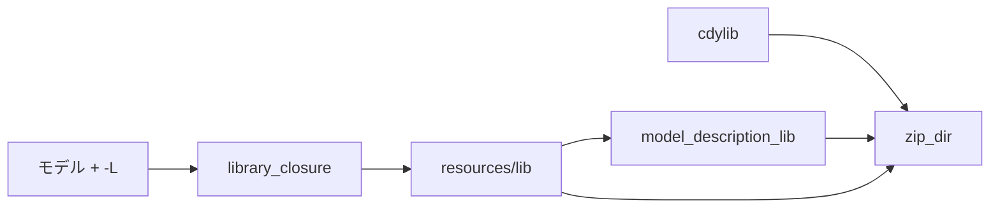

# S238 `fmu-export-p5b-cli`: P5b の FMU を CLI で作る

## 1. 目的

S237 の持ち越し 2 つ。[ADR-0031](../../adr/0031-fmi-export-p5a-first.md) の S238 の追記に決定をまとめた。

1. P5b（自前の実行時 `globe-mode-fmu`）の FMU を `globe fmu export --runtime p5b` で作る。今までは cdylib・`examples/md.rs`・zip を手で組んでいた（`fmu-export.yml` も）。
2. MSL の `.mo` を全部同梱する（約 5 MB、instantiate のたびに再解析）のをやめ、使うファイルだけにする。

## 2. 決定と理由

| 項目 | 決めたこと | 理由 |
| --- | --- | --- |
| 旗 | `--runtime p5a\|p5b`（既定 p5a）、`--runtime-lib <path>` | 既存の `--kind`（`fmu run`）・`--target` と同じ `ValueEnum` と `Vec`/`Option` の作り。`--kind` は足さない（P5b は ME と CS を 1 つの FMU に書く） |
| cdylib の入手 | `--runtime-lib` があればそれ、無ければ `cargo build --release -p globe-mode-fmu --lib` をその場で呼ぶ（案 (b)）。作れなければ理由と案内を出して終了コード 2 | `--build` が `cc`・`zig` を呼ぶのと同じ扱いで最小。(a) の静的な組み込みは cdylib が `globe` と同じ crate 群を別にリンクするので循環し、`globe` が約 44 MB 太る。(c) の配布物への同梱は `release.yml` を変える割に手元の `globe` では使えない |
| 置き場 | host の OS だけ（`binaries/linux64`・`win64`・`darwin64`、3.0 は `<arch>-<os>`） | P5a の `platform` を共有。各 OS のネイティブは S234 で済んでいる（cross はしない） |
| `modelDescription.xml` | 出力する `resources/lib` から `model_description_lib` で作る | 出した FMU が instantiate できる証拠になる。足りないクラスがあればここで断る |
| 絞り込み | `globe-mode-frontend::library_closure`（S037 の分割読み込みの閉包） | `globe deps`（`deps_closure`）はワークスペースの単純名の一致で、MSL では 1070 / 2556 ファイル（11 MB）。分割読み込みの閉包は 293 |
| 展開先の守り | P5a と同じ `check_out_root`（S212、#23）。作りかけは消す | 利用者のフォルダを消さない |
| モデルの与え方 | 1 つの `.mo`、または `-L` のライブラリの中のクラス | 実行時が `resources/` の `.mo` を 1 つだけ読むため（shortcut） |

### 測定（`Modelica.Mechanics.Translational.Examples.Accelerate`、FMI 2.0、release）

| | S237 | S238 |
| --- | ---: | ---: |
| `resources/lib` のファイル | 2556 | 293（CompareBrakingTorque は 296） |
| 大きさ（未圧縮 / zip の中） | 15.3 MB / 3.9 MB | 3.3 MB / 0.53 MB |
| `globe fmu run`（instantiate + CS 1 s） | 8.1 s | 1.2 s |
| FMU 全体 | 18.8 MB | 14.9 MB |

目標の「数十〜数百 KB」には届かなかった。閉包の単位が**ファイル**で、1 ファイルに多くのクラスがある（`Rotational/Components.mo` など）ためで、クラス単位に刻むのは持ち越し。FMU 全体の大半は strip 前の cdylib（約 14 MB）。

### MSL の 20 本（FMI 2.0、FMPy 0.3.32、`globe fmu export --runtime p5b`）

16 / 20 が通った（S237 と同じ）。落ちる 4 本も同じ: ChuaCircuit（カオス）、DemonstrateSignalExtrema（刻みの点）、DiodeBridge2Pulse・DiodeCenterTap2Pulse（`Math.Mean`）。絞り込みで足りないクラスが出た例題は無い。

## 3. 図



## 4. 再現手順

```bash
export CARGO_TARGET_DIR=<main>/.git-worktree/target-shared CARGO_BUILD_JOBS=2
cargo build --release -p globe-mode-cli
cargo build --release -p globe-mode-fmu --lib
target/release/globe fmu export -L data/msl -m Modelica.Mechanics.Translational.Examples.Accelerate \
  --out out --runtime p5b --runtime-lib target/release/libglobe_mode_fmu.so
target/release/globe fmu run out/Modelica_Mechanics_Translational_Examples_Accelerate-p5b-fmi2.fmu --stop-time 1
python .github/scripts/fmu_msl_check.py --globe target/release/globe --lib data/msl --out work5b \
  --p5b target/release/libglobe_mode_fmu.so MODEL...
cargo test -p globe-mode-cli --test fmu_export p5b
```

CI の結果（2026-11-09）: `fmu-export.yml` run 42501030245 が success（MSL の step は P5b を CLI で作る。`fmu-native` の 3 OS は `--runtime p5b` が cargo で共有ライブラリを作る経路）。`ci.yml -f full=true` run 42501039677 が success。

## 5. 次回

- 閉包をクラス単位に刻む（`resources/lib` を数百 KB 以下に）。cdylib の strip。
- Python（`export_fmu` の `runtime=`）と UI（Export の選択肢）。
- 複数ファイルのモデル（実行時が `resources/` の複数の `.mo` を読む）。
- P5b の 4 本（S237 から）。
