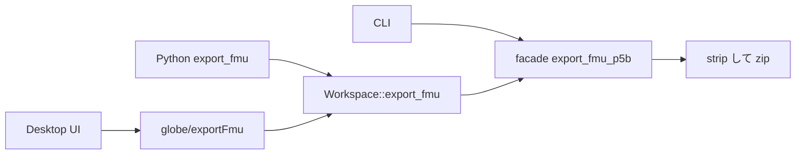

# S239 `fmu-export-p5b-surfaces`: P5b の Export を CLI 以外の面へ

## 1. 目的

S238 の持ち越し。P5b（自前の実行時 `globe-mode-fmu`）の FMU の書き出しを、CLI だけでなく facade・Python・LSP・Desktop の UI から呼べるようにする。あわせて FMU の大きさ（strip 前の cdylib）と MSL の LICENSE。決定は [ADR-0031](../../adr/0031-fmi-export-p5a-first.md) の S239 の追記。

## 2. 決定と理由

| 項目 | 決めたこと | 理由 |
| --- | --- | --- |
| 本体の場所 | `globe-mode-cli/src/fmu_p5b.rs` の本体を facade `globe-mode` の `export_fmu_p5b`（feature `fmu-p5b`）へ。CLI は引数を読んで終了コードにするだけ | 写しを作らない。Python・LSP・UI が同じ関数を呼ぶ |
| feature | `fmu-p5b = ["fmu", "dep:globe-mode-fmu"]`。CLI・Python が付け、LSP は feature `fmu-p5b`（CLI が付ける）を持つ。wasm は付けない | cargo か共有ライブラリが要り、wasm32 では動かない。付けない版は理由つきの `Err` |
| 設定 | `FmuOptions` に `runtime: FmuRuntime`（`p5a` 既定 / `p5b`）と `runtime_lib: Option<PathBuf>`。JSON の鍵も同じ | C ABI・NIF・Python が同じ `from_json` を共有しているので、鍵を足すだけで全部に届く |
| ワークスペースから | `Workspace::export_fmu` は `p5b` なら `deps_closure` のファイルが 0 個＝ライブラリの中のクラス、1 個＝その本文、2 個以上＝断る。ライブラリは `with_libraries` に渡されたパスを `Workspace` が持つ | CLI の shortcut（1 つの `.mo` か `-L` の中のクラス）と同じ |
| 誤り | `P5bError::{Usage, Failed}`。CLI は 2 と 1 | S238 の終了コードを変えない |
| Python | `export_fmu(..., runtime="p5a", runtime_lib=None)`。作れなければ `ExportError` | 既存の例外の階層。`_native.pyi` は options の JSON のままで変わらない |
| LSP | `globe/exportFmu` に `runtime`・`runtimeLib`。p5a・p5b 以外は -32602 | 許可する rpc の名前は同じなので Desktop の `shell.rs` は変えない |
| UI | Desktop だけ「実行時」select。ブラウザ・Android には出さない | cdylib を作れない。Desktop の sidecar は `cargo build` を呼ぶので、globe のソースの作業ツリーの外では理由つきで失敗する |
| strip | zip に入れる写しを strip（Linux `strip`、macOS `strip -x`、Windows は無し。無ければそのまま）。`runtime_lib` で渡されたファイルは触らない | 14 MB の大半が strip 前のシンボル |
| LICENSE | `-L` のルートの `LICENSE` を `resources/lib/LICENSE` に写す | MSL の `.mo` を再配布するので BSD-3-Clause の表示を付ける |

### 測定（Linux x86_64、release の `globe-mode-fmu`）

`GlobeModeValidation.Simulation.Decay`（FMI 2.0、`-L src/Modelica`、`resources/lib` は 1 ファイル）。strip 前の値は同じ共有ライブラリを deflate した大きさから求めた。

| | strip 前 | strip 後 |
| --- | ---: | ---: |
| 共有ライブラリ（未圧縮） | 44.5 MB | 33.1 MB |
| 共有ライブラリ（zip の中） | 14.3 MB | 12.8 MB |
| FMU 全体 | 14.3 MB | 12.9 MB |

シンボルは減るが、中身の大半はコード（Rumoca の parser・lowering と実行系）なので 1 割ほどしか縮まない。数 MB 以下にするには cdylib 自体を小さくする（`opt-level = "s"`・LTO・panic = abort など）別の仕事が要る。strip した FMU は `globe fmu run` で x(1) = 0.36788（e⁻¹）。

## 3. 図



## 4. 再現手順

```bash
export CARGO_TARGET_DIR=<main>/.git-worktree/target-shared CARGO_BUILD_JOBS=2
cargo build --release -p globe-mode-cli -p globe-mode-fmu
target/release/globe fmu export src/Modelica/GlobeModeValidation -m GlobeModeValidation.Simulation.Decay \
  --out out --runtime p5b --runtime-lib target/release/libglobe_mode_fmu.so
cargo test -p globe-mode --features fmu-p5b --test fmu_p5b
cargo test -p globe-mode-lsp --features fmu-p5b export_fmu
uv run pytest src/Python/tests/test_api.py -k p5b
uv run python src/Svelte/tests/test_ui.py
```

{CI}

## 5. 次回

- 閉包をクラス単位に刻む（`resources/lib` を数百 KB 以下に）。
- 配布物に cdylib を同梱する（Desktop が作業ツリー無しで P5b を書けるように）。
- 複数ファイルのモデル、host 以外の OS の P5b、FMI 3.0 の SE。
