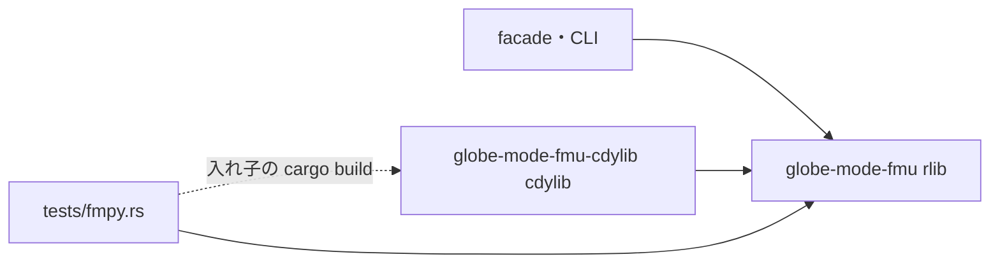

# S240 `fmu-cdylib-split`: FMU の共有ライブラリを別 crate に

## 1. 目的

S239 の持ち越し。facade が cdylib 兼 rlib の `globe-mode-fmu` に依存したため、試験の入れ子の `cargo build` が rlib を書き換え、doctest が E0460 / E0463 で落ちて 5 crate に `doctest = false` を置いた（[S239 の解説書](../S239-fmu-export-p5b-surfaces/解説書.md)）。cdylib を別 crate に出して構造で直す。決定は [ADR-0031](../../adr/0031-fmi-export-p5a-first.md) の S240 の追記。

## 2. 決定と理由

| 項目 | 決めたこと | 理由 |
| --- | --- | --- |
| `globe-mode-fmu` | crate-type を rlib だけにする。本体も `extern "C"` の入口（`fmi2*`・`fmi3*`、約 1100 行が `Instance` の内部を使う）もここに残す | 入口は private な `Instance` と密なので、別 crate へ移すと公開面が増える。`tests/fmpy.rs` が入口を rlib から直接呼ぶ |
| `globe-mode-fmu-cdylib`（新） | crate-type は cdylib だけ。`lib.rs` は `pub use globe_mode_fmu::*;` の 1 行 | 上流の `#[no_mangle]` の入口は共有ライブラリから出る（`nm -D` で `fmi2*`・`fmi3*` の 119 個）。facade は rlib にだけ依存するので、入れ子の `cargo build -p globe-mode-fmu-cdylib` が facade の依存を書き換えない |
| 共有ライブラリの名前 | `libglobe_mode_fmu_cdylib.so`・`globe_mode_fmu_cdylib.dll`・`libglobe_mode_fmu_cdylib.dylib` | rlib と同じ lib 名にすると同じ出力名になる。FMU の中は今まで通り `binaries/<os>/globe_mode_fmu.<拡張子>`（`modelIdentifier` のため、facade が写すときに名前を付ける） |
| 入れ子の build | `tests/fmpy.rs`、CLI の試験、facade の `build_runtime`、`fmu-export.yml`、Python と CLI の説明は `-p globe-mode-fmu-cdylib` | 共有ライブラリを作るのはこの crate だけ |
| doctest | facade・`globe-mode-c`・`-lsp`・`-py`・`-wasm` の `doctest = false` を外す（`globe-mode-nif` は元から false） | 原因を除いた |
| `ci_plan.py` | 依存の表は `Cargo.toml` から読むので変えない。`test_ci_plan.py` の期待に新しい crate を足した | `globe-mode-fmu` の変更で `globe-mode-fmu-cdylib` も回る |

## 3. 図



## 4. 再現手順

```bash
export CARGO_TARGET_DIR=<main>/.git-worktree/target-shared CARGO_BUILD_JOBS=2
cargo build -p globe-mode-fmu-cdylib
nm -D $CARGO_TARGET_DIR/debug/libglobe_mode_fmu_cdylib.so | grep -c ' T fmi[23]'   # 119
cargo test --workspace   # 2 回続けて（2 回目も doctest が通る）
cargo test --release -p globe-mode-fmu --test fmpy
```

## 5. 次回

- 閉包のクラス単位化、配布物への cdylib の同梱、cdylib の大きさ（`opt-level`・LTO）。
