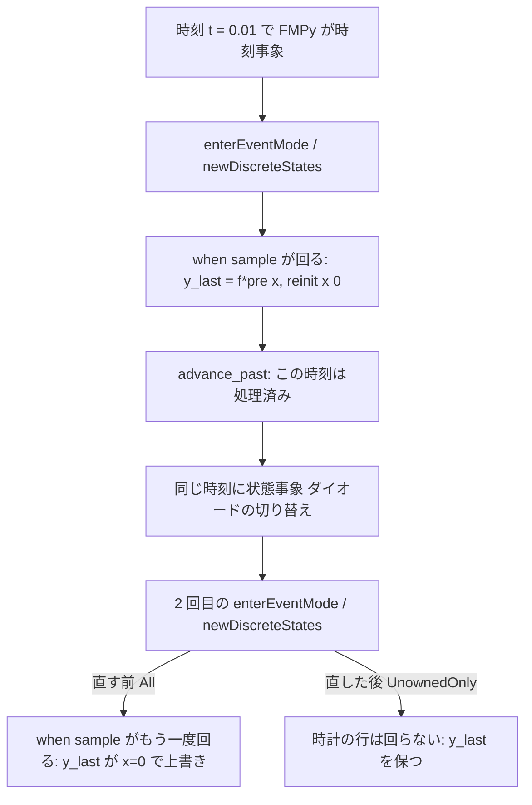

# S246 `p5b-discrete-hold`: P5b の時刻事象と状態事象が同じ時刻に重なったときの離散値

| | |
| --- | --- |
| セッション | S246 |
| 日付 | 2026-11-09 |
| ブランチ | `feature/s246-p5b-discrete-hold` |
| Phase | P5 |
| スライド | [slides.html](slides.html) |
| 作業記録 | `log/work/2026-11-09-s246-p5b-discrete-hold.md` |

## 1. 目的

[S237](../S237-fmu-export-msl-models/解説書.md) から残っていた P5b（`globe-mode-fmu`）の MSL の例題 4 本の落ちのうち、`Math.Mean` の出力が保たれない 2 本（`DiodeBridge2Pulse`・`DiodeCenterTap2Pulse`）と、`DemonstrateSignalExtrema` の極値のずれを、再現してから直す。決定は [ADR-0031](../../adr/0031-fmi-export-p5a-first.md) の S246 の追記。

## 2. 決定と理由

### 2 件の原因

| 例題 | 原因（差の出た 1 歩） | 直し |
| --- | --- | --- |
| `DiodeBridge2Pulse`・`DiodeCenterTap2Pulse`（`Math.Mean`） | `Mean` は `when sample(t0 + 1/f, 1/f) then y_last = f*pre(x); reinit(x, 0)`。整流器の電圧が 0 を横切る時刻は `sample` の時刻（0.01 の倍数）と重なる。FMPy の ME はまず時刻事象（`y_last` を取って `x` を 0 に戻す）、続けて同じ時刻にもう 1 回、状態事象でダイオードの切り替えの事象を回す。2 回目の `fmi2NewDiscreteStates` が Rumoca の `apply_projected_event_update` に `EventUpdateRowFilter::All` を渡していたので、時計の行（`when sample` の中）がもう 1 度回り、`y_last = f*pre(x)` が `reinit` の後の x（-5e-18）で書き直された（99.03 が -5e-16 に落ち、次の標本まで戻らない）。`globe simulate`（Rumoca の host）は同じ時刻の 2 回目の事象で、時刻事象が処理済みなら時計の行を回さない | `ModelInstance::update_discrete_states`（`globe-mode-exec/src/rumoca/instance.rs`。P5b の FMU だけが使う）で、`SolveStopSchedule::scheduled_event_coincidence_at(t)` が「処理済み」を返すときは `EventUpdateRowFilter::UnownedOnly`（時計の行を回さない）にする。Rumoca の FMI ME の `StateTimeCoincidence::Consumed` と同じ判断 |
| `DemonstrateSignalExtrema` | FMU の欠陥ではない。`u = A(t) sin(phi)`（`phi` は積分した状態、約 220 rad）の標本の値が、積分器の誤差で動く。解析解（`phi = 2π(55t + 45/(2π77) sin(2π77t))`）の t = 0.64 の `y_max` は 4.648119。exec の BDF（参照）は 4.633220（0.32% 低い）、FMPy の ME（CVode、相対許容 1e-6）は 4.650760（0.06% 高い）、P5b の FMU を FMPy の ME で相対許容 1e-10 にすると 4.648122、CS（P5b 自身の RK4）では 4.648119 で、解析解に 7 桁以上合う | 直さない。管（0.2%）で比べる限り、参照の側が管の外にあるので `fmu_msl_check.py` の許容は広げない（理由を ADR に書いた） |

### 再現した最小のモデル

| 項目 | 内容 |
| --- | --- |
| 試験 | `fmpy_matches_exec_on_sample_at_zero_crossing`（`tests/fmpy.rs`）。モデルは `GlobeModeValidation.Simulation.SampleAtZeroCrossing`: `u = if s > 0 then s else 0`（`s = sin(2π50t)`）を `der(x) = u` で積分し、`when sample(t0 + 0.01, 0.01)` で `yLast = f*pre(x); reinit(x, 0)`（`Mean` と同じ形） |
| 直す前 | StopTime 0.015 で FMPy の ME は `yLast = -1.1e-20`（exec は 0.6365） |
| 直した後 | ME（FMI 2.0・3.0）0.6355、CS 0.6366（解析解 0.63662）。管の許容は 5e-3 |
| 再現しなかった形 | 状態事象を `when {s < 0, s > 0}` の計数にして `cos(…(time - 1e-9))` のようにずらした形や、時刻と正確に重ねた形では、直す前でも `yLast` が壊れなかった（正確に重ねると FMPy の事象が 11 回に減って 1 回にまとまる。ずらした形の理由は未調査）。壊れたのは、時刻事象の直後に同じ時刻の許容の内側で状態事象の根が見つかる形（整流器の `if s > 0`）だけ |

### 20 本の表（FMI 2.0、FMPy 0.3.32、`--runtime p5b`、release）

release の `globe` と `libglobe_mode_fmu_cdylib.so` で `fmu_msl_check.py --p5b` を 20 本とも ME・CS で回した（1 本 1〜2 分）。S237 との差は 2 本だけで、ほかの 16 本は直す前と同じく通った（直しの副作用は無い）。

| 例題（`Modelica.` を略） | S237 の P5b | S246 の P5b |
| --- | --- | --- |
| Blocks.Examples.PID_Controller | 通る | 通る |
| Electrical.Analog.Examples.ChuaCircuit | 比較で外れ（カオス） | 比較で外れ（カオス。変わらない） |
| Mechanics.Rotational.Examples.First | 通る | 通る |
| Thermal.HeatTransfer.Examples.TwoMasses | 通る | 通る |
| Mechanics.Translational.Examples.Accelerate | 通る | 通る |
| Mechanics.Translational.Examples.SignConvention | 通る | 通る |
| ComplexBlocks.Examples.TestConversionBlock | 通る | 通る |
| Electrical.Analog.Examples.ShowSaturatingInductor | 通る | 通る |
| Mechanics.Rotational.Examples.CompareBrakingTorque | 通る | 通る |
| Thermal.FluidHeatFlow.Examples.TwoTanks | 通る | 通る |
| Thermal.HeatTransfer.Examples.ControlledTemperature | 通る | 通る |
| Magnetic.FluxTubes.Examples.BasicExamples.ToroidalCoreAirgap | 通る | 通る |
| Thermal.FluidHeatFlow.Examples.SimpleCooling | 通る | 通る |
| Magnetic.FluxTubes.Examples.BasicExamples.ToroidalCoreQuadraticCrossSection | 通る | 通る |
| Electrical.Batteries.Examples.SuperCapDischargeCharge | 通る | 通る |
| Electrical.PowerConverters.Examples.ACDC.RectifierBridge2Pulse.DiodeBridge2Pulse | 比較で外れ（`Math.Mean` の出力） | **通る** |
| StateGraph.Examples.FirstExample | 通る | 通る |
| Electrical.PowerConverters.Examples.ACDC.RectifierCenterTap2Pulse.DiodeCenterTap2Pulse | 比較で外れ（`Math.Mean` の出力） | **通る** |
| StateGraph.Examples.FirstExample_Variant2 | 通る | 通る |
| Blocks.Examples.DemonstrateSignalExtrema | 比較で外れ（最小・最大） | 比較で外れ（参照の積分誤差。FMU は解析解に合う） |
| **通った本数** | **16 / 20** | **18 / 20** |

## 3. 図



## 4. 再現手順

```bash
export CARGO_TARGET_DIR=<main>/.git-worktree/target-shared CARGO_BUILD_JOBS=2
cargo build --release -p globe-mode-cli -p globe-mode-fmu-cdylib
uv venv ~/.cache/globe-mode-s246/venv && uv pip install --python ~/.cache/globe-mode-s246/venv/bin/python fmpy numpy
P=Modelica.Electrical.PowerConverters.Examples.ACDC
~/.cache/globe-mode-s246/venv/bin/python .github/scripts/fmu_msl_check.py --globe target/release/globe --lib data/msl --out work \
  --p5b target/release/libglobe_mode_fmu_cdylib.so $P.RectifierBridge2Pulse.DiodeBridge2Pulse $P.RectifierCenterTap2Pulse.DiodeCenterTap2Pulse
cargo test --release -p globe-mode-fmu --test fmpy -- --test-threads=1
gh workflow run fmu-export.yml --ref feature/s246-p5b-discrete-hold
```

## 5. 次回

- 状態事象が先に見つかり、時刻事象があとから来る順（Rumoca の `StateTimeCoincidence::Unconsumed`）は、P5b の FMU では 1 つの事象としてまとめていない（FMPy が先に時刻事象を回す形しか見ていない）。当たる例題が出たら同じ部品で足す。
- `DemonstrateSignalExtrema` を FMU の試験に入れるなら、参照を解析解にするか、ME の許容を 1e-10 にした比べ方が要る（管の比べ方は変えていない）。
- 大きい例題（外部 C 関数・`ModelicaStandardTables`・文字列・配列・record）の測定は S237 から持ち越し。
