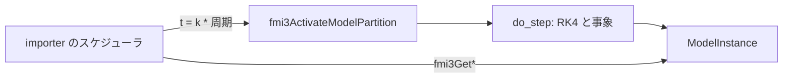

# S251 FMI 3.0 Scheduled Execution の Export（最初の一切れ）

| | |
| --- | --- |
| セッション | S251 |
| 日付 | 2026-11-14 |
| ブランチ | `feature/s251-fmi3-se-export` |
| Phase | P5 |
| スライド | [slides.html](slides.html) |
| 作業記録 | [2026-11-14-s251-fmi3-se-export.md](../../../log/work/2026-11-14-s251-fmi3-se-export.md) |

## 1. 目的

[ADR-0031](../../adr/0031-fmi-export-p5a-first.md) の持ち越し「FMI 3.0 の SE の Export」の最初の一切れ。クロックの無い連続モデルを、周期 Clock 1 つ・パーティション 1 つの SE の FMU として出せるかを調べ、出せるなら作る。調査は [research/fmi3-se-export-2026-11-14.md](../../research/fmi3-se-export-2026-11-14.md)。

## 2. 決定と理由

| 項目 | 決定 | 理由 |
| --- | --- | --- |
| 出す場所 | P5b（`globe-mode-fmu`）だけ | Rumoca の `fmi3` テンプレート（P5a）に SE は無い。P5b は CS の `do_step` をそのまま使える |
| パーティション | 周期 Clock 1 つ（`constant`、`priority="1"`） | SE は Clock ごとにパーティションを公開する。`priority` は SE で必須 |
| `fmi3ActivateModelPartition` | 前の時刻から `t` まで CS の `do_step` で進める | SE は「`ActivateModelPartition` が実際の計算をする」（仕様）。事象も中で回る |
| Clock の値参照 | 変数の最後（`time` の次） | 変数表の値参照と重ならない。modelDescription とランタイムが同じ式で出す |
| 周期 | `experiment(Interval)`、無ければ 0.01 | 最小。Clock を複数にするとき広げる |
| 口 | `globe fmu export --runtime p5b --fmi-version 3 --kind se`（facade の `FmuOptions.kind`、JSON `"se"`） | 既存の旗の流儀。2.0・p5a と組み合わせると断る |
| 検査 | FMPy の validate と `FMU3ScheduledExecution` | fmusim（v0.15.0・v0.16.0）は ME・CS だけで SE を回せない |

## 3. 図



## 4. 再現手順

```bash
export CARGO_TARGET_DIR=<main>/.git-worktree/target-shared CARGO_BUILD_JOBS=2
cargo test -p globe-mode-fmu --test fmpy -- scheduled model_description_se
cargo test -p globe-mode --features fmu-p5b --test fmu_p5b
```

検証の結果（数字）:

- Decay（SE、周期 0.01、FMPy）: x(1) = 0.3678794411714461（e⁻¹ = 0.36787944117144233、差 4e-15）。
- BouncingBall: h = 0.26074173、v = -0.16586914、n = 3。exec は h = 0.26074169、v = -0.16586948、n = 3（差 4e-8・3e-7）。
- FMPy の `validate_fmu` は SE の modelDescription.xml を通す。

## 5. 次回

- 複数の Clock・パーティション、出力 Clock・countdown・triggered の Clock、`fmi3GetClock`・`fmi3GetIntervalDecimal`、`lockPreemption`・`unlockPreemption`
- P5a での SE、Windows・macOS での確認、fmusim が SE に対応したら `fmu-export.yml` に足す
- 連続の状態を FMU の中で積分する使い方を仕様が認めるか【未確認】
