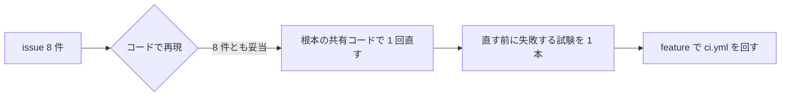

# S255 ponytail-audit の issue 8 件（#90〜#97）

| | |
| --- | --- |
| セッション | S255 |
| 日付 | 2026-11-15 |
| ブランチ | `feature/s255-audit-issues` |
| Phase | 保守（P8 の合間） |
| スライド | [slides.html](slides.html) |
| 作業記録 | `log/work/2026-11-15-s255-audit-issues.md` |

## 1. 目的

2026-11-14 の ponytail-audit が立てた GitHub issue #90〜#97 を 1 件ずつコードで確かめ、妥当なものを根本の共有コードで 1 回直す。各修正に、直す前なら失敗する小さな試験を 1 本。issue は閉じない（閉じるのはユーザー。コミットメッセージの `Fixes #n` はマージで閉じる）。

## 2. 決定と理由

監査の結論は、8 件とも主張が今の main で再現できた（妥当）。見送りは 0 件。

| # | 監査の結論 | 直した／見送り | 理由・提案との違い | 試験 |
| --- | --- | --- | --- | --- |
| 90 | 妥当。`\b` の前が `_` だと当たらない | 直した | `\b` を外し、`private_key` と `Bearer` を足した。**提案どおりだと既存の記録 4 件と散文（`Token::flag()`、`persist_github_token:` の次の行）に当たった**ので、値の前の空白を改行抜き（`[ \t]*`）にし、`::` を除いた。それでも当たる既存の記録の仮の値 4 件（`TOKEN=lmstudio`、`API_KEY=your-key-if-needed` など。`log/sessions` の 1 枚）は伏せた（改行は変えない）。`--check log/sessions/*.md` は 14 件中 0 件 | `test_save_session_log.py` に 2 本（5 つの形、`max_tokens=` は残す） |
| 91 | 妥当。`Math.min(...ys)` は約 15 万個で RangeError。NaN だけなら `lo=Infinity` | 直した | 素のループ。`ys` が空なら描かずに戻る | `test_widget.py`（`Math.min(...` が `_esm` に無い。extra `widget` が無いと飛ばされる） |
| 92 | 妥当。polars は `Inf` を数として読まない | 直した | `.cast(pl.Float64)`。整数の列（`time`）も `Float64` にそろい、`columns` の道と同じ型になる。既存の `df.equals(csv)` は通る | `test_columns.py`（Inf・-Inf・NaN が `Float64`） |
| 93 | 妥当。空欄は `parse_csv` が読めない | 直した | 書く側を `NaN` にした（Rust の `parse::<f64>` が読む）。読む側で空欄を許す案は、他の書き手の壊れた CSV を黙って通すので採らない。`Inf` は `NaN` になる（uPlot の欠損は元から区別しない） | `test_columns.mjs` |
| 94 | 妥当。scope が無いとワークスペースの設定が効く | 直した | `"scope": "machine"` の 1 行。`globeMode.libraries` は `--library` の読み取りだけで実行ファイルではないので触らない | `save.test.mjs`（`package.json` の値） |
| 95 | 妥当。手動の `desktop.yml` でしか回らない | 直した | 出力 `desktop` とジョブ `desktop`。**提案に足りなかった点**: `tauri::generate_context!` が空でよい `src/Svelte/dist` と sidecar 名のファイルを要る。sidecar の試験は `GLOBE_BIN` が無いと省かれるので debug の `cargo test` で足りる（release の `globe` は作らない）。費用は、該当ファイルを変えたときと full のときだけ webkit2gtk 入りの Tauri のビルド 1 本。feature で `ci.yml` を回し、ジョブ `desktop` が通ることを確かめた | `test_ci_plan.py` の `test_desktop` |
| 96 | 妥当。`open_in` は上限なし | 直した | 上限つきの読みを関数 `read_capped` にして `info`（`read_model_description`）と `run`（`open_in`）で共有した。切られた XML は読めない誤りになる | `tests/unpack.rs`（65 MiB の XML で両方が誤り。約 13 s、debug） |
| 97 | 妥当。構造は主張どおり（`emit`・`expand` が括弧の組ごとに `flat` を最後まで組み立てる）。660 KB・255 段の release の 3.4 s は測っていない。手元の試験の入力（200 段・2 万項）で debug 13 s | 直した | `flat_into` が、行の長さが幅＋1（先頭の空白 1 つぶん）を超えたら `None`。呼び出し側は `None` も「収まらない」も同じ展開の道なので出力は変わらない。長さの比較はバイト数で先に絞り、超えたときだけ文字数を数える（全角で誤って止めない） | `tests/format.rs`（直す前 13 s → 直したあと 1 s 未満で通る。上限は 5 s） |

プリンシプル オブ プログラミングの原則: 8 件の本文に原則名の指定は無かった。#96 は同じ規則を 2 か所に書いていた（DRY。関数 `read_capped` に 1 つにした。これは私の判断）。ほかは原則名を付けない。

## 3. 図



## 4. 再現手順

```bash
python3 .claude/hooks/test_save_session_log.py
python3 .claude/hooks/save_session_log.py --check log/sessions/*.md
uv run pytest src/Python/tests/test_columns.py src/Python/tests/test_widget.py
node src/Svelte/tests/test_columns.mjs
(cd src/VSCode/globe-mode && node --test test/save.test.mjs)
python3 .github/scripts/test_ci_plan.py
cargo test -p globe-mode-fmi-import --test unpack
cargo test -p globe-mode-fmt
```

検証の結果は作業記録に数字で書いた。

## 5. 次回

- #90: 既存の記録 4 件の仮の値を伏せ直した。今後、仮の値（`TOKEN=lmstudio`）を書く記録は、コピーのときに `--check` に当たる（実際の値と区別できないため、伏せる側に倒した）。
- #93: 書き出した CSV で `Inf` と `NaN` は区別されない。区別が要るなら列の型を持つ別の形式が要る。
- #97: 入れ子が深い入力の入力サイズ × 深さの仕事は、`flat` の打ち切り後も `emit` が段ごとに `flat` を呼ぶので、打ち切りまでの長さ（幅）×段数に抑えられるだけである。
