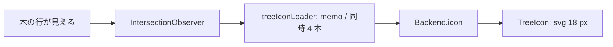

# S257 ライブラリの木のアイコン

| | |
| --- | --- |
| セッション | S257 |
| 日付 | 2026-11-15 |
| ブランチ | `feature/s257-tree-icons` |
| Phase | P4 |
| スライド | [slides.html](slides.html) |
| 作業記録 | `log/work/2026-11-15-s257-tree-icons.md` |

## 1. 目的

UI のライブラリの木（`LibraryTree.svelte`）の各行に、そのクラスの Icon を小さく描く（[roadmap](../../roadmap.md) の P4「UI の使い心地」の残り）。S244 の `Backend.icon`（[ADR-0037](../../adr/0037-icon-diagram-as-shape-data.md)）を使い、Rust・LSP・wasm は変えない。

## 2. 決定と理由

| 項目 | 決定 | 理由 |
| --- | --- | --- |
| いつ引くか | 行が見えたときだけ（`TreeIcon.svelte` の IntersectionObserver） | MSL の木は大きい。展開しただけの行も画面外なら引かない |
| 引き方 | `lib/tree-icons.ts` の `treeIconLoader`。クラス名で memo、同時 4 本 | まとめて引く口が無いので `icon` を絞って順に呼ぶ |
| memo の寿命 | 最上位の木のインスタンスの間（context で入れ子の木と共有） | 「MSL を読む」の再実行で木が作り直され、捨てられる。ライブラリの 1 クラスを編集した直後の更新はしない（下の「次回」） |
| Icon が無いクラス | 何も描かない（18 px の幅だけ残す） | 種類ごとの既定の印は足さない（小さい方） |
| text | 描かない | 18 px では読めない |
| アクセシビリティ | アイコンは `aria-hidden`、ボタンの名前は変えない | 装飾 |

## 3. 図



## 4. 再現手順

```bash
cd src/Svelte && pnpm check && node tests/test_tree_icons.mjs
# ブラウザの試験（public/msl/MSL.json があるとき）: test_ui.py の tree_icons
```

検証の結果は作業記録に書いた。

## 5. 次回

- ライブラリのクラスをエディタで編集したあとの、そのクラスのアイコンの更新（今は MSL を読み直すまで古いまま）
- 種類（model・package・connector）ごとの既定の印
