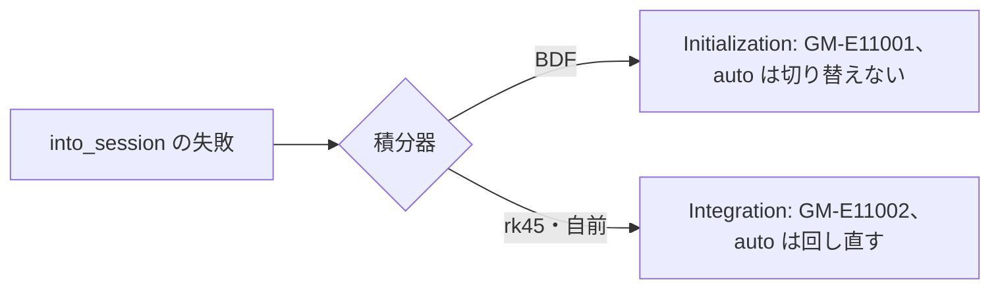

# S267 issue5-session-auto

| | |
| --- | --- |
| セッション | S267 |
| 日付 | 2026-11-15 |
| ブランチ | `feature/s267-issue5-session-auto` |
| Phase | P3 |
| スライド | [slides.html](slides.html) |
| 作業記録 | `log/work/2026-11-15-s267-issue5-session-auto.md` |

## 1. 目的

GitHub issue #5「session の道（wasm）で、BDF が始められないときに auto が dopri45 に切り替わらない」を今の main で確かめて直す。実行系の構成は [ADR-0013](../../adr/0013-exec-backend.md)、session の道は [ADR-0014](../../adr/0014-session-route-wasm.md)、`auto` の規則は [ADR-0028](../../adr/0028-auto-esdirk34-fallback.md)。

## 2. 決定と理由

| 項目 | 決定 | 理由 |
| --- | --- | --- |
| issue の例（`GenerationOfFMUs`） | 直さない | ADR-0015 で、両方の道で GM-U0004 で止まる（切り替えない）ことにした |
| 切り替える失敗の判定 | そのまま | `fallback()` は元から両方の道で同じ関数 |
| `into_session` の失敗の段 | BDF だけ Initialization（`session::start_phase`） | ネイティブの BDF は同じ呼び出しを初期化の中で回す。rk45・自前の積分器はネイティブも積分の段 |
| 再現の試験 | 単体試験（型と段の組） | 段の無い構築の失敗を起こすモデルが見つからなかった |

## 3. 図



## 4. 再現手順

```bash
cargo test -p globe-mode-exec
```

検証の結果（数字）:

- 69 本 pass（lib 24、統合 14 + 31、MSL の 5 本は ignored）、clippy 警告 0。
- `wasm:node`・`wasm:compare` は release の wasm ビルドが重いので手元では回していない（CI の wasm-node に任せる）。

## 5. 次回

- 段の無い構築の失敗を起こすモデルが見つかったら、`simulate` と `simulate_via_session` を比べる試験を足す。
- issue #5 は閉じていない。
