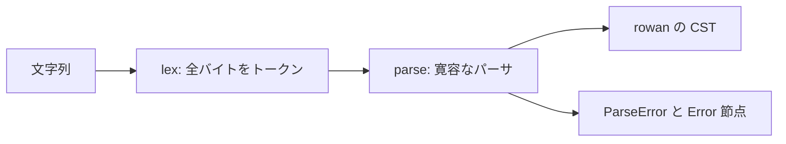

# S268 Track B の CST と寛容なパーサ

| | |
| --- | --- |
| セッション | S268 |
| 日付 | 2026-11-15 |
| ブランチ | `feature/s268-trackb-cst` |
| Phase | Track B（B1 の最初の一切れ） |
| スライド | [slides.html](slides.html) |
| 作業記録 | `log/work/2026-11-15-s268-trackb-cst.md` |

## 1. 目的

Track B（自前コア）の B1「rowan の CST と寛容なパーサ」を始める。IDE の機能（アウトライン、補完、リネーム、整形）が、Rumoca の AST が落ちる入力でも動くための土台として、空白とコメントを落とさず、誤りがあっても木を返すパーサを作る。計画は [roadmap.md](../../roadmap.md) の Track B、設計は [ADR-0039](../../adr/0039-native-cst-parser.md)。

## 2. 決定と理由

| 項目 | 決定 | 理由 |
| --- | --- | --- |
| 置き場 | 新しい crate `globe-mode-syntax`（依存は rowan だけ） | Rumoca・`Frontend` から独立させ、wasm32 と Track B の他の層から使える |
| 字句解析 | 自前の `lex`。全バイトがトークン | 木の文字列と元の文字列の一致を保証する。`globe-mode-fmt` の字句解析は整形用で、依存 0 のため置き換えない |
| 誤りの扱い | `Error` 節点と `ParseError`。panic しない | IDE は書きかけの入力を読む |
| 範囲 | クラス・`extends`・`import`・部品の宣言・`equation` / `algorithm` 節 | 式の文法を後回しにしても、アウトラインと構造が取れる |
| 式・修飾・注釈 | 不透明（括弧の対応と `;` まで） | 最初の一切れを小さくする |

## 3. 図



## 4. 再現手順

```bash
cargo test -p globe-mode-syntax
GLOBE_MSL=data/msl cargo test --release -p globe-mode-syntax -- --ignored --nocapture
```

検証の結果（数字）:

- `cargo test -p globe-mode-syntax`: 4 本 pass、1 本 ignored（MSL）。`src/Modelica` の 75 本は誤り 0・往復一致。
- MSL 4.1.0 の 2556 本: 誤り 0・往復不一致 0・panic 0（release、0.4 秒）。MSL 4.0.0 の 2512 本も同じ。`data/libs` の 10627 本は往復一致・panic 0、誤り 2 本は実際の構文の誤り。

## 5. 次回

- 式の文法と型付き AST、修飾・注釈の構造、診断の番号
- B2 resolve、`Frontend` の feature `native`、`xtask diff-frontend`
