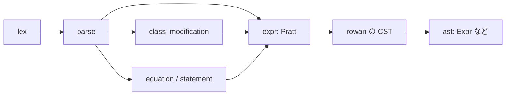

# S269 Track B の式・修飾・文

| | |
| --- | --- |
| セッション | S269 |
| 日付 | 2026-11-15 |
| ブランチ | `feature/s269-trackb-expr` |
| Phase | Track B（B1 の 2 つ目） |
| スライド | [slides.html](slides.html) |
| 作業記録 | `log/work/2026-11-15-s269-trackb-expr.md` |

## 1. 目的

S268 の `globe-mode-syntax` は式・修飾・注釈・文の中身が不透明な節点だった。これを構造にして、名前の解決（B2）や IDE の機能が式の木を使えるようにする。設計は [ADR-0039](../../adr/0039-native-cst-parser.md) の付記（S269）。

## 2. 決定と理由

| 項目 | 決定 | 理由 |
| --- | --- | --- |
| 式の読み方 | Pratt（束縛力の表）。範囲は最も外側、`if` 式は被演算子の位置でも読む | 文法が小さく、寛容にしやすい |
| 連鎖 | 同じ優先順位は 1 つの `BinaryExpr` に平らに入れる | 木が深くならず、巨大な式でスタックを使わない。畳むのは型付き AST の側 |
| 修飾と注釈 | `ClassModification` 1 種。注釈は修飾の一種として同じ仕組み | 仕様どおり。`break`（3.6）も同じ位置 |
| 方程式と文 | `Equation` / `Statement` のまま中身が式 | 節点の種類を増やさず、型付きの層で `enum` にする |
| 不透明のまま | `redeclare` の引数、`enumeration(…)`、`import A.{…}`、誤りから戻る範囲 | 使う層ができてから構造にする |
| 入れ子 | 式・修飾・クラスで合わせて 128 段 | S268 と同じ。超えたら括弧 1 組か 1 字句を `Error` に入れる |
| 型付き AST | `ast` に式の節点だけ | 文・宣言は B2 を書くときに足す |

## 3. 図



## 4. 再現手順

```bash
cargo test -p globe-mode-syntax
GLOBE_MSL=data/msl cargo test --release -p globe-mode-syntax -- --ignored --nocapture
```

検証の結果（数字）:

- `cargo test -p globe-mode-syntax`: 9 本 pass、1 本 ignored（MSL）。`src/Modelica` の 75 本は誤り 0。
- MSL 4.1.0 の 2556 本・4.0.0 の 2512 本: 誤り 0・往復不一致 0・panic 0（release、0.7 秒）。`data/libs` の 10627 本は往復一致・panic 0、誤りは実際の構文の誤り 2 本だけ。

## 5. 次回

- 文・宣言・クラスの型付き AST、診断の番号（`GM-E`）
- B2 resolve、`Frontend` の feature `native`、`xtask diff-frontend`
