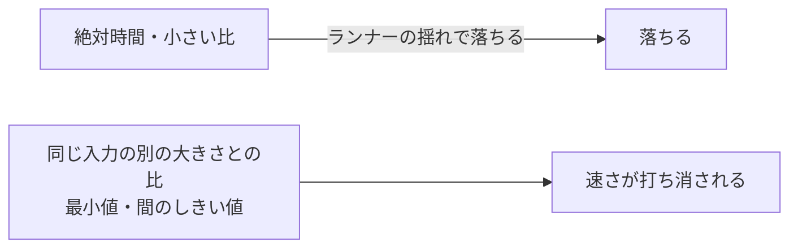

# S270 時間を測る試験の安定化

| | |
| --- | --- |
| セッション | S270 |
| 日付 | 2026-11-15 |
| ブランチ | `feature/s270-flaky-timing-tests` |
| Phase | 保守 |
| スライド | [slides.html](slides.html) |
| 作業記録 | [log/work/2026-11-15-s270-flaky-timing-tests.md](../../../log/work/2026-11-15-s270-flaky-timing-tests.md) |

## 1. 目的

共有の CI ランナーで時々落ちる、時間を測る試験を、守りたい性質（計算量が 2 乗にならない）を保ったまま安定させる。
きっかけは feature の CI run 43628763459 の rust-linux で `lint_time_grows_linearly`（S207）が落ちたこと（変更と無関係）。
S255（#97）の「200 段・2 万項で 5 s 未満」の試験も同じ種類だった。

## 2. 決定と理由

試験の中の時間の比較・上限を `Instant::now` / `elapsed()` で洗い出し、落ちうるかを判断した。

| 試験 | 場所 | 測るもの | 判断 |
| --- | --- | --- | --- |
| `lint_time_grows_linearly` | `globe-mode-fmt/tests/format.rs` | 本文 2 倍の時間比 < 3（3 回の最小値） | **直した**。本文 4 倍（2000 → 8000）・5 回の最小値・しきい値 8。線形で約 4（実測 3.4〜4.7）、2 乗で約 16（わざと戻して 15） |
| `deeply_nested_wide_input_is_not_quadratic` | 同上 | 絶対 5 s 未満（debug で約 0.6 s） | **直した**。同じ入力を深さ 1 で整形した時間との比（5 回の最小値）< 50。直したあと約 11〜16、直す前は約 100〜200。絶対時間をやめ、ランナーの速さが打ち消される |
| `a_very_long_model_name_skips_the_spelling_distance` | `globe-mode-frontend/tests/library_hints.rs` | 絶対 5 s 未満（debug で約 12 ms） | 残す。余裕が約 400 倍で、守る性質（数十秒かかる編集距離を飛ばす）との差が大きい |
| `cancel_from_another_thread_stops_the_default_solvers` | `globe-mode/tests/observed.rs` | 中断から 5 s 未満（止まらなければ分単位） | 残す。中断が効かなければ 10 s 以上かかり、差が大きい |
| `progress_is_throttled_and_does_not_change_the_result` | 同上 | 進捗の回数 ≤ 段数 + 壁時計 / 0.1 s + 1 | 残す。上限は同じ試験の中で測った壁時計から出すので、ランナーの速さに依らない |
| `crashing_fmus_are_reported_and_leave_no_process`（中断） | `globe-mode-cli/tests/fmu_worker.rs` | 中断から 1.4 s 未満 | **直した**。5 s 未満に。FMU の全部を回すと約 1.5 s 以上かかるので、旗を無視すれば「中断した」の誤りでなく成功になり、そちらの確認が本体。時間は保険 |
| 同上（無限ループ・`--timeout 1`） | 同上 | 10 s 未満（上限 1.5 s・1 s） | 残す。余裕が 6 倍以上で、止まらなければ永久に終わらない |
| 要求の中断（`worker.rs`） | `apps/desktop/src/worker.rs` | 登録 5 s・中断 5 s 未満 | 残す。`sleep` 相当の子を kill するだけで、余裕が大きい |
| `request` のタイムアウト 2 つ（`sim.rs`） | `xtask/src/sim.rs` | 5 s 未満（`sleep 30` の子を 0.3 s で止める） | 残す。止まらなければ 30 s |
| `measure_*`・`msl_*`・`graph_library` の `eprintln` | `globe-mode-db`・`globe-mode-exec`・`globe-mode-wasm`・`globe-mode-frontend/src/structure.rs` | 表示だけ、または `#[ignore]` | 対象外。CI で回らない、または比較しない |

- 仕事量で測る道は取らなかった。`flat` や `lint` の内部には呼び出し回数のカウンタが無く、足すと本体の変更になるため。
- 比の試験は、(1) 入力を大きく（4 倍）して 2 乗との差を広げる、(2) 各サイズの最小値を 5 回から取る、(3) しきい値を線形と 2 乗の間に置く、の 3 点で揃えた。
- 深さの試験は、直したあとも深さに比例する仕事が残る（深さ 10 → 200 で 0.07 s → 0.6 s）ので、深さ同士の比は使えない。深さ 1 との比にして、直したあと約 11 倍・直す前は約 200 倍の間（50）に置いた。
- 過去の CI（直近の失敗 14 件のうち、ログを確かめた約 10 本）に、時間の試験の失敗はほかに見つからなかった（clippy、UI の Playwright、取得の 504、期待どおりの panic の表示だけ）。run 43628763459 のログは取得できなかった。

## 3. 図



## 4. 再現手順

```bash
export CARGO_TARGET_DIR=<main>/.git-worktree/target-shared CARGO_BUILD_JOBS=2
for i in $(seq 20); do cargo test -p globe-mode-fmt --test format -- lint_time_grows deeply_nested; done
cargo test -p globe-mode-cli --test fmu_worker
```

検証の結果（数字）:

- 20 回回して 0 回落ちた。lint の比は 3.4〜4.7（しきい値 8）、深さの比は 11.0〜16.0（しきい値 50）。
- わざと戻すと落ちる（コミットしない）: lint の行・桁の数え直しを戻すと比 15.08、`flat` の打ち切りを外すと深さの比 101.8。
- `globe-mode-cli --test fmu_worker` 5 本が通る。

## 5. 次回

- 時間を測る試験を足すときは、絶対時間でなく同じ試験の中の比にする。
- run 43628763459 の落ち方（比の実測値）はログが取れず確かめていない。
