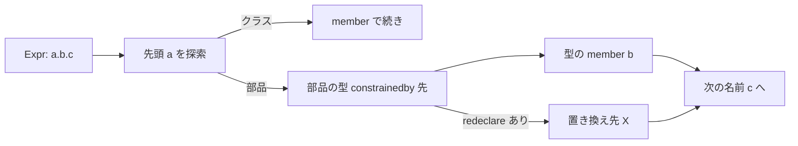

# S275 名前解決の続きと redeclare

| | |
| --- | --- |
| セッション | S275 |
| 日付 | 2026-11-15 |
| ブランチ | `feature/s275-resolve-paths` |
| Phase | Track B（B2 の 2 つ目） |
| スライド | [slides.html](slides.html) |
| 作業記録 | `log/work/2026-11-15-s275-resolve-paths.md` |

## 1. 目的

S272 の `globe-mode-resolve` は、式の成分参照 `a.b.c` の先頭 `a` で止めていた。続き（部品の型の中の名前）を解決し、`replaceable` / `redeclare` で型が変わる所の一部（宣言の既定の型・`constrainedby`・修飾の `redeclare package M = X`）を扱う。設計は [ADR-0039](../../adr/0039-native-cst-parser.md) の付記（S275）。`Frontend`・LSP にはまだつなげない。

## 2. 決定と理由

| 項目 | 決定 | 理由 |
| --- | --- | --- |
| 続き | 先頭が部品なら、その型の中で次の名前を探す。型は宣言したクラスの中で解決。添字は無視 | `parts` に添字は入らず、型だけたどればよい |
| 組み込みの型 | 型が組み込み（`type V = Real` を含む）なら続きは `Builtin`（属性） | `x.start` などは探索の外 |
| 型の候補 | 部品は `constrainedby` を先、宣言の型を後に試す。short class の `constrainedby` は基底の 2 つ目 | `constrainedby` の型の要素は必ず使える。既定の型にだけある要素も見つける |
| `redeclare package` | `extends`・部品・short class の修飾の直下を読み、その場の `M` を `X`（なければ `Y`）に置き換える。1 段 | MSL の未解決 10 件は `extends B(redeclare package Medium = …)` だった |
| 読み方 | `Redeclaration` 節点は字句が平らなので、`ast::RedeclaredClass` が前置き・`package M = X`・`constrainedby` の字句から読む | パーサを変えずに済ませる（S269 の「不透明」の決定を保つ） |
| 2 段以上先 | 未解決のまま `Reason::Redeclare` | 継ぐ側の `redeclare` が、継がれた側の部品の型に効く場合。当て推量で解決しない |

## 3. 図



## 4. 再現手順

```bash
cargo test -p globe-mode-resolve
GLOBE_MSL=data/msl cargo test -p globe-mode-resolve -- --ignored --nocapture msl_stats
GLOBE_MSL=data/msl cargo test -p globe-mode-lsp --test resolve_compare -- --ignored --nocapture
```

結果（MSL 4.1.0、debug）は [ADR-0039 の付記](../../adr/0039-native-cst-parser.md)。続きのある成分参照 45463 件のうち 44824 件が最後の名前まで解決し、残り 639 件は `Redeclare`。LSP の定義ジャンプとは、続きの 93 箇所で不一致 0（LSP が null の 7 箇所は LSP が答えない形）。

## 5. 次回

- `Redeclare` の 639 件（2 段以上先の `state.T`、部品の再宣言 `redeclare Foo x`）
- LSP・`Frontend` へのつなぎ、文の型付き AST、診断の番号
