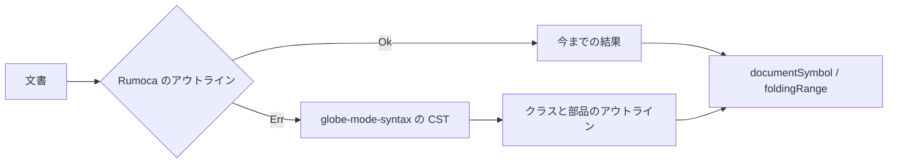

# S276 構文の誤りでも出るアウトライン

| | |
| --- | --- |
| セッション | S276 |
| 日付 | 2026-11-15 |
| ブランチ | `feature/s276-lsp-tolerant-syntax` |
| Phase | Track B（初めて製品につないだ） |
| スライド | [slides.html](slides.html) |
| 作業記録 | `log/work/2026-11-15-s276-lsp-tolerant-syntax.md` |

## 1. 目的

[roadmap](../../roadmap.md) の Track B は「B1〜B2 は IDE の機能から先に使える」とした。その最初として、LSP の `textDocument/documentSymbol`（アウトライン）と `textDocument/foldingRange`（折りたたみ）を、構文の誤りがあるファイルでも出す。

## 2. 決定と理由

| 項目 | 決定 | 理由 |
| --- | --- | --- |
| 使う条件 | Rumoca のアウトラインが引けない（`Err`）ときだけ、`globe-mode-syntax` の CST から作る | 正常なファイルの出力と既存の試験を変えない |
| 作るもの | クラス（名前・種類・`partial`・範囲）と部品（名前・型名・範囲）。`extends`・`import`・connect は空 | アウトラインと折りたたみに要るものだけ |
| 範囲 | 最初と最後の字句（末尾の空白・コメントは含めない） | `end` が無いクラスでも範囲が決まる |
| 置き場 | `globe-mode-lsp/src/tolerant.rs`。`globe-mode-lsp` が `globe-mode-syntax` に依存 | 新しい外部依存は無い（rowan は syntax がすでに使う） |
| RPC | 足さない | 既存の 2 つの要求の答えが変わるだけ |

## 3. 図



## 4. 再現手順

```bash
cargo test -p globe-mode-lsp
```

試験は `globe-mode-lsp/tests/tolerant_outline.rs`（誤りのあるファイルでクラスと部品が出る、正常なファイルは同じ）と `tests/folding.rs`（誤りのあるファイルでクラスと equation 節が折りたためる）。数字は [ADR-0039 の付記](../../adr/0039-native-cst-parser.md)。

## 5. 次回

- 補完・定義ジャンプを `globe-mode-resolve` につなぐ。
- 誤りのあるファイルでの `extends`・`import`・connect はアウトラインに出さない（今は不要）。
