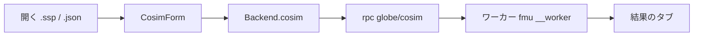

# S277 コシミュレーションの UI の口

| | |
| --- | --- |
| セッション | S277 |
| 日付 | 2026-11-15 |
| ブランチ | `feature/s277-cosim-ui` |
| Phase | P5 / P8 |
| スライド | [slides.html](slides.html) |
| 作業記録 | `log/work/2026-11-15-s277-cosim-ui.md` |

## 1. 目的

S249〜S274 で CLI と facade にあるコシミュレーション（`globe fmu cosim`）を、Desktop の UI から回せるようにする。`.ssp` か spec の `.json` を「開く」で選び、結果を既存のプロットのタブに出す。

## 2. 決定と理由

| 項目 | 決定 | 理由 |
| --- | --- | --- |
| 口 | LSP `globe/cosim`（`{path, stopTime?, step?, workDoneToken?}` → `{layout, columns}`） | FMU の実行（`globe/fmuRun`）が LSP にあるので同じ場所。ワーカー・進捗・中断も同じ |
| 上書き | `stopTime`・`step` は JSON の値も上書きする | UI の欄が空なら spec・SSP の既定。CLI は JSON で断るが、UI では同じ欄で両方を扱いたい |
| UI の入口 | 「開く」が `.ssp`・`.json` も受け、`CosimForm`（警告・終了時刻・刻み）を出す | FMU の「開く」と同じ流れ。ボタンを増やさない |
| ブラウザ・Android | `Backend.cosim` が無く、選ぶと「Desktop だけ」と出す | FMU と同じ（ネイティブコードを動かせない） |

## 3. 図



## 4. 再現手順

```bash
cargo test -p globe-mode-cli --test lsp lsp_reads_and_runs_fmus   # data/reference-fmus が要る
cargo test -p globe-mode-lsp fmu_requests_reject_bad_params_over_rpc
cd src/Svelte && node tests/test_tauri.mjs && pnpm check
```

検証の結果は作業記録に書いた。

## 5. 次回

- SSP の書き出し（`write_ssp`）の UI。
- FMU の名前・接続を UI で編集する口。
- コシミュレーションの結果のタブの再読み込みでの復元（path を持たない）。

関連: [ADR-0026](../../adr/0026-fmi-import-placement.md) の (u)、[features.md](../../features.md)。
