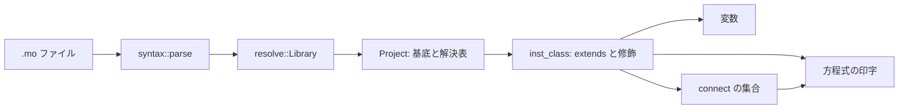

# S278 Track B のモデルの flatten

| | |
| --- | --- |
| セッション | S278 |
| 日付 | 2026-11-15 |
| ブランチ | `feature/s278-trackb-flatten` |
| Phase | Track B（B3 の最初の一切れ） |
| スライド | [slides.html](slides.html) |
| 作業記録 | `log/work/2026-11-15-s278-trackb-flatten.md` |

## 1. 目的

`globe-mode-syntax`（S268・S269）の CST と `globe-mode-resolve`（S272）の名前解決を使って、モデルをフラットな変数と方程式の列にする。コンパイルのパイプラインは引き続き Rumoca が受け持つので、今回は Rumoca の flat と数字を突き合わせて、自前の flatten が同じ結果になる範囲を測る。設計は [ADR-0039](../../adr/0039-native-cst-parser.md) の付記（S278）。`Frontend`・LSP にはまだつなげない。

## 2. 決定と理由

| 項目 | 決定 | 理由 |
| --- | --- | --- |
| 置き場 | 新しい crate `globe-mode-flat`（依存は syntax と resolve。rowan は両方と同じ） | B4（DAE）が flat に依存できる。resolve の中は S275 が触っているので変えない |
| 基底の取り方 | `extends` の名前を resolve の解決表で引いて、`Project` 側で基底を持つ | resolve は `bases` を公開していない。足りない分は新しい crate 側で補う約束 |
| 式 | 評価せず、名前を付け替えた正規化の印字で残す。評価は大きさ・`for` の範囲・添字だけ | B4 以降で式の木が要るときに、型付き AST から作り直せる |
| 修飾 | 値は書いた場所の前置きで印字する（`Bind` が文脈を持つ）。外側が勝つ | `Resistor R(R = k)` の `k` は外側のインスタンスの `k` |
| 束縛 | 変数に残す（Rumoca の flat と同じ）。`binding_equations()` で DAE の方程式の数を出す | 突き合わせの定義を揃える |
| `connect` | インスタンスごとに集合。potential は等式、flow は内側 `+`・外側 `-` の和が 0。つなげない内側の flow は 0、最上位のコネクタの flow も 0 | MLS 9.2 と Rumoca の flat |
| 断る | `redeclare`・`replaceable`・`inner`/`outer`・条件つきの宣言・外部関数・`stream`・`expandable`・`class extends` など | 近似せず、理由の分類つきで数える |

突き合わせで見つかった Rumoca の flat の定義（自前に合わせた）: (1) 最上位のコネクタの flow は 0 の方程式が付く、(2) `equations` には変数の束縛と `when` を数えない、(3) 組み込みの列挙 `StateSelect` の変数は入れない。

## 3. 図



## 4. 再現手順

```bash
cargo test -p globe-mode-flat
# 共有の target では別の worktree の resolve の古いビルドが混ざることがある。変えた crate を touch してから回す
GLOBE_MSL=data/msl cargo test -p globe-mode-flat --test compare validation_vs_rumoca -- --ignored --nocapture
GLOBE_MSL=data/msl GLOBE_FLAT_RUMOCA=1 cargo test -p globe-mode-flat --test compare msl_examples_flatten -- --ignored --nocapture
```

結果（debug。Rumoca の読み込みを含めて約 1〜2.5 分）:

| 対象 | 自前で平坦化できた | 名前の集合が一致 | 方程式の数が一致 |
| --- | --- | --- | --- |
| `GlobeModeValidation` の model・block 75 本 | 71（断った 4: `redeclare` 3、`inner`/`outer` 1） | 70 / 70 | 70 / 70 |
| MSL 4.1.0 の例題 566 本（Rumoca の flatten は 562） | 67 | 66 / 66 | 64 / 66 |

MSL で方程式の数が合わなかった 2 本は `Modelica.Clocked.Examples.Elementary.RealSignals.UniformNoise`（10 対 12）と `UniformNoiseXorshift64star`（10 対 11）。出力が 2 つの関数の呼び出しの方程式 `(a, b) = f(x)` と、クロックの `previous` に関わる所の数え方が違う。原因は未確認。

断った 499 本の理由（最初の理由だけ数える）: `redeclare` 205、条件つきの宣言 131、`inner`/`outer` 43、大きさが定数でない 35、レコードの束縛 33、`[:]` の大きさが決まらない 25、`class extends` 11、`replaceable` 5、配列の型 5、配列のコネクタの一括接続 4、`expandable` 2。

## 5. 次回

- `redeclare` / `replaceable`（`globe-mode-resolve` の S275 と合わせる。205 本の大半は resolve が型を決められない `Redeclare`）、条件つきの宣言（`if` が定数なら外す。131 本）、`inner` / `outer`（43 本）
- 配列のコネクタの一括接続、レコードの束縛、`[:]` の大きさ（関数の戻り値）、B4（DAE）、`xtask diff-frontend` への組み込み
