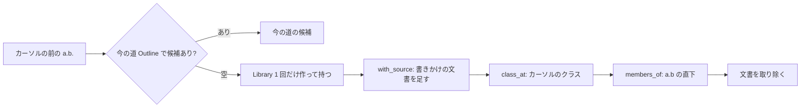

# S279 LSP の補完を自前の名前解決に

| | |
| --- | --- |
| セッション | S279 |
| 日付 | 2026-11-15 |
| ブランチ | `feature/s279-lsp-completion-resolve` |
| Phase | Track B（IDE の機能から自前に） |
| スライド | [slides.html](slides.html) |
| 作業記録 | `log/work/2026-11-15-s279-lsp-completion-resolve.md` |

## 1. 目的

LSP の補完（`textDocument/completion`）で、`a.` の後ろに部品の型のメンバー（部品・入れ子のクラス、受け継ぎを含む）を出す。S171 から `Outline` で出していたが、書きかけの文書にカーソルの行以外の誤りがある・`end` の前で切れている、のいずれかで空になる。自前の寛容な構文（`globe-mode-syntax`）の上の名前解決（`globe-mode-resolve`）で、その場合を埋める。設計は [ADR-0039](../../adr/0039-native-cst-parser.md) の付記（S279）。

## 2. 決定と理由

| 項目 | 決定 | 理由 |
| --- | --- | --- |
| 足し方 | 今の道で候補が出るなら今の道。空のときだけ自前の道 | 読める文書の出力と既存の試験の期待値を変えない |
| 書きかけの文書 | `Library::with_source` で一時的に足して引き、取り除く | ライブラリを作り直さない。文書の編集のたびの再構築を避ける |
| カーソルのクラス | `Class::range` を足し、`class_at` で一番内側を引く | 構文の木が `end` の無いクラスも読めたところまで返す |
| ライブラリの木 | `Server` が最初に 1 回だけ作って持つ。作ったあと `refs` を捨てる | MSL で約 72 MB（debug）。補完は `Ref` を使わない |
| wasm | `lib` を持たない（今の道だけ） | 今回は LSP のみ。展開は次回 |

## 3. 図



## 4. 再現手順

```bash
cargo test -p globe-mode-lsp -p globe-mode-resolve
GLOBE_MSL=data/msl cargo test -p globe-mode-resolve --test resolve -- --ignored --nocapture msl_members
```

MSL 4.1.0（debug）で `Library` を作るのに 8.8 秒、RSS は 3.3 MB から 83 MB、`refs` を捨てて 75 MB。`Resistor r;` の `r.` を 0.5 ms で引き、13 件が出る。release は測っていない。

## 5. 次回

- 別の開いている文書にある型、`redeclare` が 2 段以上先で効く型、組み込みの属性（`x.start`）
- ライブラリの更新で `Library` を作り直す仕組み、wasm への展開
- 定義ジャンプ・参照・ホバーの自前化
