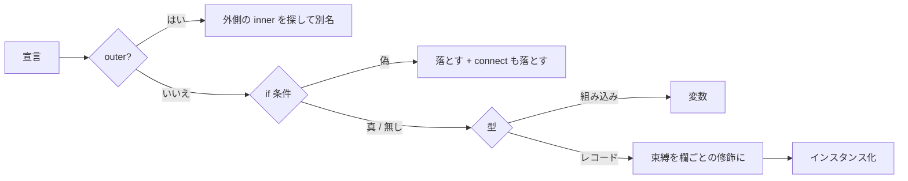

# S284 flatten の続き: 条件つきの宣言・inner/outer・レコードの束縛・大きさ

| | |
| --- | --- |
| セッション | S284 |
| 日付 | 2026-11-15 |
| ブランチ | `feature/s284-flat-conditional` |
| Phase | Track B（B3 の 2 つ目） |
| スライド | [slides.html](slides.html) |
| 作業記録 | `log/work/2026-11-15-s284-flat-conditional.md` |

## 1. 目的

S278 の `globe-mode-flat` が断った理由の上位（条件つきの宣言 131・`inner`/`outer` 43・大きさが定数でない 35・レコードの束縛 33・`[:]` 25）を減らし、MSL の例題で平らにできる本数を増やす。変えたのは `globe-mode-flat` の中だけで、`globe-mode-resolve`・`globe-mode-syntax` は変えない。設計は [ADR-0039](../../adr/0039-native-cst-parser.md) の付記（S284）。

## 2. 決定と理由

| 項目 | 決定 | 理由 |
| --- | --- | --- |
| 条件つきの宣言 | 条件が定数に評価できるときだけ。偽なら宣言と、その部品につながる `connect` を落とす | MLS 4.4。評価できないものは近似せず断る |
| 定数の条件の `if` の方程式 | 選んだ枝だけを平らにする（`connect` も入る） | Rumoca の flat が同じ数え方（`if not useHeatPort then …` が消える）。`connect-in-if-when` の 13 本も通る |
| `inner`/`outer` | `outer` は部品を作らず、外側へたどって最初の同じ名前の `inner` へ参照を付け替える。無ければ断る | 名前の付け替えだけで済み、変数の名前が Rumoca の flat と一致する |
| レコードの束縛 | コンストラクタの引数・`other` の欄を欄ごとの修飾にする。優先順位は明示した修飾 > 束縛 > 型の修飾 | 部品の展開をそのまま使える。関数の戻り値のレコードは評価が要るので断る |
| 大きさ | 列挙の型名の添字、列挙の比較、パッケージの定数、`max`/`min` の配列、後ろで宣言した配列の `size`、`[:]` を式の形から決める | 小さい変更で、断る理由の `non-constant-dim` と `unsized-array` の大半が消える |
| コネクタの中の parameter | `connect` の等式にしない | Rumoca の flat と同じ（`FluidHeatFlow` で 15〜40 本ずれていた） |

## 3. 図



## 4. 再現手順

```bash
cargo test -p globe-mode-flat
# 共有の target では別の worktree の syntax・resolve の古いビルドが混ざることがある。touch してから回す
touch src/Rust/mod/globe-mode-{syntax,resolve,flat}/src/lib.rs
GLOBE_MSL=data/msl cargo test -p globe-mode-flat --test compare validation_vs_rumoca -- --ignored --nocapture
GLOBE_MSL=data/msl GLOBE_FLAT_RUMOCA=1 cargo test -p globe-mode-flat --test compare msl_examples_flatten -- --ignored --nocapture
# 断った理由の本数を全部見る
GLOBE_FLAT_SHOW=composite-binding,unsized-array GLOBE_MSL=data/msl cargo test -p globe-mode-flat --test compare msl_examples_flatten -- --ignored --nocapture
```

| 対象 | 自前で平らにできた | 名前の集合が一致 | 方程式の数が一致 |
| --- | --- | --- | --- |
| `GlobeModeValidation` の model・block 75 本 | 72（S278 は 71。断った 3 は `redeclare`） | 71 / 71（70 / 70） | 71 / 71（70 / 70） |
| MSL 4.1.0 の例題 566 本 | 192（67） | 189 / 189（66 / 66） | 186 / 189（64 / 66） |

合わない 3 本: `UniformNoise`（10 対 12）、`UniformNoiseXorshift64star`（10 対 11）、`GenerationOfFMUs`（210 対 214）。原因は未確認。

## 5. 次回

- `redeclare` / `replaceable`（263 本）
- 関数の戻り値のレコード（Spice3）、外部オブジェクト、配列の修飾つきの条件（`useHeatPort = fill(…)`）、配列のコネクタの一括接続、`xtask diff-frontend`、B4（DAE）
