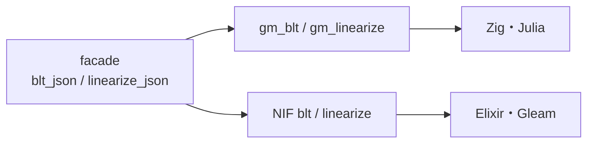

# S285 言語 API に線形化と BLT

| | |
| --- | --- |
| セッション | S285 |
| 日付 | 2026-11-15 |
| ブランチ | `feature/s285-lang-linearize-blt` |
| Phase | P7 |
| スライド | [slides.html](slides.html) |
| 作業記録 | `log/work/2026-11-15-s285-lang-linearize-blt.md` |

## 1. 目的

facade `Workspace` に入った線形化（`linearize`、S254）と BLT（`blt`、S256）を、C ABI（`globe-mode-c`）・Zig・Julia、Elixir の NIF（`globe-mode-nif`）・Elixir・Gleam から呼べるようにする。Python は S258・S262 で済んでいる。[roadmap](../../roadmap.md) の P7「参照シナリオが 6 言語で通る」の流儀（束ねは JSON の文字列を返すだけ）。

## 2. 決定と理由

| 項目 | 決定 | 理由 |
| --- | --- | --- |
| JSON と誤りの文字列化 | facade に `Workspace::blt_json`・`linearize_json(model, options)` を置く。誤りは最初の診断の `コード: 文` | C ABI と NIF の 2 か所に同じ処理を書かない（`outline_json` と同じ流儀）。ロジックは各言語に置かない |
| C ABI の形 | `gm_blt(ws, model)`・`gm_linearize(ws, model, options_json)`。通らなければ `{"error": "..."}` | `gm_simulate` の `settings_json`（NULL 可）に合わせる。`options_json` は `{"time": 1.0, "parameters": {"R": 2.0}}`（未知のキーは誤り） |
| 線形化の JSON | `linearization_json`（`globe linearize --json`・LSP と共通）をそのまま使う | 形を増やさない |
| NIF・Elixir・Gleam | NIF `blt/2`・`linearize/3`（DirtyIo）。Elixir は `linearize(ws, model, options \\ %{})` が `JSON.encode!`、Gleam は JSON の文字列のまま | 既存の `simulate` と同じ |

## 3. 図



## 4. 再現手順

```bash
export CARGO_TARGET_DIR=<main>/.git-worktree/target-shared CARGO_BUILD_JOBS=2
cargo test -p globe-mode-c
mise run c:zig && mise run c:julia && mise run elixir:test && mise run gleam:test
```

試験は各言語とも同じ 2 本: `der(x) = -a x + u、y = 2 x`（a = 3）の A が約 -3・C が約 2（数値微分なので 1e-4 の幅）、`x + y = time; x - 2 y = 1` の BLT に大きさ 2 の代数ループが 1 つ。結果は作業記録の「検証」に書いた。

## 5. 次回

- 検査が通らないときの誤りは文字列の 1 行だけ（診断の配列は返さない。Python は `.diagnostics` を持つ）。必要になったら JSON の配列にする。
- `Backend` 側（wasm・LSP）は S260・S262 で済み。固有値は未。
