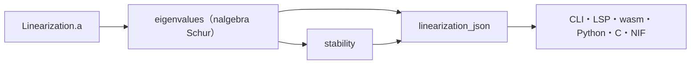

# S286 線形化に固有値

| | |
| --- | --- |
| セッション | S286 |
| 日付 | 2026-11-15 |
| ブランチ | `feature/s286-linearize-eigen` |
| Phase | P8 |
| スライド | [slides.html](slides.html) |
| 作業記録 | `log/work/2026-11-15-s286-linearize-eigen.md` |

## 1. 目的

S254 の線形化（A・B・C・D）に、A の固有値（極）と安定性の一言を足す。[ADR-0038](../../adr/0038-linearize-numeric.md) の付記に決めを書いた。

## 2. 決定と理由

| 項目 | 決定 | 理由 |
| --- | --- | --- |
| 置き場 | facade の `linearization_json` に `eigenvalues`（`[{re, im}]`）と `stability` を足す | LSP・wasm・Python・C ABI・NIF がこの関数を通すので、束ねを変えずに全部の口に出る。既存のキーは変えない |
| 計算 | `nalgebra` 0.34 の `Schur::try_new`（反復に上限）→ `complex_eigenvalues` | diffsol の推移的依存で Cargo.lock に既にある。自前の QR 法を書かない。非正方・非有限・収束しない A は空 |
| 安定性 | `stable`・`unstable`・`marginal`・`none` | `\|Re\| ≤ 1e-6·max(1, \|λ\|)` を境界とする。数値微分の誤差 1e-8 で ±i が揺れても境界になる |
| CLI | 「固有値（A）: …」と安定性の 1 行。状態 0 個なら出さない | 人が読む出力に一言 |

## 3. 図



## 4. 再現手順

```bash
export CARGO_TARGET_DIR=<main>/.git-worktree/target-shared CARGO_BUILD_JOBS=2
cargo test -p globe-mode-cli --test linearize
cargo check -p globe-mode --target wasm32-unknown-unknown
```

試験は 2 本足した。`LinearSystem`（A = [-2 1; 1 -2]）の固有値が -1・-3 で安定、`Pendulum` を `c=0`・`th0=0` で回すと ±i で境界、既定（c = 0.5）は安定。

## 5. 次回

- Svelte の LinearizeView に固有値の小さな表を足す（Svelte を他の担当が触っていたので今回は足していない）。
- 固有ベクトル・モードの寄与率、解析ヤコビ行列は未。
