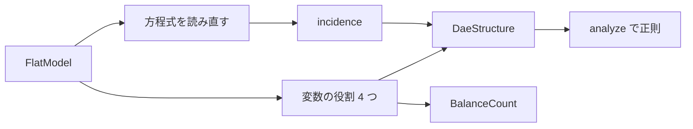

# S290 B4 DAE の最初の一切れ: フラットなモデルから釣り合いと構造を出す

| | |
| --- | --- |
| セッション | S290 |
| 日付 | 2026-11-15 |
| ブランチ | `feature/s290-trackb-dae` |
| Phase | Track B（B4 の最初の一切れ） |
| スライド | [slides.html](slides.html) |
| 作業記録 | `log/work/2026-11-15-s290-trackb-dae.md` |

## 1. 目的

Track B の B3（`globe-mode-flat`）が出したフラットなモデルから、DAE の構造と釣り合いの数を作り、Rumoca の釣り合いの判定と突き合わせる。`Frontend`・LSP にはつながない。設計は [ADR-0039](../../adr/0039-native-cst-parser.md) の付記 S290。

## 2. 決定と理由

| 項目 | 決定 | 理由 |
| --- | --- | --- |
| 置き場 | 新しい crate `globe-mode-dae`（依存は flat・syntax・ir・analysis。新しい外部依存は無い） | flat は ir に依存させない。`DaeStructure` は ir の型を使う |
| incidence | 方程式の印字を syntax で読み直して成分参照から取る | flat の出力（文字列）を変えずに済む |
| 近道 | `if`・`when`・`algorithm` は枝の和集合を 1 行にする。配列は添字なしなら全要素 | 釣り合いの数は変わらない。正則は甘く出る方に傾くので、書いておく |
| 数え方 | Clock 型の変数と、辺が Clock 型の変数そのものの方程式、`initial algorithm` は数えない。離散の定義は左辺だけで決める | Rumoca の釣り合いと同じ数え方にそろえるため（計測で見つけた） |

## 3. 図



## 4. 再現手順

```bash
cargo test -p globe-mode-dae
GLOBE_MSL=data/msl cargo test -p globe-mode-dae --test compare validation_vs_rumoca -- --ignored --nocapture
GLOBE_MSL=data/msl cargo test -p globe-mode-dae --test compare msl_examples_dae -- --ignored --nocapture
# 1 本の中身を見る
GLOBE_DAE_SHOW=Modelica.Clocked.Examples.Elementary.IntegerSignals.Sample1 GLOBE_MSL=data/msl cargo test -p globe-mode-dae --test compare show_model -- --ignored --nocapture
```

| 対象 | 判定 | 方程式と未知数の数 | 状態の数 | 正則 |
| --- | --- | --- | --- | --- |
| `GlobeModeValidation`（両方で通った 71 本） | 71 / 71 | 71 / 71 | 71 / 71 | 70 / 70 |
| MSL の例題（両方で通った 146 本。平坦化できた 192 本はすべて DAE になった） | 144 / 146 | 144 / 146 | 141 / 146 | 132 / 146 |

数の差 2 本は `UniformNoise` と `UniformNoiseXorshift64star`。状態の差 5 本と正則の差 14 本は、モデル名と原因を確かめていない。

## 5. 次回

- 残った差の分類と直し（原因は未確認）
- 非線形の判定、位置の付与、`Frontend` の feature `native` へのつなぎ
