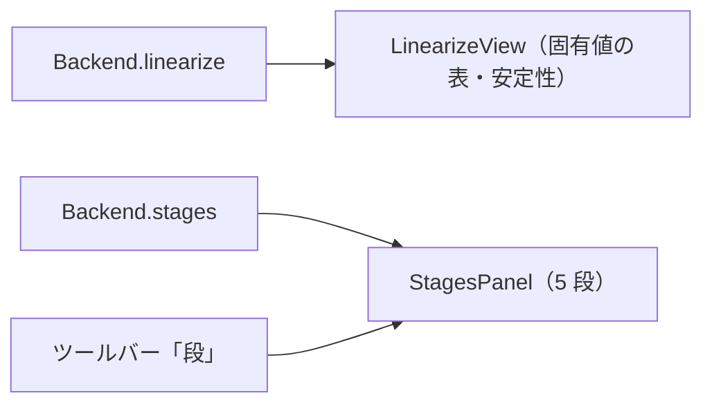

# S291 固有値の表と段のパネル

| | |
| --- | --- |
| セッション | S291 |
| 日付 | 2026-11-15 |
| ブランチ | `feature/s291-stages-eigen-ui` |
| Phase | P8 |
| スライド | [slides.html](slides.html) |
| 作業記録 | `log/work/2026-11-15-s291-stages-eigen-ui.md` |

## 1. 目的

S286 で線形化の JSON に入った `eigenvalues`・`stability` と、S282 の `Backend.stages` を、UI（Svelte。Desktop とブラウザ共用）に出す。Rust は変えない。

## 2. 決定と理由

| 項目 | 決定 | 理由 |
| --- | --- | --- |
| 固有値の表 | `LinearizeView.svelte` に `<table>`（見出し行つき。列は # ・実部・虚部、有効数字 6 桁） | 既存の A・B・C・D の表と同じ書式 |
| 安定性 | 「安定性: 安定（極がすべて左半面）」などの文字 1 行（`data-stability`） | 色だけに頼らない |
| 段のパネル | `StagesPanel.svelte`、ツールバーに「段」（`data-stages-button`） | [BltPanel](../../../src/Svelte/src/lib/BltPanel.svelte) と同じ流儀（モデル名で `backend.stages` を引き直す） |
| 段の中身 | flat・DAE・インデックスの低減・BLT・tearing を番号つきの `<ol>` に。数と、微分した方程式・増えた未知数・状態選択の候補・tearing の変数と残差を名前で出す | `globe stages` の CLI の出力と同じ内容 |
| 読み上げ | 本体を `aria-live="polite"`、失敗は `role="alert"` | BltPanel と同じ |

`Linearization` の型（`protocol.ts`）に `eigenvalues`・`stability` を足した。

## 3. 図



## 4. 再現手順

```bash
export CARGO_TARGET_DIR=<main>/.git-worktree/target-shared CARGO_BUILD_JOBS=2
mise run wasm:build            # 古い wasm は stages を持たない
cd src/Svelte && pnpm check && pnpm build
cd ../.. && uv run python src/Svelte/tests/test_ui.py
```

試験は `test_ui.py` の `eigen_and_stages`。LinearSystem の固有値が -1・-3 で「安定」、Index.Pendulum の「段」がインデックス 3 で flat → DAE → index → BLT → tearing の順に並ぶ。

## 5. 次回

- 変換前後の式の差分（段のパネルは数と名前だけ）。
- 固有ベクトル・解析ヤコビ行列。
