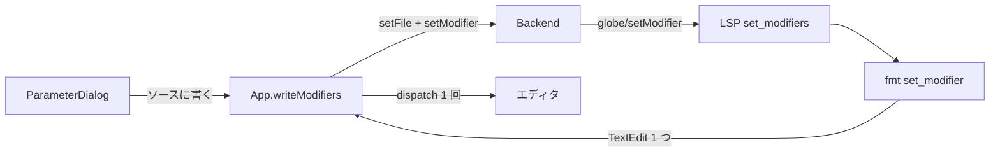

# S294 部品の修飾をソースへ

| | |
| --- | --- |
| セッション | S294 |
| 日付 | 2026-11-15 |
| ブランチ | `feature/s294-param-modifiers` |
| Phase | P8 |
| スライド | [slides.html](slides.html) |
| 作業記録 | `log/work/2026-11-15-s294-param-modifiers.md` |

## 1. 目的

S248 のパラメータダイアログは、入れた値を実行の設定の `parameters`（実行時の上書き）に乗せるだけで、ソースは変えなかった。
[roadmap](../../roadmap.md) の P8 の行にある「修飾の編集」のうち、部品の直下 1 段の修飾 `Type part(name = value)` をソースに書けるようにする。

## 2. 決定と理由

| 項目 | 決定 | 理由 |
| --- | --- | --- |
| 置き場 | `globe-mode-fmt` の `set_modifier`（Diagram の編集と同じ流儀） | 移動・追加・削除と同じく、Rust が範囲と文字列を返し UI が 1 回の dispatch で入れる |
| 式の検査 | 字句と括弧の対応だけ | fmt は依存 0 で構文の木を持たない。型や名前の誤りは検査・実行の診断に任せる |
| 断る | 入れ子の名前・`each`・`final`・入れ子の引数・壊れた式・クラスや部品が無い | 今回は部品の直下 1 段だけ。理由を返す（`Result`） |
| 複数の値 | LSP は `modifiers` の配列を順に当て、差を 1 つの TextEdit にする | 同じ部品に複数を足すと、範囲が重なり `(a = 1)(b = 2)` になるため |
| 断る理由の運び方 | LSP は -32803、wasm は例外（`globe/rename` と同じ） | UI がダイアログに出せる |
| 実行時の上書き | 残す。書いた値は上書きから外す | 2 つは別の機能（見出しに一言） |

詳細は [ADR-0037](../../adr/0037-icon-diagram-as-shape-data.md) の S294 の項。

## 3. 図



## 4. 再現手順

```bash
cargo test -p globe-mode-fmt --lib set_modifier
cargo test -p globe-mode-lsp --lib set_modifier
cargo test -p globe-mode-wasm --test decay diagram
(cd src/Svelte && pnpm check && node tests/test_tauri.mjs)
```

検証の結果（数字）:

- fmt 32 本（lib）・LSP 65 本・wasm の decay 28 本が通り、clippy `-D warnings` は 0 件。`pnpm check` は 0 エラー・0 警告、`test_tauri.mjs` は ok。
- `RPC_METHODS` は 36（`tauri-backend.ts` の `globe/*` と突き合わせて差 0。desktop の cargo 試験は別 workspace なので回していない）。
- ブラウザでの操作（`test_ui.py`）と `smoke.mjs`（wasm のビルドが要る）は回していない。

## 5. 次回

修飾を外す UI（Rust は対応済み）、入れ子の名前・`each`・`final`・`redeclare`、列挙、モデル自身のパラメータの書き換え、ブラウザでの操作の試験。
