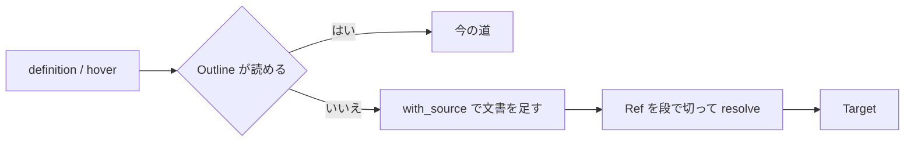

# S296 LSP の定義ジャンプとホバーを自前の構文と名前解決に

| | |
| --- | --- |
| セッション | S296 |
| 日付 | 2026-11-15 |
| ブランチ | `feature/s296-lsp-definition-resolve` |
| Phase | Track B（IDE の機能から自前に） |
| スライド | [slides.html](slides.html) |
| 作業記録 | `log/work/2026-11-15-s296-lsp-definition-resolve.md` |

## 1. 目的

構文に誤りがある文書や `end` の前で切れた文書では、LSP の定義ジャンプとホバーが null だった。S279 の補完と同じ形で、そのときだけ `globe-mode-syntax` と `globe-mode-resolve` で答える。

## 2. 決定と理由

| 項目 | 決定 | 理由 |
| --- | --- | --- |
| 使う条件 | 文書の `Outline` が `Err` のときだけ | 読める文書の出力と既存の試験は変えない。読める文書で null のたびに木（MSL で約 72 MB）を作らない |
| 引き方 | `Library::with_source` で足した文書の `Ref`（カーソルを含む一番狭いもの）を、`r.p.v` ならカーソルの段まで切って `resolve` | 型名と成分参照を同じ道で引ける |
| ホバー | 定義の `Target` から既存の `hover_at` で作る | 文面を今の `globe/hover` と同じにする。`textDocument/hover` は読めない文書で null のときだけ `**…**` で出す |

詳細と持ち越しは [ADR-0039](../../adr/0039-native-cst-parser.md) の付記（S296）。

## 3. 図



## 4. 再現手順

```bash
cargo test -p globe-mode-lsp
cargo clippy -p globe-mode-lsp --all-targets -- -D warnings
```

## 5. 次回

- 添字に `.` がある `a[x.y].b` は段がずれる。属性（`x.start`）と 2 段以上先の `redeclare` は null。
- 別の開いている文書にある型は読まない（S279 と同じ）。
