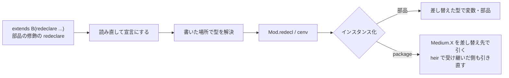

# S297 flatten の続き: redeclare・replaceable・class extends

| | |
| --- | --- |
| セッション | S297 |
| 日付 | 2026-11-15 |
| ブランチ | `feature/s297-flat-redeclare` |
| Phase | Track B（B3 の 3 つ目） |
| スライド | [slides.html](slides.html) |
| 作業記録 | `log/work/2026-11-15-s297-flat-redeclare.md` |

## 1. 目的

S284 の `globe-mode-flat` が断る理由の最上位だった `redeclare`（263 本）・`replaceable`（9）・`class extends`（11）を平坦化で扱い、MSL の例題で平らにできる本数を増やす。変えたのは `globe-mode-flat` の中だけで、`globe-mode-resolve`・`globe-mode-syntax` は変えない。設計は [ADR-0039](../../adr/0039-native-cst-parser.md) の付記（S297）。

## 2. 決定と理由

| 項目 | 決定 | 理由 |
| --- | --- | --- |
| `redeclare` の読み方 | 修飾の `redeclare …` を `model R <本文>; end R;` に包んで読み直し、部品かクラスの宣言にする。名前は書いた場所のクラスから `resolve_head` で引く | `globe-mode-syntax` では字句の並びで節点でない。syntax・resolve を変えずに済む |
| 部品の `redeclare` | 差し替えた宣言の型・接頭辞・添字を使い、元の宣言の修飾は残して新しい修飾を足す。外側が勝つ | MLS 7.3。修飾の伝播と同じ順にそろう |
| `redeclare package M = X` | インスタンスごとの表 `cenv`（名前 → クラス）に足し、`M.Foo` の `M` を差し替え先で引く。差し替え先の名前は書いた場所の表で先に解決する | `redeclare package Medium = Medium` で入れ子の部品へ運べる |
| `replaceable` | 既定の型で平らにする。`constrainedby` は見ない | 型の検査だけで、平坦化には既定の型が要る |
| `class extends` | 受け継いだ同名のクラスを先に取り込み、`(…)` の修飾を当てる | resolve の `class_ext` と同じ基底の探し方 |
| 受け継いだクラスの中の `ThermodynamicState`・`nXi` | 差し替え後のパッケージ（`heir`）の同名のメンバーで引き直す。パッケージの定数は `extends` の修飾も合わせて評価する | `Medium.BaseProperties` の中の型・定数は、静的には元のパッケージを指す |
| 関数 | 平らにしない（`redeclare function` は無視。呼び出しは式のまま） | 評価しない方針 |

## 3. 図



## 4. 再現手順

```bash
cargo test -p globe-mode-flat
# 共有の target では別の worktree の古いビルドが混ざる。touch してから回す
touch src/Rust/mod/globe-mode-{core,fmi,fmt,ir,syntax,resolve,flat,frontend}/src/lib.rs
GLOBE_MSL=data/msl cargo test -p globe-mode-flat --test compare validation_vs_rumoca -- --ignored --nocapture
GLOBE_MSL=data/msl GLOBE_FLAT_RUMOCA=1 cargo test -p globe-mode-flat --test compare msl_examples_flatten -- --ignored --nocapture
# 1 本ずつ Rumoca の flat と比べる
GLOBE_MSL=data/msl GLOBE_FLAT_MODEL=Modelica.Media.Examples.MoistAir cargo test -p globe-mode-flat --test compare cmp -- --ignored --nocapture
```

| 対象 | 自前で平らにできた | 名前の集合が一致 | 方程式の数が一致 |
| --- | --- | --- | --- |
| `GlobeModeValidation` の model・block 75 本 | 74（S284 は 72） | 73 / 73（71 / 71） | 73 / 73（71 / 71） |
| MSL 4.1.0 の例題 566 本 | 279（192） | 273 / 273（189 / 189） | 254 / 273（186 / 189） |

断った理由（MSL の例題、最初の理由だけ。S284 → S297）: `redeclare` 263 → 0、`replaceable` 9 → 0、`class extends` 11 → 0、配列の型 13 → 0、レコードの束縛 41 → 155、配列のコネクタの一括接続 7 → 72、`[:]` 13 → 20、条件つきの宣言 6 → 19。先へ進んだ分が別の理由に当たるので、増えた行もある。

方程式の数が合わない 19 本は、`Clocked` 4 本・`QuasiStatic` 11 本・DC 機械 2 本・`SuperCapDischargeCharge`・`GenerationOfFMUs`。原因は未確認（`Connections.isRoot` と `protected` のコネクタの数え方と見ているが確かめていない）。

## 5. 次回

- 後ろで宣言したレコード（`frictionParameters = dcpmData.frictionParameters`、46 本）を欄ごとの修飾にするための宣言順の入れ替え
- 関数の戻り値のレコード（`R = Frames.nullRotation()`、27 本）、外部オブジェクト（29 本）、配列のコネクタの一括接続（72 本）
- `xtask diff-frontend` への組み込み、B4（DAE）
