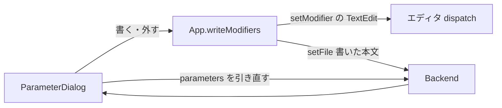

# S298 `param-dialog-2` 解説書

## 1. 目的

S294 でパラメータダイアログに「ソースに書く」を足したとき、持ち越した 3 つを済ませる（[ADR-0037](../../adr/0037-icon-diagram-as-shape-data.md) の S294・S298 の項）。

- 修飾を外す UI（Rust の `set_modifier` は空の値で外せる）
- 列挙（enumeration）のパラメータ（ダイアログが型の名前を持たないので書けなかった）
- 書いたあとの既定値の列の更新（再検査を待たない）

## 2. 決定と理由

| 項目 | 決定 | 理由 |
| --- | --- | --- |
| 修飾を外す | 行ごとの「修飾を外す」。外した行は実行時の上書きからも外す | Rust は対応済み。修飾が無い行では「ソースは変わらなかった」と理由が出る |
| 列挙の型名 | `ModelParameter.enum_type`（完全修飾名）を足す | `Leaf.Mode.fast` と書くのに型名が要る。facade の `parameters` が返せば LSP・wasm・Python はそのまま通る |
| 修飾名の取り方 | `enum_literal_ordinals` の別名から、ordinal 1 のリテラルで `…型.リテラル` の形のいちばん長いもの | flat の `variable_type_names` は書いた通りの名前（`Speed`）。同じ末尾の型が複数あれば先に見つかったもの（取り違えれば書いたあとの検査が診断する） |
| `EnumType.name` | 変えず `qualified` を足す | FMI の `declaredType` が使っていて、FMU の出力を変えないため |
| 引き直し | `writeModifiers` が書いた本文を `setFile`、ダイアログは `parameters` を取り直す | 検査は別の経路で、既定値の列は検査を待たず変えたい |

## 3. 図



## 4. 再現手順

```bash
cargo test -p globe-mode-frontend --test parameters
(cd src/Svelte && pnpm check && node tests/test_tauri.mjs)
mise run wasm:build && (cd src/Svelte && pnpm build) && uv run python src/Svelte/tests/test_ui.py
```

検証の結果は作業記録（`log/work/2026-11-15-s298-param-dialog-2.md`）に数字で書いた。

## 5. 次回

入れ子の名前・`each`・`final`・`redeclare`、配列の部品、モデル自身のパラメータの束縛の書き換え。
