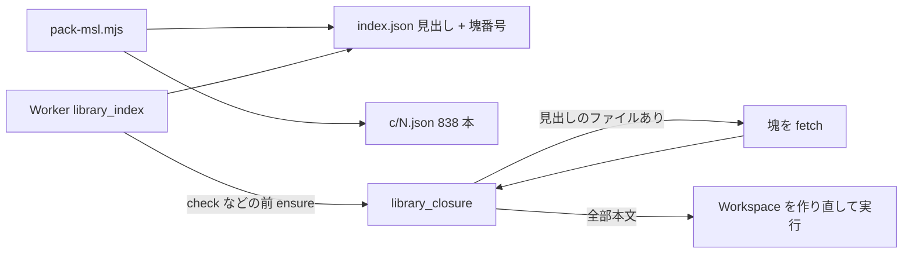

# S301 MSL.json の分割配信

| | |
| --- | --- |
| セッション | S301 |
| 日付 | 2026-11-15 |
| ブランチ | `feature/s301-msl-split-delivery` |
| Phase | P6 |
| スライド | [slides.html](slides.html) |
| 作業記録 | `log/work/2026-11-15-s301-msl-split-delivery.md` |

## 1. 目的

ブラウザ版（wasm）が MSL を読むときの `MSL.json`（15.2 MiB、gzip で 2.66 MB）を分割して配り、起動と最初の検査を軽くする。[roadmap](../../roadmap.md) の「機能の穴（P6）」の持ち越し。分割読み込み（S037）は Worker の線形メモリを減らしただけで、配る量は変えていなかった。

## 2. 決定と理由

詳細は [ADR-0023 の S301](../../adr/0023-desktop-and-web-process-layout.md)。

| 項目 | 決定 | 理由 |
| --- | --- | --- |
| 配る単位 | 索引 `index.json`（ファイルごとの見出し）と、同じディレクトリのファイルを 16 KiB までまとめた塊 `c/*.json`（838 本） | ファイルごとだと 295 本の要求、ディレクトリごとだと余計に取る。16 KiB で ChuaCircuit は 163 塊（cap 128 KiB は 102 塊で 4.0 MB、8 KiB は 197 塊で 2.9 MB） |
| 見出し | fmt の `tree_stub`（`within` と入れ子を含むクラスの種類・名前・説明文字列）。木と分割読み込みの修飾名の索引が本文のときと同じになることを関数の中で確かめ、ならなければ本文のまま | 木の入れ子のクラスと検索（S167）を落とさないため |
| 閉包の求め方 | 既存の `library_closure`（S238）を wasm に出す。見出しのままのファイルが答えに入ったら塊を取って取り直す（固定点） | 本文だけが参照を持つ。新しい閉包の実装を作らず、全部読みと同じ閉包に落ち着く |
| `Workspace` | 塊を取ったら作り直し、`set_file` した文書を足し直す | `Checker` に差し込む道を作らない最小の変更 |
| キャッシュ | 足さない。CSP は `connect-src 'self'` のまま | HTTP キャッシュに任せる |
| `MSL.json` | pack は作る（Leptos・Dioxus・marimo と、索引が無いとき）。`globe-web` の束には入れない | 他の入口を壊さない |

## 3. 図



## 4. 再現手順

```bash
cargo xtask fetch-msl
mise run wasm:build
node src/Rust/mod/globe-mode-wasm/node/split.mjs --msl data/msl     # 20 本が全部読みと一致するか、取った塊と線形メモリ
cd src/Svelte && pnpm install --frozen-lockfile && pnpm build       # msl/index.json と msl/c/*.json
uv run python src/Svelte/tests/test_ui.py                            # 分割配信の試験を含む
gh workflow run web.yml --ref feature/s301-msl-split-delivery        # 束の中身（MSL.json が無く、塊が全部ある）
```

検証の結果（Node、release の wasm、ChuaCircuit の初回）:

| | 全部（MSL.json） | 分割配信 |
| --- | --- | --- |
| 取る量（生） | 15.2 MiB | 4.6 MiB（索引 1.5 + 塊 163 本 3.1） |
| 取る量（gzip） | 2.66 MB | 約 0.87 MB（索引 0.22 + 塊 0.65） |
| 読み込み | 424 ms | 83 ms |
| 読み込み後の線形メモリ | 62.1 MiB | 9.9 MiB |
| 初回の検査の後 | 95.9 MiB | 74.4 MiB |
| 初回の検査 | 2031 ms | 2331 ms（塊の取り直しのぶん +300 ms。ブラウザでの値は作業記録） |
| 20 本の一致 | | 20 / 20（全部読みと passed・段階・診断のコードが同じ） |

## 5. 次回

- 塊を取る往復が閉包の深さ（ChuaCircuit 11 回、Pendulum 8 回、PID_Controller 6 回）。遅い回線では回数ぶん待つ。索引に塊ごとの依存を持たせて 1〜2 回にする案。
- Android の APK は dist に `MSL.json` も入る。分割配信だけにする。
- 全 566 本での一致の確認（S047 と同じ。今回は 20 本）。
