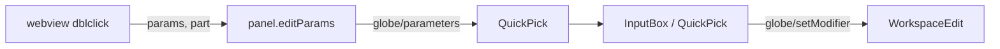

# S306 VS Code のパラメータ入力

| | |
| --- | --- |
| セッション | S306 |
| 日付 | 2026-11-15 |
| ブランチ | `feature/s306-vscode-params` |
| Phase | P8 |
| スライド | [slides.html](slides.html) |
| 作業記録 | `log/work/2026-11-15-s306-vscode-params.md` |

## 1. 目的

UI のパラメータダイアログ（S248・S294・S298）の VS Code 版の最小を作る。図の部品のダブルクリックで、その部品のパラメータを宣言の修飾 `(名前 = 値)` として書けるようにする。Rust・LSP は変えない。[doc/roadmap.md](../../roadmap.md) の P8「VS Code の側の編集」の続き（S264 の移動と結線、S293 の削除）。

## 2. 決定と理由

| 項目 | 決定 | 理由 |
| --- | --- | --- |
| 入力の形 | QuickPick → InputBox（Boolean・列挙は QuickPick） | webview に表を足すより小さい。webview の CSP は `script-src 'nonce'` だけで、入力部品を足すと `webview.js` が増える。キーボードで使え、e2e は `panel.ui` を差し替えて値を渡せる |
| webview が送るもの | `{type: "params", part}`（部品の名前だけ） | `file`・`class` は受け取らず、最後に描かせた図のものを使う（S264 と同じ）。`edit.js` の `parseParams` が識別子を検査する |
| 一覧 | `globe/parameters` の `部品.名前`（直下の 1 段。配列・String は除く） | UI の `ParameterDialog` と同じ |
| 値の検査 | Rust の `set_modifier` に任せる | 断られたら -32803 の理由を `showErrorMessage` に出す。`2*R0` のような式も書ける |
| 空の入力 | 修飾を外す | UI と同じ。列挙・Boolean は末尾の「修飾を外す」 |
| 文書への入れ方 | S264・S293 と同じ `apply`（`WorkspaceEdit`、undo 1 回、保存しない、版が変われば入れない） | 既存の流儀 |

詳しくは [ADR-0037](../../adr/0037-icon-diagram-as-shape-data.md) の付記（S306）。

## 3. 図



## 4. 再現手順

```bash
cd src/VSCode/globe-mode
pnpm install --frozen-lockfile
GLOBE_BIN=<main>/.git-worktree/target-shared/debug/globe pnpm test
gh workflow run vscode.yml --ref feature/s306-vscode-params   # 3 OS の e2e
```

検証の結果は作業記録に書く。

## 5. 次回

- キーボードだけで部品のパラメータを開く口（コマンドパレットのコマンド）
- 複数の値を一度に直す表（webview の中）
- 入れ子・`each`・`final`・`redeclare`、配列の部品
