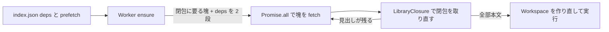

# S308 分割配信の持ち越し

| | |
| --- | --- |
| セッション | S308 |
| 日付 | 2026-11-15 |
| ブランチ | `feature/s308-split-delivery-followups` |
| Phase | P6 |
| スライド | [slides.html](slides.html) |
| 作業記録 | `log/work/2026-11-15-s308-split-delivery-followups.md` |

## 1. 目的

[S301](../S301-msl-split-delivery/解説書.md) の持ち越しのうち 2 つ。(1) 塊を取る往復が閉包の深さ（ChuaCircuit 11 回）だけある。(2) Android の APK の dist に `MSL.json` が入ったまま。

## 2. 決定と理由

詳細は [ADR-0023 の S308](../../adr/0023-desktop-and-web-process-layout.md)。

| 項目 | 決定 | 理由 |
| --- | --- | --- |
| 塊の依存 | pack の時に、塊のファイルが直接参照する他の塊を `index.deps` に持つ。直接の参照は閉包と同じ走査（`SplitLibrary::deps_of`）を wasm の `file_deps` で求める | 閉包の走査を新しく作らない。索引は約 50 KB 増える |
| 先読み | Worker が、閉包に要る塊から `deps` を 2 段たどった塊をまとめて `Promise.all` で取る（`index.prefetch`） | 深さ 2 で往復が 11 → 3。3 より先は往復があまり減らず、取りすぎだけが増える |
| 閉包の正しさ | 今までの繰り返し（見出しのファイルが残れば取る）のまま | 先読みは目安。足りなければ追加で取り、取りすぎても閉包は変わらない |
| Android | `android.yml` の `ui` ジョブで `dist/msl/MSL.json` を消し、塊が全部あることを確かめてから APK に渡す | UI は索引があれば分割配信で読む（ブラウザ版と同じ） |

## 3. 図



## 4. 再現手順

```bash
cargo xtask fetch-msl
mise run wasm:build
node src/Rust/mod/globe-mode-wasm/node/split.mjs --msl data/msl                 # 20 本の一致と、ChuaCircuit の往復（既定は深さ 2）
node src/Rust/mod/globe-mode-wasm/node/split.mjs --msl data/msl --prefetch 0    # 先読みなし（S301 と同じ）
gh workflow run android.yml --ref feature/s308-split-delivery-followups         # APK の大きさとエミュレータの smoke
gh workflow run web.yml --ref feature/s308-split-delivery-followups             # 束の中身
```

結果（Node、release の wasm、ChuaCircuit の初回）:

| 深さ | 往復 | 塊 | 取る量（索引込み） |
| ---: | ---: | ---: | ---: |
| 0（S301） | 11 | 163 | 4.64 MiB |
| 1 | 5 | 174 | 4.78 MiB |
| 2（既定） | 3 | 179 | 5.16 MiB |
| 3 | 3 | 182 | 5.19 MiB |
| 4 | 2 | 189 | 5.26 MiB |
| 6 | 1 | 192 | 5.29 MiB |

ブラウザ（`?smoke=1` で ChuaCircuit まで、索引を含む `/msl/` の取得）は S301 の 174 要求・4.8 MiB から 192 要求・5.35 MiB。木のアイコン（`extends` の基底だけの閉包）にも先読みを効かせると 218 要求・6.9 MiB に膨らむので、アイコンは先読みしない。

20 本を続けて回した合計: 先読みなし 39 往復・235 塊・8.8 MiB、深さ 2 で 17 往復・258 塊・9.4 MiB。20 本は全部読みと一致。往復あたりの待ちは回線しだいで、実測していない。

Android の APK（run 43665628896、前は main の run 43663027170）:

| APK | 前 | 後 |
| --- | ---: | ---: |
| arm64 release | 13,616,490 B | 14,859,242 |
| x86_64 release | 14,202,127 B | 15,444,927 |
| universal debug | 259,532,967 B | 261,050,263 |

APK は軽くならず、arm64 で 1,242,752 B（+9.1%）、x86_64 で 1,242,800 B、debug の universal で 1,517,296 B 増えた。`MSL.json` 1 本はまとめて圧縮されるが、塊 838 本は別々に圧縮され（zlib -9 で測ると、`MSL.json` 2.65 MB に対し塊の合計 3.30 MB と索引 0.22 MB）、ファイルをまたぐ重複が効かないため。分割配信の利点は、APK でなく実行時にある（読み込み後の線形メモリが 62 → 14 MiB。全部を JSON の文字列にして Worker に渡さない）。エミュレータの smoke（`msl=ok` を含む全項目）は塊だけで通り、`msl_ms` は前 9.3 / 11.0 s、後 10.6 / 11.2 s で差はない（共有のランナーでの目安）。

## 5. 次回

- APK の大きさを戻したいなら、Android だけ `MSL.json` に戻す（`android.yml` の `rm` を消す）か、塊を大きくする（cap を上げると圧縮は効くが取りすぎが増える）。どちらを取るかはユーザーの判断。
- 遅い回線での実測（往復の回数が時間にどれだけ効くか）。
- 566 本での一致の確認（S047 と同じ。今回は 20 本）。
