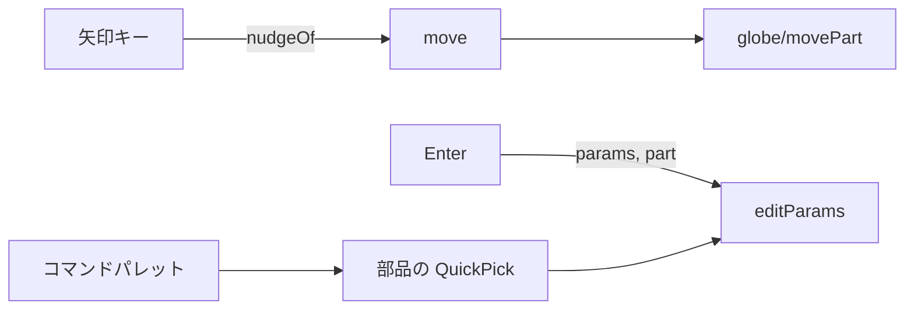

# S309 VS Code のパネルのキーボード操作

| | |
| --- | --- |
| セッション | S309 |
| 日付 | 2026-11-15 |
| ブランチ | `feature/s309-vscode-keyboard` |
| Phase | P8（アクセシビリティ） |
| スライド | [slides.html](slides.html) |
| 作業記録 | `log/work/2026-11-15-s309-vscode-keyboard.md` |

## 1. 目的

VS Code の側のパネルの図の編集を、マウスなしでもできるようにする。S306 の持ち越し「キーボードだけでパラメータを開く口」と、部品の移動を足す。Rust・LSP は変えない。[ADR-0037](../../adr/0037-icon-diagram-as-shape-data.md) の付記（S309）。

## 2. 決定と理由

パネルの操作を洗い出した結果（Tab で図の部品・結線にフォーカスが移り、選びになる）。

| 操作 | マウス | キーボード（S309 の後） |
| --- | --- | --- |
| 宣言の行へ飛ぶ | クリック | Space（部品以外は Enter も） |
| 部品を選ぶ | クリック | Tab |
| 部品の移動（S264） | ドラッグ | **矢印キーで 2 単位、Shift で 10 単位（S309）** |
| 結線の追加（S264） | コネクタからドラッグ | 無し（次回） |
| 部品・結線の削除（S293） | — | Delete / Backspace（選んだもの） |
| 途中の点の移動・追加（S302） | ドラッグ・ダブルクリック | 無し（次回） |
| パラメータ（S306） | 部品のダブルクリック | **Enter（部品を選んだとき）、コマンド「GlobeMode: 部品のパラメータを編集」（S309）** |

| 項目 | 決定 | 理由 |
| --- | --- | --- |
| 移動 | `diagram-select.ts` の `nudgeOf`（矢印キー、Shift で 10 単位、y 上向き）。1 回ごとに `globe/movePart` | ドラッグの吸着と同じ 2 単位。Svelte の `DiagramView` も同じ関数を使う |
| 続けて押す | webview が前の編集を待ってから次を送る（`queue`） | `apply` は待つあいだに文書の版が変わると入れないので、連打で取りこぼさないため |
| フォーカス | 図を作り直す `show` のあと、選びの要素へフォーカスを戻す | 作り直すとフォーカスが落ち、矢印を続けて押せないため |
| Enter | 部品ではパラメータ（QuickPick）。結線などは従来どおり宣言の行へ。Space は宣言の行へ | S306 と同じ流れ。宣言へ飛ぶ操作は Space に残る |
| コマンド | `globeMode.editParams`。カーソルが部品の宣言の行にあればその部品、なければ部品の QuickPick | webview を開かなくても使える |

## 3. 図



## 4. 再現手順

```bash
cd src/VSCode/globe-mode
pnpm install --frozen-lockfile
GLOBE_BIN=<main>/.git-worktree/target-shared/debug/globe pnpm test
gh workflow run vscode.yml --ref feature/s309-vscode-keyboard   # 3 OS の e2e
```

## 5. 次回

- 結線の追加と途中の点をキーボードで行う口
- Svelte の `DiagramView` で Enter からパラメータ（今は Enter は宣言の行へ。S175 の操作を変えないため）
- 実機の VS Code でのキー操作の目視
