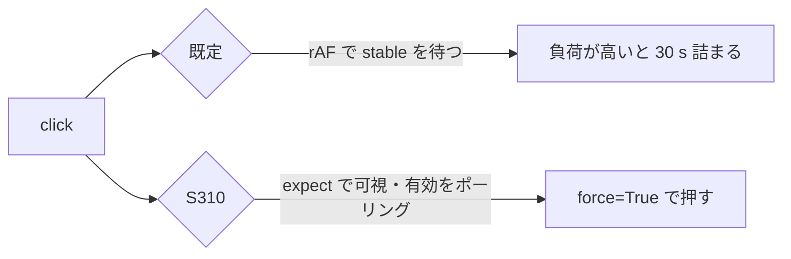

# S310 `test-ui-stability`

| | |
| --- | --- |
| セッション | S310 |
| 日付 | 2026-11-15 |
| ブランチ | `feature/s310-test-ui-stability` |
| Phase | P4（試験の安定） |
| スライド | [slides.html](slides.html) |
| 作業記録 | [log/work/2026-11-15-s310-test-ui-stability.md](../../../log/work/2026-11-15-s310-test-ui-stability.md) |

## 1. 目的

ブラウザ UI の試験 `src/Svelte/tests/test_ui.py`（Playwright）が、手元で負荷が高いときに時々落ちる。CI では通る。落ち方は、冒頭の fold gutter のクリックの時間切れ、CodeMirror のホバー位置の RangeError、`render_slides.py` の `Page.screenshot` の 30 秒の時間切れ。原因を切り分けて直す。

## 2. 決定と理由

| 項目 | 決定 | 理由 |
| --- | --- | --- |
| クリックの時間切れ | `test_ui.py` の `Locator.click` の既定を、可視・有効をポーリングで待ってから `force=True` で押すものにする（`click_without_stable()`） | 既定の actionability の「stable」は rAF で位置を 2 回比べる。負荷が高く frame が出ない間は 30 秒詰まる。ポーリングの待ちは rAF に頼らない。上限を延ばすのではなく、待ち方を替えた |
| ホバーの RangeError | `editor.ts` の `modelicaHover` で、待つ間に本文が変わったら何も出さない | 非同期の間に本文が変わると、古い範囲が本文の外を指して CodeMirror の tooltip の位置決めで RangeError になる。試験側の位置の取り方ではなくアプリ側の競合。ただし手元では再現できていない【未確認】 |
| Esc で実行が止まる（`ui_polish` の `expect(running).to_have_count(1)`） | `App.svelte` の Esc の判定を `completionStatus(...) !== "active"` から `!currentCompletions(view.state).length`（見えている候補が無いとき）に替える | 候補の再問い合わせが pending（実行中の Worker は答えない）のとき、前の候補は見えているのに status は pending で、Esc が補完を閉じつつ実行も止めていた。負荷で出方が変わるアプリ側の競合 |
| `render_slides.py` | `Page.screenshot` の時間切れで 1 回だけ撮り直す | 引数を足すより小さい。cargo と同時に回さないという約束は変えない |

## 3. 図



## 4. 再現手順

```bash
cd src/Svelte && pnpm build && cd ../..
uv run python src/Svelte/tests/test_ui.py
```

負荷は、CPU を使い切る `while :; do :; done` を 8〜16 本走らせて作る。作業記録に回数と結果を書いた。

## 5. 次回

- ホバーの RangeError は再現していない。再び出たら、そのときの `pageerror` の文面から位置を確かめる。
- 実行中に Chromium が外から終了させられる（SIGTERM、exit 143）ことが 10〜40 % の実行で起きた。同じ機械の別の担当の `pkill -f '[c]hromium'`（render_slides の片付け）が原因で、時刻が 0.5 秒以内で一致した。試験側では防げないので、片付けを自分のプロセスだけにする運用の変更が要る。
- ほかの `.click()` も同じ待ち方に替わる。重なった要素を待つ挙動（hit target）は無くなる。
