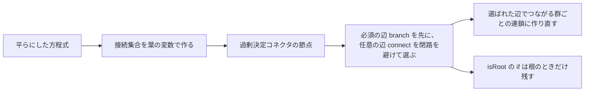

# S312 自前の flat・DAE と Rumoca の食い違いの原因を分けて直す

| | |
| --- | --- |
| セッション | S312 |
| 日付 | 2026-11-15 |
| ブランチ | `feature/s312-dae-mismatches` |
| Phase | Track B（B3・B4 の続き） |
| スライド | [slides.html](slides.html) |
| 作業記録 | `log/work/2026-11-15-s312-dae-mismatches.md` |

## 1. 目的

S297 の時点で、MSL の例題で Rumoca と両方で通った 273 本のうち、方程式の数が合わないものが 19 本、DAE の釣り合いの判定が合わないものが 10 本（比べられた 201 本）あった。原因を確かめて、直せるものを `globe-mode-flat`（数え方）と `globe-mode-dae` で直す。直せないものは既知の差として [ADR-0039](../../adr/0039-native-cst-parser.md) の付記（S312）に書く。`Var`・`Equation` の形は変えない（S311 が由来を足している）。

## 2. 決定と理由

| 項目 | 決定 | 理由 |
| --- | --- | --- |
| 調べ方 | `cargo xtask diff-frontend` に `--class`（例題でなくても検査）と `--dump`（自前の flat と Rumoca の方程式の由来を並べる）を足す。`FlatSummary::equation_origins`（JSON には出さない）に Rumoca の方程式の由来を持たせる | 方程式の数の差を、部品を単独で検査して小さいモデルまで絞り込める |
| 接続集合 | 葉の変数の単位で作る（丸ごとのコネクタの名前では作らない） | `connect(a, c.x)` と `connect(b, c)` は同じ集合（Rumoca の flat と同じ）。flow の和の符号は、外側の（自分の）コネクタの端が逆 |
| `protected` のコネクタの flow = 0 | 丸ごと `connect` の端になっているか、どこにもつながっていない葉だけ | Rumoca の `interface` の判定（コネクタの宣言が `protected` でも、単一の識別子の端なら外側の flow）に合わせる |
| 過剰決定コネクタ | 平らにし終えたあとに、仮想接続グラフの全域森を選び、等式を作り直す（`flatten/graph.rs`）。大きさ 0 の `equalityConstraint` は等式を作らない | 切れた辺をまたぐ等式の数の合計は、全域森の選び方によらない。Rumoca の辺の順は真似ない |
| `if Connections.isRoot(N) then … end if` | `else` の無いものだけ、`N` が根でなければ落とす | Ground（潜在的な根）の `pin.reference.gamma = 0` が対象 |
| 行列の連結 | 要素はスカラー・ベクトル（n×1）・行列。行は横に、行どうしは縦に連結する | `[y] = [u1; u2; u3]` の数が欄の大きさの和になる |
| 定数の `if` 式 | 印字で選んだ枝だけを出す | Rumoca の flat は落とす。枝の `der` が状態の数に効く |
| DAE | 束縛の `der` も状態、レコードの方程式は欄ごと、大きさ 0 の配列は未知数 0 | Rumoca の balance と同じ数え方 |

## 3. 図



## 4. 再現手順

```bash
cargo test -p globe-mode-flat -p globe-mode-dae
# 食い違いを小さいモデルで見る（完全修飾名を , で並べる）
cargo xtask diff-frontend --class Modelica.Electrical.QuasiStatic.SinglePhase.Examples.ParallelResonance --dump
# 回帰の確認（前回の target/frontend-diff.json と比べ、doc/frontend-diff.md を書く）
mise run msl:diff-frontend
```

| 項目（MSL の例題、母数は Rumoca も通った本数） | S297 | S312 |
| --- | --- | --- |
| 方程式の数が Rumoca の flat と一致 | 254 / 273 | 273 / 273 |
| 釣り合いの判定が一致 | 191 / 201 | 201 / 201 |
| 方程式と未知数の数が一致 | 191 / 201 | 201 / 201 |
| 状態の数が一致 | 185 / 201 | 201 / 201 |
| 構造が正則かの判定が一致 | 179 / 201 | 184 / 201 |

`GlobeModeValidation` の 75 本は変わらない（73/73・73/73・73/73・正則 72/72）。回帰 0 本。

## 5. 次回

- 構造の正則の差 17 本（Clocked 16 本と `WaterIF97`）。Clocked は信号を離散の側として扱う分割が要ると見ているが、確かめていない。
- 平らにできない 287 本（レコードの束縛 155・配列のコネクタの一括接続 72 など）。
