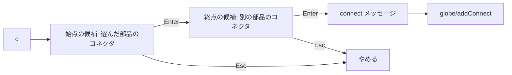

# S316 キーボードで結線を足す

| | |
| --- | --- |
| セッション | S316 |
| 日付 | 2026-11-15 |
| ブランチ | `feature/s316-keyboard-connect` |
| Phase | P8（アクセシビリティ） |
| スライド | [slides.html](slides.html) |
| 作業記録 | `log/work/2026-11-15-s316-keyboard-connect.md` |

## 1. 目的

S309 の持ち越し「結線の追加と途中の点をキーボードで行う口」「Svelte の Enter からのパラメータ」を、VS Code のパネルと Svelte の `DiagramView` の両方で、共有の関数で済ませる。Rust・LSP は変えない。[ADR-0037](../../adr/0037-icon-diagram-as-shape-data.md) の付記（S316）。

## 2. 決定と理由

| 項目 | 決定 | 理由 |
| --- | --- | --- |
| 入るキー | 部品を選んで `c` | 既存の矢印・Enter・Space・Delete・Tab と衝突しない。Ctrl・Alt・Meta つきは使わない（コピーを奪わない） |
| 選び方 | 始点は選んだ部品のコネクタ、終点は別の部品のコネクタ。Tab・矢印で切り替え、Enter で決める、Esc でやめる | ドラッグの「コネクタから別のコネクタへ」と同じ。同じ部品どうしは出さない |
| 状態 | `diagram-connect.ts` の `wireKey`（純粋な関数）。呼び出し側が `Wire` を持つ | node の試験で動かせる。webview と Svelte で写しを作らない |
| 出すメッセージ | ドラッグと同じ `connect`（`points` は両端の座標） | 拡張・Rust の検査と編集をそのまま使える |
| 伝え方 | 選び中のコネクタに `.cur`・始点に `.from` の枠と `aria-label`、図の下の `role="status"` | コネクタの円はフォーカスの対象ではないので、live region で読み上げる |
| 途中の点 | 結線を選んで `+` で、いちばん長い線分の中点に足す（`midWaypointOf`） | 最小の口。点を選んで動かす操作は次回 |
| Svelte の Enter | 部品の Enter はパラメータ、宣言の行へは Space | S175 の試験に部品の Enter は無く、衝突しなかった |

## 3. 図



## 4. 再現手順

```bash
cd src/VSCode/globe-mode
pnpm install --frozen-lockfile
GLOBE_BIN=<main>/.git-worktree/target-shared/debug/globe pnpm test
gh workflow run vscode.yml --ref feature/s316-keyboard-connect   # 3 OS の e2e
cd ../../Svelte && pnpm check
```

## 5. 次回

- 途中の点を選んでキーで動かす・消す
- 実機の VS Code でのキー操作の目視
- Svelte で、コネクタのあるモデル（MSL の ChuaCircuit など）の結線の試験
