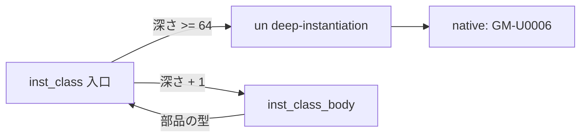

# S320 native と LSP の issue 5 件の監査と修正

| | |
| --- | --- |
| セッション | S320 |
| 日付 | 2026-11-15 |
| ブランチ | `feature/s320-native-issues` |
| Phase | Track B（native）と P8（LSP） |
| スライド | [slides.html](slides.html) |
| 作業記録 | `log/work/2026-11-15-s320-native-issues.md` |

## 1. 目的

3 回目のレビューが立てた issue のうち、native（Track B）と LSP の 5 件（#111・#113・#114・#115・#116）を 1 件ずつ再現して監査し、直す。issue は閉じない（コミットに `Fixes #n` は付ける）。設計は [ADR-0039](../../adr/0039-native-cst-parser.md)（付記 S320）。

## 2. 決定と理由

| issue | 監査の結論 | 直したか | 理由（どう直したか） | 試験 | 原則名 |
| --- | --- | --- | --- | --- | --- |
| #111（Must） | 本当。`inst_class` の再帰に上限が無く、`model C C a; end C;` と `redeclare` の循環でスタックが溢れて abort | 直した | `F` に `inst_depth`（`Cell<u32>`）を足し、`inst_class` を入れ子の数えを持つ薄い入口と本体（`inst_class_body`）に分けた。64 段で `un("deep-instantiation", クラス名)`（native の検査では `GM-U0006`）。MSL の入れ子は 30 段に届かない。debug の試験スレッド（2 MiB）でも溢れない | flat `self_containing_model_is_refused_not_overflowed`（自己の部品と `redeclare` の循環の 2 形） | 資源の上限（信頼できない入力の再帰に上限を持つ） |
| #113（Should） | 本当。`check` は作業中のファイルと、閉包が読んだディスクの版を別々に足し、同じファイルが二重になる | 直した | `NativeFrontend::check` で、閉包の結果から、作業中のファイルと同じ名前（`\` を `/` にそろえて比べる）を除く。編集中の本文が真 | frontend `edited_library_file_wins_over_disk`（ディスクは釣り合い、編集後は `y` が余る → 検査が落ちる） | 同じ事実の置き場を 1 つにする |
| #114 | 本当。`Project::read_dirs` が `read_to_string(..).ok()?` で UTF-8 でないファイルを落とす | 直した | `from_utf8_lossy` で U+FFFD にして読む（#85 の `Workspace::with_libraries` と同じ） | frontend `non_utf8_library_file_is_read`（Latin-1 の `\xe9 \xb0` を含む `Lib/B.mo` を `extends`） | 同じ入力は同じに読む |
| #115（Should） | 本当で、issue の指摘より広い。`drop_lib_for` だけでなく、定義ジャンプの `read`（開いている文書を引く）と `definition` の「開いている文書か」も同じ文字列比較だった。相対 `--library` の木のファイル名は相対のまま | 直した | `same_path_key`（絶対にして `..` を字句で畳み、`\` を `/`、ドライブ文字を小文字にそろえる。syscall なし）を足し、この 3 か所で使う。Windows は手元で未確認で、`#[cfg(windows)]` の単体試験だけを置いた | LSP `editing_an_open_library_file_refreshes_with_relative_library_path`（unix。相対の `--library`）、`same_path_key_ignores_separator_and_drive_case`（windows） | 同じものを同じ形で比べる（比較の前に正規化） |
| #116（Nice） | 本当。`Box::leak` した `Resolution` は `Project` を捨てても戻らない | 直した | `extra` を `HashMap<_, Resolution>`（`Project` が所有）にし、`res_of` は `Option<Resolution>`（値。16 バイトの `Clone`）を返す。呼び出し側は `&` を付けるか `.cloned()` を外すだけ | 構造の変更でリークが無くなる（コンパイルが試験。既存の flat の試験 19 本が同じ結果）。RSS の再現（probe3/leak）は繰り返しなので試験にしていない | 寿命を持つ資源は所有者に結ぶ（漏らさない） |

## 3. 図



## 4. 再現手順

```bash
cd .git-worktree/s320-native-issues
export CARGO_TARGET_DIR=<main>/.git-worktree/target-shared CARGO_BUILD_JOBS=2
cargo test -p globe-mode-flat
cargo test -p globe-mode-frontend --features native --test native_issues
cargo test -p globe-mode-lsp
mise run msl:diff-frontend
```

検証の結果: `msl:diff-frontend` は回帰 0 本・改善 0 本（flat 279/566、方程式数一致 254/273、釣り合いの判定一致 191/201。前回と同じ）。ほかの数字は作業記録 `log/work/2026-11-15-s320-native-issues.md`。

## 5. 次回

- `definition.rs` の `t.path == path` など、相対の `--library` で残る文字列比較（開いている文書どうしの比較なので、絶対パスで来る限り外れない）。
- #115 の Windows の確認（CI の `rust-windows` で単体試験が走る）。
- #116 の RSS の再現を `#[ignore]` の計測にするかは未定。
